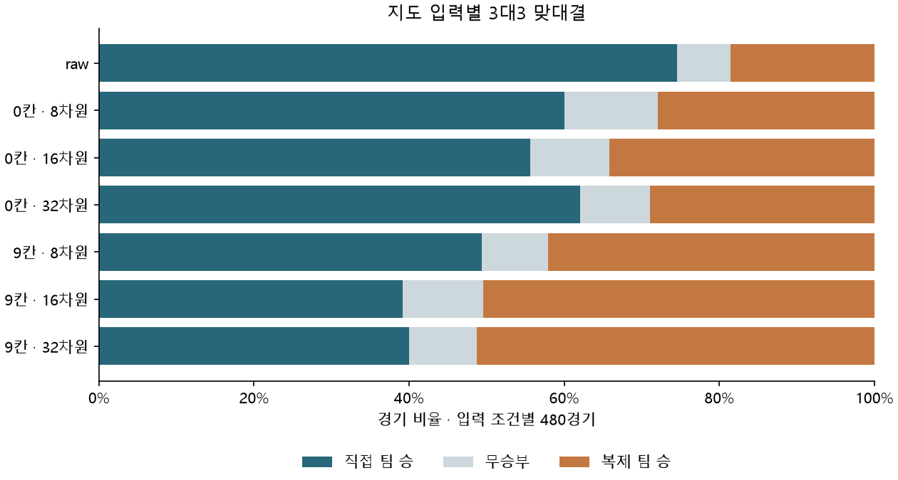
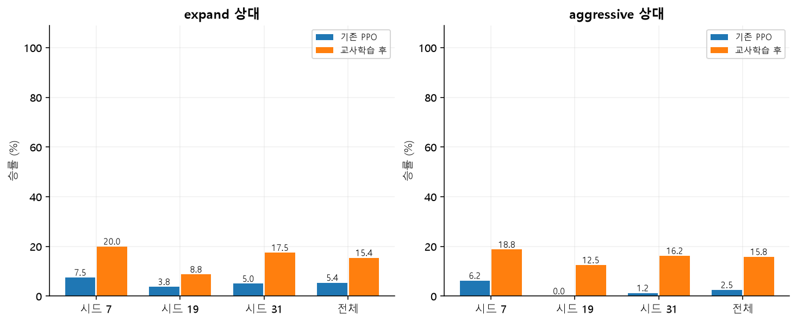
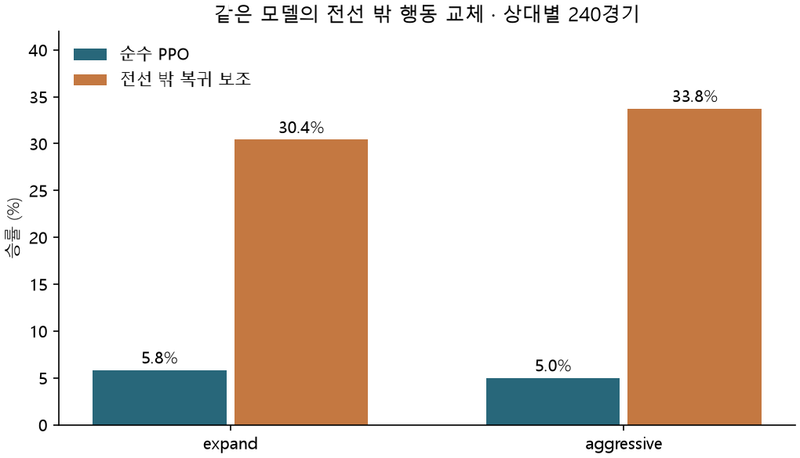

# SL-RL 실험 요약 — 1대1 정책 전이와 3대3 독립 결정

## Ⅰ. 데이터와 측정 조건

### 1. 실험 범위

지도는 3행 × 10열, 경기 제한은 64틱, 정책 학습 시드는 7·19·31이다. 복제 팀은 1대1에서 학습한 정책 하나를 세 에이전트에 적용한 팀이고, 직접 팀은 3대3에서 학습한 팀이다. 평가는 모두 3대3이다. 한 팀의 세 에이전트는 정책 가중치를 공유한다. 독립 결정에서는 각 에이전트가 같은 틱에 아군이 선택한 행동을 전달받지 않는다. 승률은 전체 경기 수 중 승리 비율이며 무승부도 분모에 포함한다.

| 실험 | 변경한 조건 | 학습·평가 방식 |
|---|---|---|
| exp1 | 지도 30칸 중 9칸을 가리고 복원하는 인코더, 잠재 차원 16 | 1대1·3대3 인코더를 각각 사전학습한 후 고정하고, 인원별 PPO 자기대전 3,200경기 |
| exp2 | 마스킹 없는 AE 16차원 또는 raw 지도 30칸 | 각 입력에서 1대1·3대3 자기대전 후 복제 팀과 직접 팀 평가 |
| exp3 | 마스킹 0·9칸 × 잠재 차원 8·16·32 | 같은 인원·시드·예산으로 비교. 16차원은 exp1·2 결과 재사용 |
| exp4 | exp2 raw 직접 팀에 두 봇의 행동을 지도학습 | 시드당 시범 160경기, 별도 검증 32경기, 24에포크. 교사별 손실 가중치 1:1 |
| exp5 | raw 직접 팀의 actor·critic 은닉층을 함께 변경 | 자기대전 사전학습 3,200경기 후 고정 봇 상대 PPO 3,200경기. 단층은 같은 조건의 exp2 가중치 재사용 |

[exp1 설정](experiment/exp1/config.toml) · [exp2 설정](experiment/exp2/config.toml) · [exp3 재사용 내역](experiment/exp3/COPIED_FROM.md) · [exp4 설정](experiment/exp4/config.toml) · [exp5 설정](experiment/exp5/config.toml)

### 2. exp1~3 — 복제 팀과 직접 팀의 맞대결

표의 관점은 모두 **3대3 직접 팀**이다. 시드별 열은 160경기 중 승수, 합계는 480경기의 승·무·패다. exp3 원자료의 `duel_1v3`는 복제 팀 관점이므로 승패를 뒤집어 집계했다.

| 지도 입력 | 시드 7 승 | 시드 19 승 | 시드 31 승 | 직접 팀 승–무–패 | 직접 팀 승률 |
|---|---:|---:|---:|---:|---:|
| raw | 115 | 111 | 132 | 358–33–89 | 74.58% |
| 0칸 마스킹, 8차원 | 89 | 100 | 99 | 288–58–134 | 60.00% |
| 0칸 마스킹, 16차원 | 88 | 79 | 100 | 267–49–164 | 55.63% |
| 0칸 마스킹, 32차원 | 109 | 107 | 82 | 298–43–139 | 62.08% |
| 9칸 마스킹, 8차원 | 84 | 74 | 79 | 237–41–202 | 49.38% |
| 9칸 마스킹, 16차원 | 65 | 63 | 60 | 188–50–242 | 39.17% |
| 9칸 마스킹, 32차원 | 79 | 59 | 54 | 192–42–246 | 40.00% |

raw 팀을 고정 봇과 평가한 결과는 다음과 같다. 각 칸은 240경기 중 승수와 승률이다.

| 상대 | 1대1 복제 팀 | 3대3 직접 팀 |
|---|---:|---:|
| random | 229승 (95.42%) | 239승 (99.58%) |
| expand | 8승 (3.33%) | 13승 (5.42%) |
| aggressive | 1승 (0.42%) | 6승 (2.50%) |
| defend | 203승 (84.58%) | 211승 (87.92%) |
| noop | 240승 (100%) | 240승 (100%) |

[exp2 raw 맞대결·고정 봇 원자료](experiment/exp2/result/analysis_u0400/raw/eval_20261120_40_random-expand-aggressive-defend-noop/REPORT.md) · [exp3 시드별 원자료](experiment/exp3/result/analysis_u0400/grid_20261120_40_random-expand-aggressive-defend-noop.csv)

### 3. exp4 — 혼합 교사 행동 모방

행동 일치율은 검증 시범에서 학생의 최빈 행동이 교사가 실제 선택한 행동과 일치한 비율이다. 선택 가능한 행동이 하나뿐인 표본은 제외했다. 두 교사 및 두 학습 진영을 평균한 값은 학습 전 **41.0%**, 학습 후 **67.6%**였다. 세 시드 모두 검증 모방 손실이 가장 낮은 24에포크를 평가했다.

| 고정 상대 | 학습 전 승–무–패 | 학습 후 승–무–패 | 전 → 후 승률 | 변화 |
|---|---:|---:|---:|---:|
| expand | 13–7–220 | 37–22–181 | 5.42% → 15.42% | +10.00%p |
| aggressive | 6–12–222 | 38–18–184 | 2.50% → 15.83% | +13.33%p |

[exp4 시드별 승률](experiment/exp4/result/evaluation1/win_rates.csv) · [학습·검증 곡선](experiment/exp4/result/learning_run1_run2_run3/learning.png)

### 4. exp5 — 모델 크기와 고정 봇 PPO

학습 전은 PPO+GAE 자기대전 직후, 학습 후는 고정 봇과 대전하면서 승패 및 점령 격차 변화로 학습한 뒤 검증으로 고른 체크포인트다. exp5는 exp4의 교사학습 가중치를 사용하지 않았다. 평가 시드는 exp4가 20261120, exp5가 246853이며 각 실험 내에서 전후 경기 조건을 짝지었다.

| 은닉층 | 팀당 파라미터 | expand 전 → 후 승률 | aggressive 전 → 후 승률 |
|---|---:|---:|---:|
| [128] | 19,434 | 2.92% → 2.92% | 4.58% → 2.50% |
| [64, 64] | 18,154 | 7.08% → 3.33% | 6.25% → 3.33% |
| [128, 128] | 52,458 | 5.83% → 5.83% | 5.42% → 5.00% |

각 승률의 분모는 240경기다. 세 구조 × 세 시드 중 두 상대에서 모두 80%를 넘은 run은 0/9개였다. [exp5 시드별 승률·점령 격차](experiment/exp5/result/evaluation1/win_rates.csv)

### 5. 후속 행동 진단 — 전선 밖 복귀 규칙 교체

exp5의 [128, 128] 평가 정책을 사용했다. 적 땅이 상하좌우에 인접하면 기존 정책이 행동하고, 인접하지 않은 생존 에이전트만 봇의 경로 탐색으로 행동을 선택하게 했다. 가중치는 고정하고 원래 평가의 상대·경기 시드·진영 조합으로 480경기를 재생했다.

| 학습 시드 | expand 기존 → 복귀 보조 | aggressive 기존 → 복귀 보조 |
|---|---:|---:|
| 7 | 5승 → 26승 / 80 | 6승 → 26승 / 80 |
| 19 | 4승 → 18승 / 80 | 2승 → 26승 / 80 |
| 31 | 5승 → 29승 / 80 | 4승 → 29승 / 80 |
| **합계** | **14승 → 73승 / 240** | **12승 → 81승 / 240** |
| **승률** | **5.83% → 30.42%** | **5.00% → 33.75%** |
| **평균 최종 점령 격차** | **−8.26칸 → −1.13칸** | **−7.98칸 → −1.37칸** |

기존 정책 값은 exp5 평가 CSV에서, 복귀 보조 값은 이전 대화에서 실행한 추가 대전의 시드별 집계에서 가져왔다. 복귀 보조 경기별 CSV는 이번 정리에 포함되어 있지 않다. [기존 평가 기록 경로](experiment/exp5/result/evaluation1/sources.json) · [봇 이동 규칙](../territory_rl/controller.py)

<!-- EXP3_COOP_DATA_BEGIN -->
### exp3 협력 지표 측정

업데이트 400 정책을 기존 평가와 같은 경기 시드·진영·상대로 재생했다. 아래 표는 복제 팀과 직접 팀이 서로 대전한 경기의 팀별 값이다. 공동 공격률은 공격한 (틱, 목표 칸) 중 같은 팀 2명 이상이 공격한 비율, 공동 점령률은 소유권이 바뀐 점령 칸 중 기여자가 2명 이상인 비율이다. 비율은 경기별 분자·분모를 합산했고 분모가 0이면 —로 표시했다.

| 지도 조건 | 학습 팀 | 경기 | 공동 공격률 | 공동 점령률 | 사망/경기 | 이동 실패/경기 | 승률 |
|---|---|---:|---:|---:|---:|---:|---:|
| mask00_z16 | 1대1 복제 | 480 | 2.00% | 1.51% | 17.09 | 39.81 | 34.17% |
| mask00_z16 | 3대3 직접 | 480 | 2.32% | 1.09% | 14.21 | 40.33 | 55.62% |
| mask00_z32 | 1대1 복제 | 480 | 1.40% | 0.66% | 17.47 | 40.95 | 28.96% |
| mask00_z32 | 3대3 직접 | 480 | 2.35% | 1.04% | 13.90 | 40.83 | 62.08% |
| mask00_z8 | 1대1 복제 | 480 | 2.12% | 1.46% | 16.45 | 43.39 | 27.92% |
| mask00_z8 | 3대3 직접 | 480 | 2.38% | 0.86% | 13.04 | 44.07 | 60.00% |
| mask09_z16 | 1대1 복제 | 480 | 1.66% | 0.82% | 12.86 | 41.12 | 50.42% |
| mask09_z16 | 3대3 직접 | 480 | 1.28% | 0.84% | 14.59 | 41.95 | 39.17% |
| mask09_z32 | 1대1 복제 | 480 | 2.13% | 1.03% | 11.51 | 48.51 | 51.25% |
| mask09_z32 | 3대3 직접 | 480 | 1.64% | 0.73% | 12.09 | 47.27 | 40.00% |
| mask09_z8 | 1대1 복제 | 480 | 1.16% | 0.45% | 13.22 | 44.21 | 42.08% |
| mask09_z8 | 3대3 직접 | 480 | 2.13% | 0.70% | 10.77 | 45.94 | 49.38% |

[고정 봇 5종과 맞대결의 시드별 집계 및 분자·분모](experiment/exp3/result/cooperation_u0400/summary.csv) · [경기별 양 팀 측정 파일 목록](experiment/exp3/result/cooperation_u0400/files.csv)
<!-- EXP3_COOP_DATA_END -->

## Ⅱ. 해석과 다음 연구 질문

### 1. 어느 조건에서 약한 팀과 중간 팀을 구분할 수 있는가?

프로젝트의 첫 목적은 1대1 정책을 복제한 팀과 3대3으로 직접 학습한 팀으로 서로 다른 상대 난이도를 만드는 것이었다. **raw 조건에서는 이 구분을 사용할 근거가 있다.** 세 시드 모두 직접 팀이 복제 팀보다 많이 이겼다. 반면 9칸 마스킹·16차원에서는 세 시드 모두 복제 팀이 더 많이 이겼다. 따라서 ‘복제 팀은 약하고 직접 팀은 강하다’는 명칭은 입력 표현과 대진을 붙여서 쓰는 편이 정확하다. 잠재 차원을 키울 때의 효과도 마스킹 조건에 따라 달라져 단일 최적 차원을 고르기는 어렵다.

### 2. 모방, 모델 크기, 이동 행동에서 얻은 결론은 무엇인가?

교사 행동을 모방한 뒤 두 봇 상대 승률이 모두 오른 결과는 기존 raw 정책이 봇의 행동을 일부 습득하고 실전에 활용할 수 있음을 보여준다. 다만 행동 일치율은 개별 선택의 일치를 재고, 승률은 그 선택들이 쌓여 만들어진 경기 결과를 잰다. 하나를 다른 하나의 대리 지표로 쓰기는 어렵다.

exp5에서는 가장 큰 구조가 학습 후 가장 높은 승률을 기록했지만, 그 구조 자체의 사전학습 직후와 비교하면 고정 봇 PPO가 승수를 늘리지 못했다. 실험한 범위에서는 용량 부족만으로 성능 한계를 설명하기 어렵다. exp4와 exp5는 출발점과 평가 시드가 달라 두 실험의 최종 승률 차이를 연속 학습 중의 성능 하락으로 읽을 수 없다.

같은 가중치에서 전선 밖 행동만 바꾼 비교는 복귀·접근 행동이 실제 성능에 영향을 준다는 더 직접적인 근거다. 이때 얻은 승률은 규칙의 도움을 받은 혼합 정책의 성적이다. 복귀 실패가 개인 경로 탐색 때문인지, 팀원들의 경로 선택이 겹쳤기 때문인지는 이 비교만으로 분리되지 않는다.

<!-- EXP3_COOP_INTERPRETATION_BEGIN -->
### exp3에서 관찰된 공동 공격과 공동 점령

맞대결에서 직접 팀의 공동 공격률이 복제 팀보다 높은 조건은 4개, 낮은 조건은 2개, 같은 조건은 0개다.
맞대결에서 직접 팀의 공동 점령률이 복제 팀보다 높은 조건은 3개, 낮은 조건은 3개, 같은 조건은 0개다.

두 비율은 화력을 한 칸에 모으는 빈도를 측정한다. 불필요한 중복 공격도 같은 방식으로 집계되므로, 이 수치만으로 협력이 승리를 일으켰다고 해석하기는 어렵다. 상대별 승률·점령과 함께 읽어야 한다.
<!-- EXP3_COOP_INTERPRETATION_END -->

### 3. Sequential 모델에서 검증할 가설

**앞 순번 아군이 이번 틱에 확정한 행동을 알면, 뒤 순번 에이전트가 이동 경로나 공격 목표를 조정해 팀 성적을 높일 수 있는가?** 이 질문을 검증할 대조군으로 exp2의 raw 3대3 독립 팀을 제안한다. 같은 시드의 1대1 복제 팀은 원래의 난이도 비교를 이어가는 보조 대조군으로 쓴다.

새 순차 모델은 SL-RL과 나란한 별도 폴더에서 시작한다. 기존 설계대로 같은 틱에 앞 순번 아군의 확정 행동과 자기 순번을 actor에 제공하고, critic 입력은 독립 모델과 같게 둔다. 여섯 명이 모두 제출한 뒤 보드를 한 번 갱신한다. 지도, 보상, 학습 예산, 평가 시드를 맞춘 뒤 팀 승률과 최종 점령 격차를 비교한다. 행동 단위에서는 **부활 후 첫 전선 도달 시간**과 **공격자 한 명을 빼면 점령 또는 방어 판정이 달라졌을 공동 공격 비율**을 살펴볼 수 있다. 같은 순차 체크포인트에서 순번은 유지하고 앞선 아군 행동만 가린 평가를 추가하면, 그 정보가 실제 결정에 기여했는지도 검증할 수 있다. [환경의 행동 공개 규칙](../env.md) · [팀 알고리즘 문헌](../docs/RL_Algorithm_Literature_Notes.tex)
