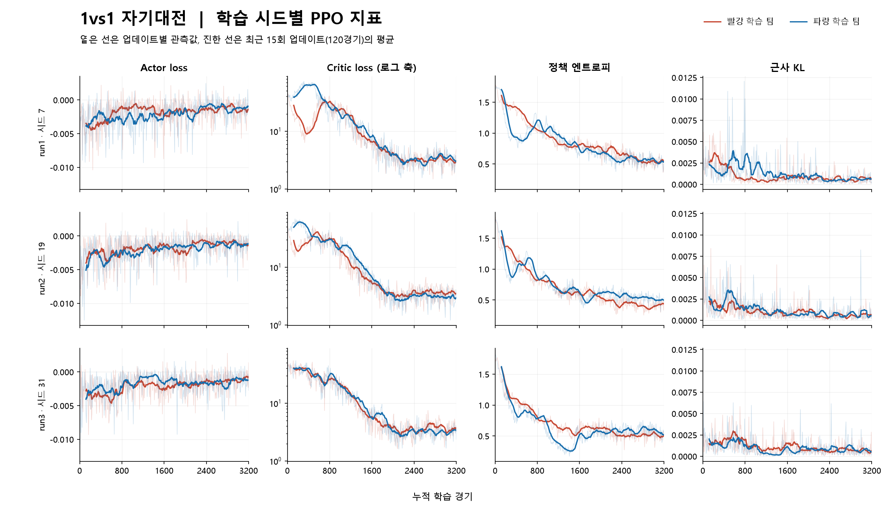
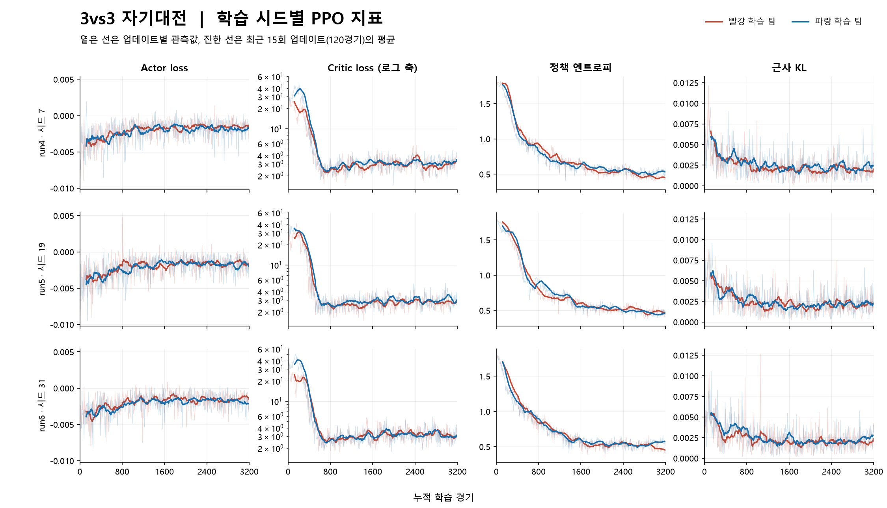
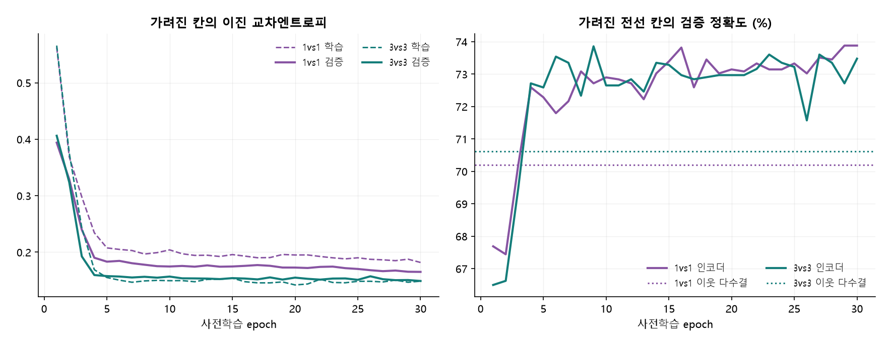
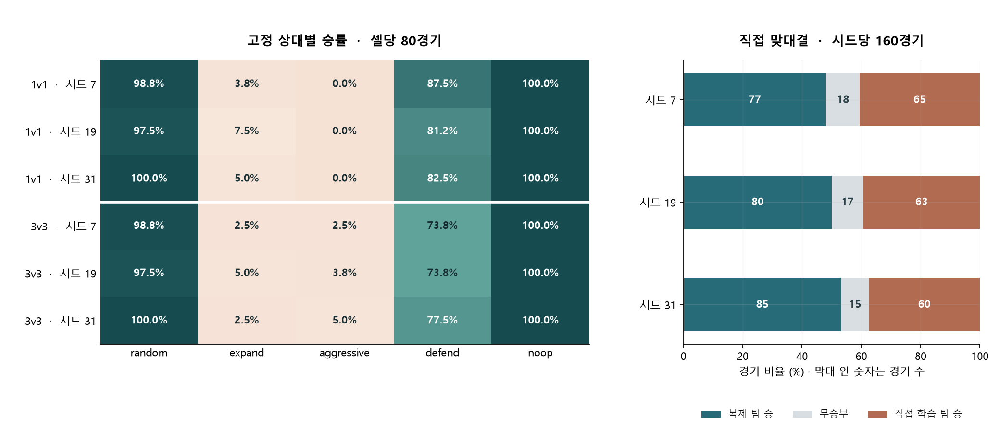

# exp1 최종 학습 및 3vs3 평가

**1vs1에서 배운 정책 세 개를 복제한 팀이 3vs3 직접 학습 팀에 242승 50무 188패를 기록했습니다.** 세 학습 시드 모두 복제 팀이 더 많이 이겼습니다. 직접 학습 팀은 aggressive에서만 더 많은 승리를 얻었고, 두 조건 모두 expand와 aggressive에 약했습니다. 이번 frontier 평가에서 직접 학습 팀을 더 높은 난도의 상대로 분류할 근거는 부족합니다.

## 실험과 판정 조건

3×10 맵, frontier 출발, 최대 64틱, 부활 지연 0, 팀 점유율 + 개인 점령 기여(α=1), 종료 보너스 0입니다. 각 인원 조건의 16차원 인코더를 동결하고 양 팀 자기대전 PPO를 수행했습니다. 400업데이트 × 8경기 × 6개 run으로 학습 총 19,200경기입니다. 실제 학습 로그에서 run마다 204,800 환경 틱을 확인했습니다. 1vs1은 run당 양 팀 합계 409,600회, 3vs3은 1,228,800회의 행동 선택을 기록했습니다.

평가는 사전에 동일하게 정한 **400번째 체크포인트**로 진행했습니다. 평가 시드 20261120에서 파생한 20개 경기 시드를 양 진영에서 짝지었습니다. 고정 상대별로 각 학습 팀이 40경기씩 치렀고, 맞대결에서는 같은 학습 시드의 양측 빨강·파랑 학습 정책을 모두 교차했습니다. 평가 환경은 모두 3vs3이며 정책은 가장 확률이 높은 합법 행동을 선택했습니다. 승률은 승수/전체 경기 수입니다.

## PPO 학습 곡선

처음과 마지막 25업데이트(각 200경기)를 비교했습니다. 각 값은 세 시드·양 학습 팀의 평균이며, 에이전트당 보상은 할인하지 않은 경기별 합입니다.

| 학습 | 구간 | Actor loss | Critic loss | 엔트로피 | 근사 KL | 에이전트당 보상 |
| --- | --- | --- | --- | --- | --- | --- |
| 1vs1 | 처음 200경기 | -0.00359 | 37.46 | 1.490 | 0.00215 | 35.88 |
| 1vs1 | 마지막 200경기 | -0.00114 | 3.40 | 0.499 | 0.00059 | 46.97 |
| 3vs3 | 처음 200경기 | -0.00380 | 29.53 | 1.684 | 0.00525 | 34.65 |
| 3vs3 | 마지막 200경기 | -0.00171 | 3.07 | 0.490 | 0.00230 | 44.66 |

1vs1 Critic loss는 37.46에서 3.40, 3vs3은 29.53에서 3.07로 낮아졌습니다. 3vs3은 176~200번째 업데이트에서 이미 2.98이어서 이후의 개선은 작았습니다. Actor loss는 advantage를 정규화한 PPO 목적함수의 일부입니다. 0 근처의 절댓값을 정책 성능 점수로 읽기 어렵습니다. 두 조건 모두 엔트로피가 약 0.49~0.50으로 낮아졌고, 후반 근사 KL은 3vs3이 0.00230, 1vs1이 0.00059였습니다. 3vs3 쪽의 정책 분포가 업데이트 중에 더 크게 움직였지만, 이 차이만으로 불안정이나 협력의 학습 여부를 판정할 수 없습니다.

모든 학습 경기가 64틱을 채웠습니다. 매 틱 두 진영 점유율의 합은 1이고 팀 인원이 같으므로 양 팀 평균의 점유율 보상은 에이전트당 경기마다 정확히 32입니다. 그 결과 1vs1 평균 보상 35.88 → 46.97의 상승은 평균 개인 점령 기여 3.88 → 14.97, 3vs3의 34.65 → 44.66은 2.65 → 12.66으로 설명됩니다. 점령 기여에는 이전에 잃은 칸을 다시 점령하는 행동도 포함됩니다.

## 인코더 검증

| 인코더 | 선택 epoch | 검증 loss | 전체 정확도 | 전선 정확도 | 초기 지도 전선 | 이웃 다수결 전선 |
| --- | --- | --- | --- | --- | --- | --- |
| 1vs1 | 30 | 0.165 | 93.5% | 73.9% | 67.7% | 70.2% |
| 3vs3 | 30 | 0.149 | 93.7% | 73.5% | 66.5% | 70.6% |

두 인코더 모두 전선에서 이웃 다수결보다 높았습니다. 각 인코더의 검증 경기 분포가 다르고 인원별 SSL fit은 하나씩입니다. PPO에 대한 사전학습의 효과나 인코더 간 우열은 이 비교만으로 분리하기 어렵습니다.

## 고정 상대 평가

각 칸의 승·무·패는 상대 하나에 세 학습 시드와 두 학습 팀을 합친 240경기입니다. 격차는 평가 팀의 종료 시점 점령 칸 수에서 상대의 점령 칸 수를 뺀 값입니다.

| 상대 | 복제 승·무·패 | 복제 승률 | 격차 | 평균 보상 | 직접 승·무·패 | 직접 승률 | 격차 | 평균 보상 |
| --- | --- | --- | --- | --- | --- | --- | --- | --- |
| random | 237·1·2 | 98.8% | +16.98 | 58.06 | 237·2·1 | 98.8% | +13.94 | 52.85 |
| expand | 13·2·225 | 5.4% | -10.57 | 43.99 | 8·5·227 | 3.3% | -10.71 | 43.77 |
| aggressive | 0·8·232 | 0.0% | -9.47 | 44.10 | 9·6·225 | 3.8% | -9.80 | 43.78 |
| defend | 201·10·29 | 83.8% | +13.67 | 51.15 | 180·13·47 | 75.0% | +11.09 | 49.39 |
| noop | 240·0·0 | 100.0% | +28.33 | 28.50 | 240·0·0 | 100.0% | +28.52 | 28.36 |

복제 팀은 세 시드 각각에서 defend 상대 승수가 더 많았습니다. expand 상대 평균 최종 격차는 두 조건 모두 약 −11칸입니다. aggressive를 상대로 직접 학습 팀이 기록한 9승은 세 시드의 파랑 학습 정책에서 각각 2·3·4승씩 나왔습니다. 학습 팀 내부의 차이도 있으며, 전체적으로는 양쪽 모두 240경기 중 225패 이상이었습니다.

## 시드별 직접 맞대결

아래 표는 1vs1 복제 팀 관점입니다. 무승부를 절반으로 센 점수는 직접 승률과 별도로 표기했습니다.

| 시드 | 경기 | 승 | 무 | 패 | 승률 | 무승부 절반 점수 | 최종 격차 |
| --- | --- | --- | --- | --- | --- | --- | --- |
| 7 | 160 | 77 | 18 | 65 | 48.1% | 53.8% | +0.97 |
| 19 | 160 | 80 | 17 | 63 | 50.0% | 55.3% | +1.07 |
| 31 | 160 | 85 | 15 | 60 | 53.1% | 57.8% | +1.71 |
| 합계 | 480 | 242 | 50 | 188 | 50.4% | 55.6% | +1.25 |

복제 팀은 실제 빨강과 파랑 진영에서 각각 240경기 중 121승을 기록했습니다. 점유율·보상·승률은 서로 다른 지표입니다. 무승부를 반영한 맞대결 점수는 55.6%이고, 3vs3 직접 학습 팀이 모든 전술 상황에서 약하다고 일반화하기에는 학습 시드가 세 개입니다. 같은 경기 시드·진영을 되풀이하므로 480경기를 독립 훈련 표본으로 해석할 수도 없습니다.

## 시드 19에서 관찰한 행동

expand 상대의 진영별 첫 리플레이를 보면 run2(1vs1)의 빨강·파랑 학습 정책과 run5(3vs3)의 빨강 학습 정책은 같은 진영에서 팀원 세 명의 **64틱 행동열 전체가 일치**했습니다. 빨강에서 이 행동열은 오른쪽 공격 96회와 오른쪽 이동 96회, 파랑에서는 왼쪽 공격 96회와 왼쪽 이동 96회였습니다. 세 정책 모두 이 두 경기에서는 옆 행으로 가지 않았습니다. run5의 파랑 학습 정책은 다른 행동열을 냈습니다. 이 관찰은 저장된 소수의 첫 경기에서 나온 것으로, 모든 경기의 행동 통계는 아닙니다.

후속 분석에서 먼저 확인할 것은 고정된 ‘상대 진영 방향으로 공격하고 전진’ 규칙이 학습 정책의 평가 성적을 얼마나 재현하는지입니다. 이를 측정하면 학습 연장 전에 두 팀이 실제로 서로 다른 전술을 배웠는지 판단하는 데 도움이 됩니다.

## 원자료와 실행 식별자

| 실행 | 팀당 학습 인원 | 시드 | 기록된 업데이트 시간 합 | 학습 | 고정 상대 | 경기별 |
| --- | --- | --- | --- | --- | --- | --- |
| run1 | 1 | 7 | 6.5분 | [학습 CSV](../../run1/training.csv) | [평가표](../../run1/evaluation/eval1/summary.csv) | [경기별 CSV](../../run1/evaluation/eval1/games.csv) |
| run2 | 1 | 19 | 6.6분 | [학습 CSV](../../run2/training.csv) | [평가표](../../run2/evaluation/eval1/summary.csv) | [경기별 CSV](../../run2/evaluation/eval1/games.csv) |
| run3 | 1 | 31 | 6.8분 | [학습 CSV](../../run3/training.csv) | [평가표](../../run3/evaluation/eval1/summary.csv) | [경기별 CSV](../../run3/evaluation/eval1/games.csv) |
| run4 | 3 | 7 | 11.1분 | [학습 CSV](../../run4/training.csv) | [평가표](../../run4/evaluation/eval1/summary.csv) | [경기별 CSV](../../run4/evaluation/eval1/games.csv) |
| run5 | 3 | 19 | 11.1분 | [학습 CSV](../../run5/training.csv) | [평가표](../../run5/evaluation/eval1/summary.csv) | [경기별 CSV](../../run5/evaluation/eval1/games.csv) |
| run6 | 3 | 31 | 11.1분 | [학습 CSV](../../run6/training.csv) | [평가표](../../run6/evaluation/eval1/summary.csv) | [경기별 CSV](../../run6/evaluation/eval1/games.csv) |

맞대결 원자료　[시드 7](../../comparison/eval1/games.csv) · [시드 19](../../comparison/eval2/games.csv) · [시드 31](../../comparison/eval3/games.csv)

시드 19 expand 리플레이　[복제 팀](../../run2/evaluation/eval1/0_expand_0.json) · [직접 학습 팀](../../run5/evaluation/eval1/0_expand_0.json)
