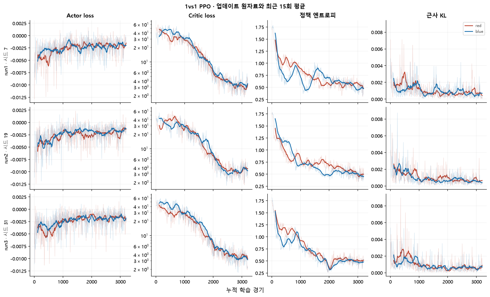
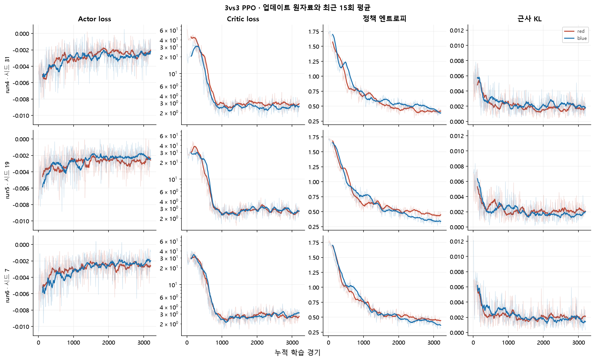
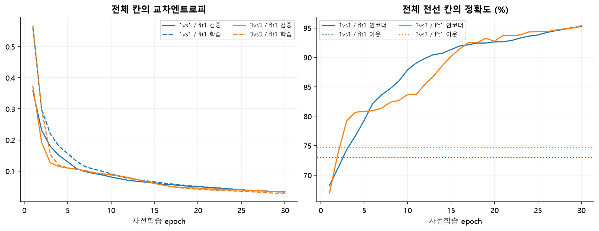
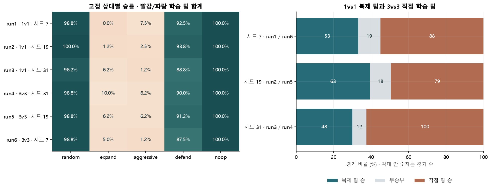

# exp2 · 업데이트 400 학습 및 3vs3 평가

평가 시드 20261120 · 학습 팀·상대 조합별 40경기 · 양 진영 절반씩. 승률은 승수/전체 경기 수입니다.

## 자기대전 학습

| 팀 인원 | 구간 | 업데이트 수 | actor_loss | critic_loss | entropy | approx_kl | 평균 보상 | 개인 점령 보상분 |
| --- | --- | --- | --- | --- | --- | --- | --- | --- |
| 1 | 처음 | 25 | -0.0042521 | 40.144 | 1.4015 | 0.0018451 | 37.79 | 5.79 |
| 1 | 마지막 | 25 | -0.0017383 | 3.5033 | 0.4855 | 0.00058323 | 46.50 | 14.50 |
| 3 | 처음 | 25 | -0.0051087 | 32.166 | 1.5982 | 0.0051017 | 35.75 | 3.75 |
| 3 | 마지막 | 25 | -0.0022877 | 2.7205 | 0.40132 | 0.0018253 | 45.47 | 13.47 |

양 팀을 동일 가중치로 평균한 구간입니다. 개인 점령 보상분은 평균 에이전트 보상에서 평균 경기 길이의 절반(점유율 보상)을 뺀 값입니다.

## 인코더 검증

| 인코더 | 최저 검증 loss epoch | 검증 loss | 전선 정확도 | 이웃 다수결 |
| --- | --- | --- | --- | --- |
| 1vs1 / fit1 | 30 | 0.0335 | 0.9521963596343994 | 0.7297896146774292 |
| 3vs3 / fit1 | 30 | 0.0329 | 0.9538553953170776 | 0.7475029826164246 |

## 고정 상대

| 팀당 학습 인원 | 상대 | 경기 | 승 | 무 | 패 | 최종 격차 | 에이전트당 보상 | 승률 |
| --- | --- | --- | --- | --- | --- | --- | --- | --- |
| 1 | aggressive | 240 | 9 | 13 | 218 | -8.61 | 44.33 | 3.75% |
| 1 | defend | 240 | 220 | 3 | 17 | +16.79 | 52.31 | 91.67% |
| 1 | expand | 240 | 6 | 6 | 228 | -9.86 | 43.99 | 2.50% |
| 1 | noop | 240 | 240 | 0 | 0 | +29.44 | 27.47 | 100.00% |
| 1 | random | 240 | 236 | 1 | 3 | +17.33 | 57.15 | 98.33% |
| 3 | aggressive | 240 | 11 | 8 | 221 | -8.68 | 43.76 | 4.58% |
| 3 | defend | 240 | 215 | 4 | 21 | +15.35 | 51.88 | 89.58% |
| 3 | expand | 240 | 17 | 12 | 211 | -7.18 | 44.55 | 7.08% |
| 3 | noop | 240 | 240 | 0 | 0 | +30.00 | 12.00 | 100.00% |
| 3 | random | 240 | 237 | 3 | 0 | +16.48 | 54.73 | 98.75% |

## 맞대결 · 복제 팀 관점

| run 쌍 | 학습 시드 | 승 | 무 | 패 | 점령 격차 | 무승부 절반 점수 | 승률 |
| --- | --- | --- | --- | --- | --- | --- | --- |
| run1 / run6 | 7 | 53 | 19 | 88 | -1.29 | 39.06% | 33.12% |
| run2 / run5 | 19 | 63 | 18 | 79 | -0.75 | 45.00% | 39.38% |
| run3 / run4 | 31 | 48 | 12 | 100 | -3.21 | 33.75% | 30.00% |
| 합계 | 전체 | 164 | 49 | 267 | -1.75 | 39.27% | 34.17% |

## 원자료

| 실행 | 상대 | 경기 | 기록 |
| --- | --- | --- | --- |
| run1 | 고정 상대 | 400 | [경기별 CSV](../../../../run1/evaluation/eval1/games.csv) |
| run2 | 고정 상대 | 400 | [경기별 CSV](../../../../run2/evaluation/eval1/games.csv) |
| run3 | 고정 상대 | 400 | [경기별 CSV](../../../../run3/evaluation/eval1/games.csv) |
| run4 | 고정 상대 | 400 | [경기별 CSV](../../../../run4/evaluation/eval1/games.csv) |
| run5 | 고정 상대 | 400 | [경기별 CSV](../../../../run5/evaluation/eval1/games.csv) |
| run6 | 고정 상대 | 400 | [경기별 CSV](../../../../run6/evaluation/eval1/games.csv) |
| run1 | run6 | 160 | [경기별 CSV](../../../../comparison/eval1/games.csv) |
| run2 | run5 | 160 | [경기별 CSV](../../../../comparison/eval2/games.csv) |
| run3 | run4 | 160 | [경기별 CSV](../../../../comparison/eval3/games.csv) |

[학습 팀·실제 진영별 전체 평가표](evaluation_groups.csv)
