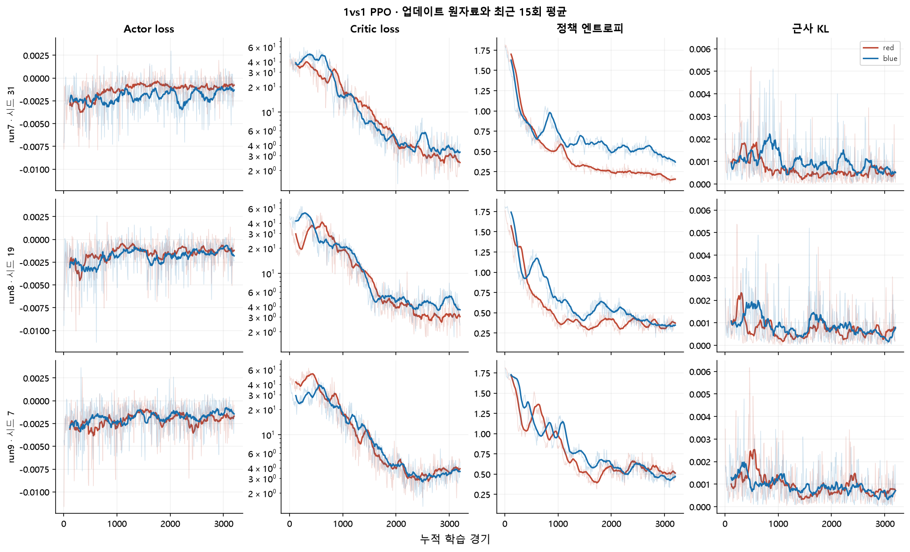
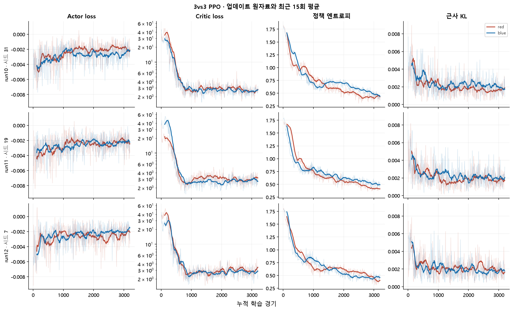
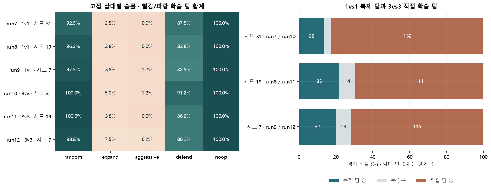

# exp2 · 업데이트 400 학습 및 3vs3 평가

평가 시드 20261120 · 학습 팀·상대 조합별 40경기 · 양 진영 절반씩. 승률은 승수/전체 경기 수입니다.

## 자기대전 학습

| 팀 인원 | 구간 | 업데이트 수 | actor_loss | critic_loss | entropy | approx_kl | 평균 보상 | 개인 점령 보상분 |
| --- | --- | --- | --- | --- | --- | --- | --- | --- |
| 1 | 처음 | 25 | -0.0027684 | 35.566 | 1.5807 | 0.0010898 | 34.92 | 2.92 |
| 1 | 마지막 | 25 | -0.0013099 | 3.417 | 0.37093 | 0.00061092 | 46.53 | 14.53 |
| 3 | 처음 | 25 | -0.0040861 | 32.008 | 1.5788 | 0.004169 | 35.93 | 3.93 |
| 3 | 마지막 | 25 | -0.0021337 | 2.8597 | 0.44534 | 0.0018518 | 45.91 | 13.91 |

양 팀을 동일 가중치로 평균한 구간입니다. 개인 점령 보상분은 평균 에이전트 보상에서 평균 경기 길이의 절반(점유율 보상)을 뺀 값입니다.

## 고정 상대

| 팀당 학습 인원 | 상대 | 경기 | 승 | 무 | 패 | 최종 격차 | 에이전트당 보상 | 승률 |
| --- | --- | --- | --- | --- | --- | --- | --- | --- |
| 1 | aggressive | 240 | 1 | 9 | 230 | -11.17 | 42.00 | 0.42% |
| 1 | defend | 240 | 203 | 11 | 26 | +12.38 | 48.83 | 84.58% |
| 1 | expand | 240 | 8 | 7 | 225 | -12.49 | 41.41 | 3.33% |
| 1 | noop | 240 | 240 | 0 | 0 | +26.95 | 27.14 | 100.00% |
| 1 | random | 240 | 229 | 6 | 5 | +14.93 | 54.70 | 95.42% |
| 3 | aggressive | 240 | 6 | 12 | 222 | -9.35 | 43.38 | 2.50% |
| 3 | defend | 240 | 211 | 8 | 21 | +15.21 | 51.88 | 87.92% |
| 3 | expand | 240 | 13 | 7 | 220 | -9.24 | 43.69 | 5.42% |
| 3 | noop | 240 | 240 | 0 | 0 | +29.68 | 17.33 | 100.00% |
| 3 | random | 240 | 239 | 0 | 1 | +17.06 | 53.96 | 99.58% |

## 맞대결 · 복제 팀 관점

| run 쌍 | 학습 시드 | 승 | 무 | 패 | 점령 격차 | 무승부 절반 점수 | 승률 |
| --- | --- | --- | --- | --- | --- | --- | --- |
| run7 / run10 | 31 | 22 | 6 | 132 | -8.62 | 15.62% | 13.75% |
| run8 / run11 | 19 | 35 | 14 | 111 | -6.34 | 26.25% | 21.88% |
| run9 / run12 | 7 | 32 | 13 | 115 | -4.55 | 24.06% | 20.00% |
| 합계 | 전체 | 89 | 33 | 358 | -6.50 | 21.98% | 18.54% |

## 원자료

| 실행 | 상대 | 경기 | 기록 |
| --- | --- | --- | --- |
| run7 | 고정 상대 | 400 | [경기별 CSV](../../../../run7/evaluation/eval1/games.csv) |
| run8 | 고정 상대 | 400 | [경기별 CSV](../../../../run8/evaluation/eval1/games.csv) |
| run9 | 고정 상대 | 400 | [경기별 CSV](../../../../run9/evaluation/eval1/games.csv) |
| run10 | 고정 상대 | 400 | [경기별 CSV](../../../../run10/evaluation/eval1/games.csv) |
| run11 | 고정 상대 | 400 | [경기별 CSV](../../../../run11/evaluation/eval1/games.csv) |
| run12 | 고정 상대 | 400 | [경기별 CSV](../../../../run12/evaluation/eval1/games.csv) |
| run7 | run10 | 160 | [경기별 CSV](../../../../comparison/eval4/games.csv) |
| run8 | run11 | 160 | [경기별 CSV](../../../../comparison/eval5/games.csv) |
| run9 | run12 | 160 | [경기별 CSV](../../../../comparison/eval6/games.csv) |

[학습 팀·실제 진영별 전체 평가표](evaluation_groups.csv)
