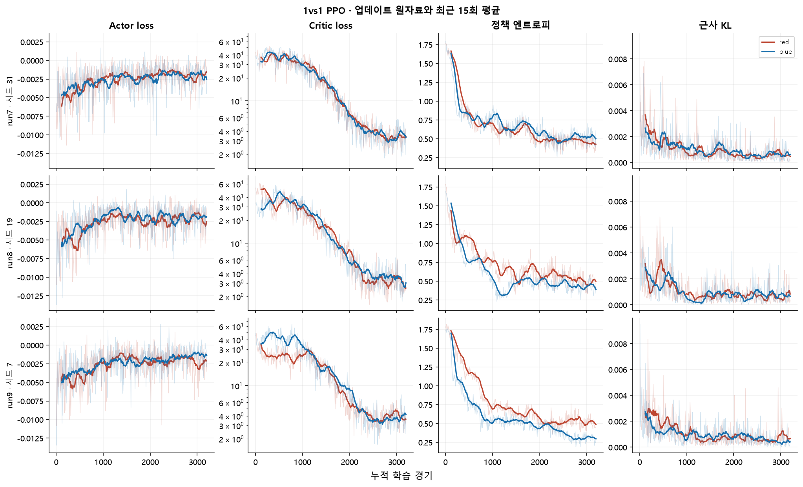
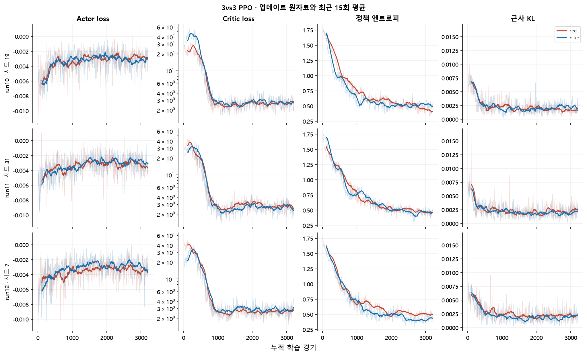
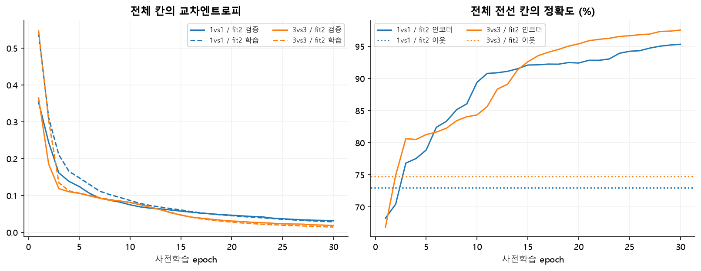
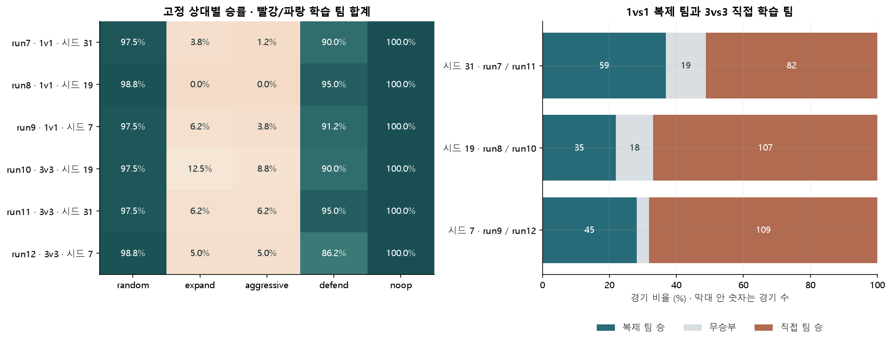

# exp3 · 업데이트 400 학습 및 3vs3 평가

평가 시드 20261120 · 학습 팀·상대 조합별 40경기 · 양 진영 절반씩. 승률은 승수/전체 경기 수입니다.

## 자기대전 학습

| 팀 인원 | 구간 | 업데이트 수 | actor_loss | critic_loss | entropy | approx_kl | 평균 보상 | 개인 점령 보상분 |
| --- | --- | --- | --- | --- | --- | --- | --- | --- |
| 1 | 처음 | 25 | -0.0048796 | 36.324 | 1.4909 | 0.002538 | 36.73 | 4.73 |
| 1 | 마지막 | 25 | -0.0020085 | 3.4204 | 0.44775 | 0.00064176 | 46.91 | 14.91 |
| 3 | 처음 | 25 | -0.0055612 | 31.639 | 1.5734 | 0.0059413 | 35.14 | 3.14 |
| 3 | 마지막 | 25 | -0.0032117 | 2.7286 | 0.46442 | 0.0021284 | 45.24 | 13.24 |

양 팀을 동일 가중치로 평균한 구간입니다. 개인 점령 보상분은 평균 에이전트 보상에서 평균 경기 길이의 절반(점유율 보상)을 뺀 값입니다.

## 인코더 검증

| 인코더 | 최저 검증 loss epoch | 검증 loss | 전선 정확도 | 이웃 다수결 |
| --- | --- | --- | --- | --- |
| 1vs1 / fit2 | 30 | 0.0313 | 0.9531192183494568 | 0.7297896146774292 |
| 3vs3 / fit2 | 30 | 0.0184 | 0.9752297401428223 | 0.7475029826164246 |

## 고정 상대

| 팀당 학습 인원 | 상대 | 경기 | 승 | 무 | 패 | 최종 격차 | 에이전트당 보상 | 승률 |
| --- | --- | --- | --- | --- | --- | --- | --- | --- |
| 1 | aggressive | 240 | 4 | 14 | 222 | -9.47 | 43.61 | 1.67% |
| 1 | defend | 240 | 221 | 7 | 12 | +13.87 | 49.58 | 92.08% |
| 1 | expand | 240 | 8 | 4 | 228 | -10.15 | 43.49 | 3.33% |
| 1 | noop | 240 | 240 | 0 | 0 | +27.33 | 45.45 | 100.00% |
| 1 | random | 240 | 235 | 5 | 0 | +16.66 | 57.35 | 97.92% |
| 3 | aggressive | 240 | 16 | 18 | 206 | -7.91 | 43.65 | 6.67% |
| 3 | defend | 240 | 217 | 3 | 20 | +16.47 | 52.57 | 90.42% |
| 3 | expand | 240 | 19 | 14 | 207 | -7.37 | 44.39 | 7.92% |
| 3 | noop | 240 | 240 | 0 | 0 | +29.33 | 20.43 | 100.00% |
| 3 | random | 240 | 235 | 4 | 1 | +16.61 | 55.31 | 97.92% |

## 맞대결 · 복제 팀 관점

| run 쌍 | 학습 시드 | 승 | 무 | 패 | 점령 격차 | 무승부 절반 점수 | 승률 |
| --- | --- | --- | --- | --- | --- | --- | --- |
| run7 / run11 | 31 | 59 | 19 | 82 | -1.05 | 42.81% | 36.88% |
| run8 / run10 | 19 | 35 | 18 | 107 | -3.54 | 27.50% | 21.88% |
| run9 / run12 | 7 | 45 | 6 | 109 | -4.12 | 30.00% | 28.12% |
| 합계 | 전체 | 139 | 43 | 298 | -2.90 | 33.44% | 28.96% |

## 원자료

| 실행 | 상대 | 경기 | 기록 |
| --- | --- | --- | --- |
| run7 | 고정 상대 | 400 | [경기별 CSV](../../../../run7/evaluation/eval1/games.csv) |
| run8 | 고정 상대 | 400 | [경기별 CSV](../../../../run8/evaluation/eval1/games.csv) |
| run9 | 고정 상대 | 400 | [경기별 CSV](../../../../run9/evaluation/eval1/games.csv) |
| run10 | 고정 상대 | 400 | [경기별 CSV](../../../../run10/evaluation/eval1/games.csv) |
| run11 | 고정 상대 | 400 | [경기별 CSV](../../../../run11/evaluation/eval1/games.csv) |
| run12 | 고정 상대 | 400 | [경기별 CSV](../../../../run12/evaluation/eval1/games.csv) |
| run7 | run11 | 160 | [경기별 CSV](../../../../comparison/eval4/games.csv) |
| run8 | run10 | 160 | [경기별 CSV](../../../../comparison/eval5/games.csv) |
| run9 | run12 | 160 | [경기별 CSV](../../../../comparison/eval6/games.csv) |

[학습 팀·실제 진영별 전체 평가표](evaluation_groups.csv)

조건 mask00_z32 · 이 실험에서 학습한 결과
