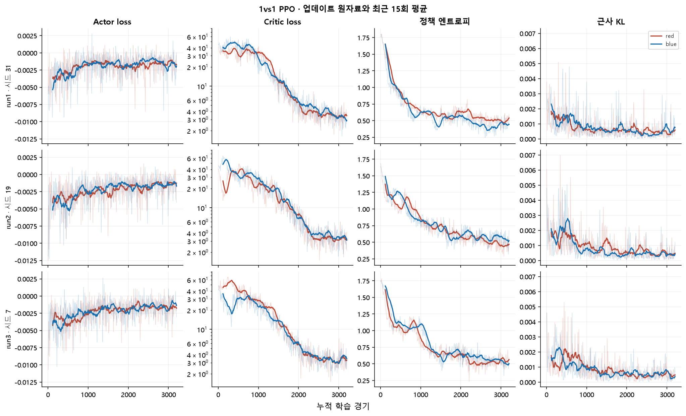
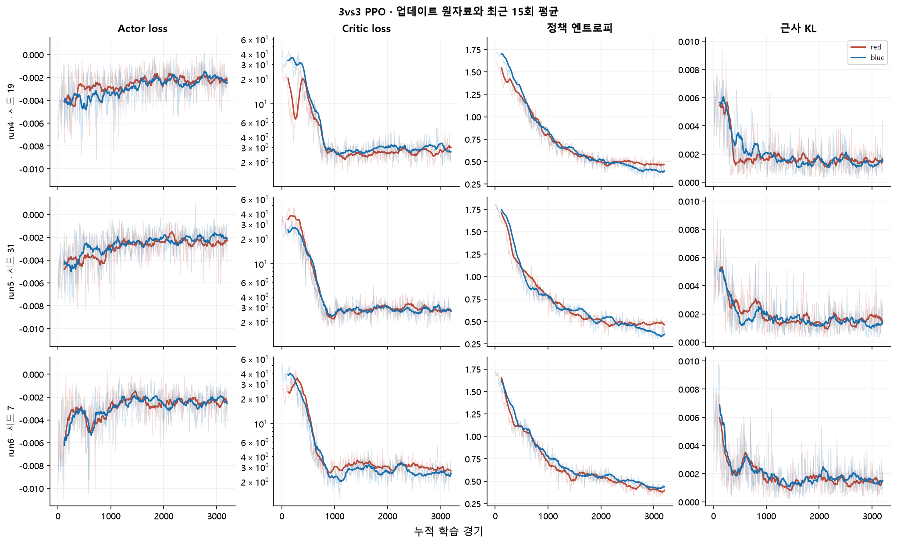
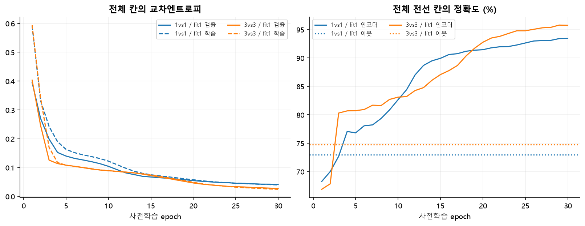
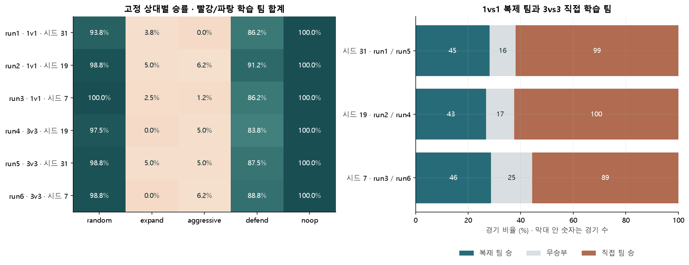

# exp3 · 업데이트 400 학습 및 3vs3 평가

평가 시드 20261120 · 학습 팀·상대 조합별 40경기 · 양 진영 절반씩. 승률은 승수/전체 경기 수입니다.

## 자기대전 학습

| 팀 인원 | 구간 | 업데이트 수 | actor_loss | critic_loss | entropy | approx_kl | 평균 보상 | 개인 점령 보상분 |
| --- | --- | --- | --- | --- | --- | --- | --- | --- |
| 1 | 처음 | 25 | -0.0040223 | 38.33 | 1.4573 | 0.0017407 | 36.32 | 4.32 |
| 1 | 마지막 | 25 | -0.0014228 | 3.4062 | 0.49791 | 0.00042971 | 46.28 | 14.28 |
| 3 | 처음 | 25 | -0.004619 | 29.149 | 1.6035 | 0.0052394 | 34.40 | 2.40 |
| 3 | 마지막 | 25 | -0.002283 | 2.6958 | 0.41575 | 0.001485 | 45.46 | 13.46 |

양 팀을 동일 가중치로 평균한 구간입니다. 개인 점령 보상분은 평균 에이전트 보상에서 평균 경기 길이의 절반(점유율 보상)을 뺀 값입니다.

## 인코더 검증

| 인코더 | 최저 검증 loss epoch | 검증 loss | 전선 정확도 | 이웃 다수결 |
| --- | --- | --- | --- | --- |
| 1vs1 / fit1 | 30 | 0.0415 | 0.9342930912971497 | 0.7297896146774292 |
| 3vs3 / fit1 | 30 | 0.0274 | 0.9574510455131531 | 0.7475029826164246 |

## 고정 상대

| 팀당 학습 인원 | 상대 | 경기 | 승 | 무 | 패 | 최종 격차 | 에이전트당 보상 | 승률 |
| --- | --- | --- | --- | --- | --- | --- | --- | --- |
| 1 | aggressive | 240 | 6 | 10 | 224 | -8.82 | 44.33 | 2.50% |
| 1 | defend | 240 | 211 | 10 | 19 | +14.79 | 51.07 | 87.92% |
| 1 | expand | 240 | 9 | 6 | 225 | -9.32 | 44.16 | 3.75% |
| 1 | noop | 240 | 240 | 0 | 0 | +28.67 | 28.86 | 100.00% |
| 1 | random | 240 | 234 | 3 | 3 | +17.32 | 57.69 | 97.50% |
| 3 | aggressive | 240 | 13 | 6 | 221 | -9.07 | 43.98 | 5.42% |
| 3 | defend | 240 | 208 | 13 | 19 | +14.35 | 51.05 | 86.67% |
| 3 | expand | 240 | 4 | 10 | 226 | -9.89 | 43.98 | 1.67% |
| 3 | noop | 240 | 240 | 0 | 0 | +30.00 | 12.37 | 100.00% |
| 3 | random | 240 | 236 | 4 | 0 | +17.98 | 54.64 | 98.33% |

## 맞대결 · 복제 팀 관점

| run 쌍 | 학습 시드 | 승 | 무 | 패 | 점령 격차 | 무승부 절반 점수 | 승률 |
| --- | --- | --- | --- | --- | --- | --- | --- |
| run1 / run5 | 31 | 45 | 16 | 99 | -3.10 | 33.12% | 28.12% |
| run2 / run4 | 19 | 43 | 17 | 100 | -2.64 | 32.19% | 26.88% |
| run3 / run6 | 7 | 46 | 25 | 89 | -2.21 | 36.56% | 28.75% |
| 합계 | 전체 | 134 | 58 | 288 | -2.65 | 33.96% | 27.92% |

## 원자료

| 실행 | 상대 | 경기 | 기록 |
| --- | --- | --- | --- |
| run1 | 고정 상대 | 400 | [경기별 CSV](../../../../run1/evaluation/eval1/games.csv) |
| run2 | 고정 상대 | 400 | [경기별 CSV](../../../../run2/evaluation/eval1/games.csv) |
| run3 | 고정 상대 | 400 | [경기별 CSV](../../../../run3/evaluation/eval1/games.csv) |
| run4 | 고정 상대 | 400 | [경기별 CSV](../../../../run4/evaluation/eval1/games.csv) |
| run5 | 고정 상대 | 400 | [경기별 CSV](../../../../run5/evaluation/eval1/games.csv) |
| run6 | 고정 상대 | 400 | [경기별 CSV](../../../../run6/evaluation/eval1/games.csv) |
| run1 | run5 | 160 | [경기별 CSV](../../../../comparison/eval1/games.csv) |
| run2 | run4 | 160 | [경기별 CSV](../../../../comparison/eval2/games.csv) |
| run3 | run6 | 160 | [경기별 CSV](../../../../comparison/eval3/games.csv) |

[학습 팀·실제 진영별 전체 평가표](evaluation_groups.csv)

조건 mask00_z8 · 이 실험에서 학습한 결과
