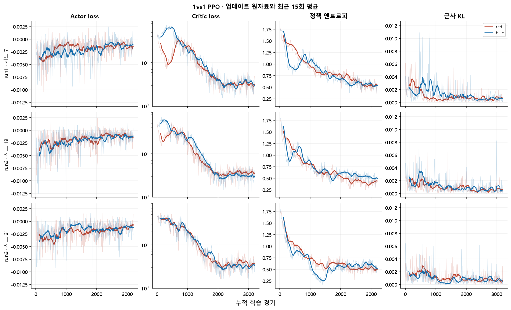
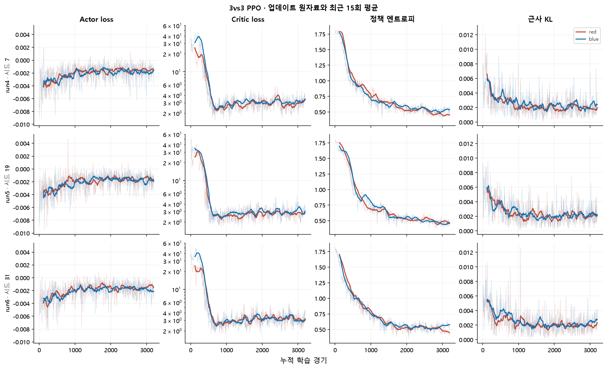
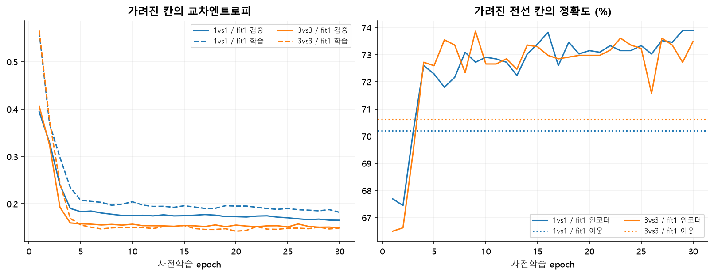
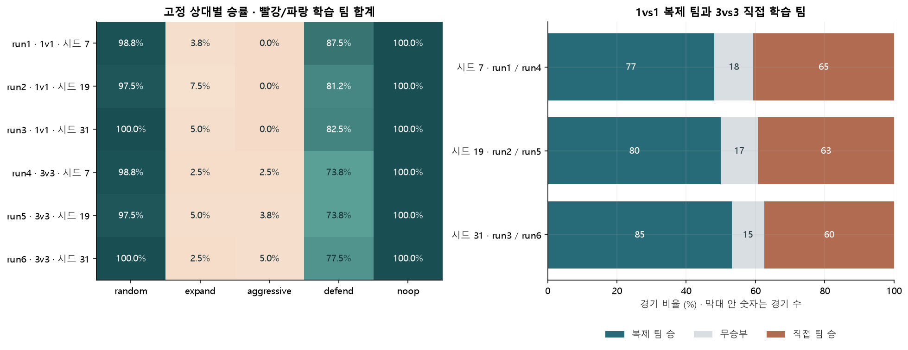

# exp1 · 업데이트 400 학습 및 3vs3 평가

평가 시드 20261120 · 학습 팀·상대 조합별 40경기 · 양 진영 절반씩. 승률은 승수/전체 경기 수입니다.

## 자기대전 학습

| 팀 인원 | 구간 | 업데이트 수 | actor_loss | critic_loss | entropy | approx_kl | 평균 보상 | 개인 점령 보상분 |
| --- | --- | --- | --- | --- | --- | --- | --- | --- |
| 1 | 처음 | 25 | -0.003594 | 37.455 | 1.4897 | 0.0021496 | 35.88 | 3.88 |
| 1 | 마지막 | 25 | -0.0011382 | 3.3986 | 0.49935 | 0.00058516 | 46.97 | 14.97 |
| 3 | 처음 | 25 | -0.0038031 | 29.534 | 1.6838 | 0.0052482 | 34.65 | 2.65 |
| 3 | 마지막 | 25 | -0.0017075 | 3.0687 | 0.48951 | 0.0022977 | 44.66 | 12.66 |

양 팀을 동일 가중치로 평균한 구간입니다. 개인 점령 보상분은 평균 에이전트 보상에서 평균 경기 길이의 절반(점유율 보상)을 뺀 값입니다.

## 인코더 검증

| 인코더 | 최저 검증 loss epoch | 검증 loss | 전선 정확도 | 이웃 다수결 |
| --- | --- | --- | --- | --- |
| 1vs1 / fit1 | 30 | 0.1652 | 0.7388105392456055 | 0.7020233273506165 |
| 3vs3 / fit1 | 30 | 0.1490 | 0.7347715497016907 | 0.7062183022499084 |

## 고정 상대

| 팀당 학습 인원 | 상대 | 경기 | 승 | 무 | 패 | 최종 격차 | 에이전트당 보상 | 승률 |
| --- | --- | --- | --- | --- | --- | --- | --- | --- |
| 1 | aggressive | 240 | 0 | 8 | 232 | -9.47 | 44.10 | 0.00% |
| 1 | defend | 240 | 201 | 10 | 29 | +13.67 | 51.15 | 83.75% |
| 1 | expand | 240 | 13 | 2 | 225 | -10.57 | 43.99 | 5.42% |
| 1 | noop | 240 | 240 | 0 | 0 | +28.33 | 28.50 | 100.00% |
| 1 | random | 240 | 237 | 1 | 2 | +16.98 | 58.06 | 98.75% |
| 3 | aggressive | 240 | 9 | 6 | 225 | -9.80 | 43.78 | 3.75% |
| 3 | defend | 240 | 180 | 13 | 47 | +11.09 | 49.39 | 75.00% |
| 3 | expand | 240 | 8 | 5 | 227 | -10.71 | 43.77 | 3.33% |
| 3 | noop | 240 | 240 | 0 | 0 | +28.52 | 28.36 | 100.00% |
| 3 | random | 240 | 237 | 2 | 1 | +13.94 | 52.85 | 98.75% |

## 맞대결 · 복제 팀 관점

| run 쌍 | 학습 시드 | 승 | 무 | 패 | 점령 격차 | 무승부 절반 점수 | 승률 |
| --- | --- | --- | --- | --- | --- | --- | --- |
| run1 / run4 | 7 | 77 | 18 | 65 | +0.97 | 53.75% | 48.12% |
| run2 / run5 | 19 | 80 | 17 | 63 | +1.07 | 55.31% | 50.00% |
| run3 / run6 | 31 | 85 | 15 | 60 | +1.71 | 57.81% | 53.12% |
| 합계 | 전체 | 242 | 50 | 188 | +1.25 | 55.62% | 50.42% |

## 원자료

| 실행 | 상대 | 경기 | 기록 |
| --- | --- | --- | --- |
| run1 | 고정 상대 | 400 | [경기별 CSV](../../../../copied/exp1/run1/evaluation/eval1/games.csv) |
| run2 | 고정 상대 | 400 | [경기별 CSV](../../../../copied/exp1/run2/evaluation/eval1/games.csv) |
| run3 | 고정 상대 | 400 | [경기별 CSV](../../../../copied/exp1/run3/evaluation/eval1/games.csv) |
| run4 | 고정 상대 | 400 | [경기별 CSV](../../../../copied/exp1/run4/evaluation/eval1/games.csv) |
| run5 | 고정 상대 | 400 | [경기별 CSV](../../../../copied/exp1/run5/evaluation/eval1/games.csv) |
| run6 | 고정 상대 | 400 | [경기별 CSV](../../../../copied/exp1/run6/evaluation/eval1/games.csv) |
| run1 | run4 | 160 | [경기별 CSV](../../../../copied/exp1/comparison/eval1/games.csv) |
| run2 | run5 | 160 | [경기별 CSV](../../../../copied/exp1/comparison/eval2/games.csv) |
| run3 | run6 | 160 | [경기별 CSV](../../../../copied/exp1/comparison/eval3/games.csv) |

[학습 팀·실제 진영별 전체 평가표](evaluation_groups.csv)

조건 mask09_z16 · exp1에서 복사한 기준 결과
