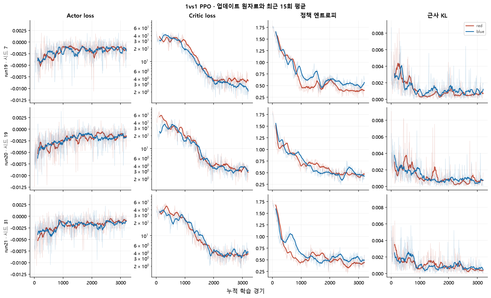
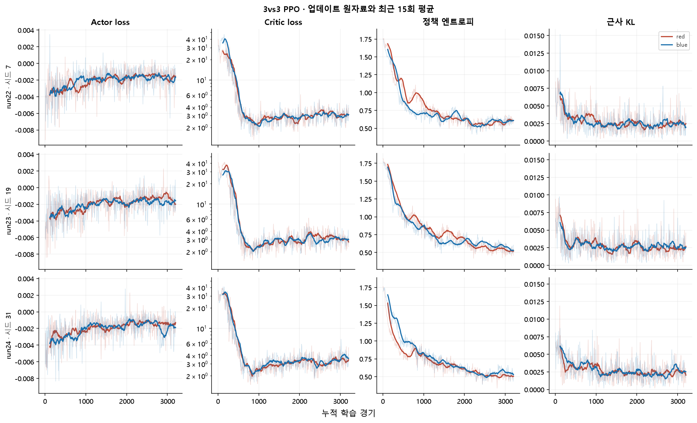
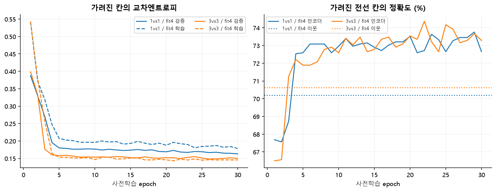
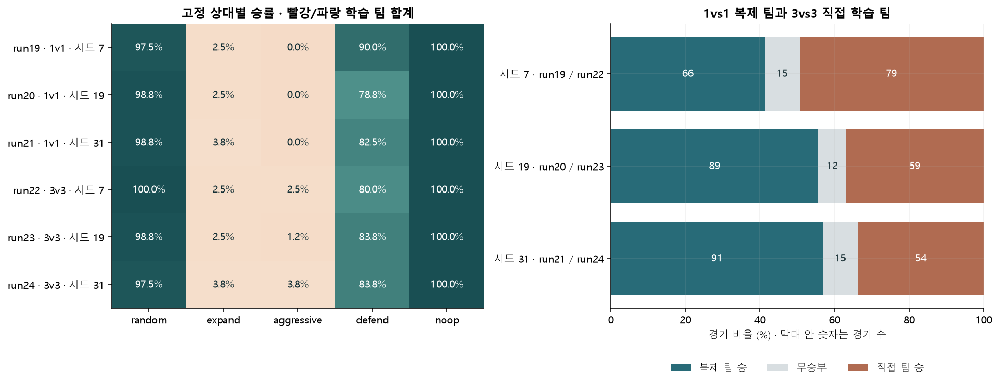

# exp3 · 업데이트 400 학습 및 3vs3 평가

평가 시드 20261120 · 학습 팀·상대 조합별 40경기 · 양 진영 절반씩. 승률은 승수/전체 경기 수입니다.

## 자기대전 학습

| 팀 인원 | 구간 | 업데이트 수 | actor_loss | critic_loss | entropy | approx_kl | 평균 보상 | 개인 점령 보상분 |
| --- | --- | --- | --- | --- | --- | --- | --- | --- |
| 1 | 처음 | 25 | -0.0043398 | 36.677 | 1.487 | 0.0027369 | 36.73 | 4.73 |
| 1 | 마지막 | 25 | -0.0013632 | 3.4494 | 0.45486 | 0.00065307 | 47.12 | 15.12 |
| 3 | 처음 | 25 | -0.0037073 | 31.146 | 1.5566 | 0.0054994 | 35.82 | 3.82 |
| 3 | 마지막 | 25 | -0.0017234 | 3.2094 | 0.55612 | 0.0024549 | 44.18 | 12.18 |

양 팀을 동일 가중치로 평균한 구간입니다. 개인 점령 보상분은 평균 에이전트 보상에서 평균 경기 길이의 절반(점유율 보상)을 뺀 값입니다.

## 인코더 검증

| 인코더 | 최저 검증 loss epoch | 검증 loss | 전선 정확도 | 이웃 다수결 |
| --- | --- | --- | --- | --- |
| 1vs1 / fit4 | 30 | 0.1629 | 0.7265481352806091 | 0.7020233273506165 |
| 3vs3 / fit4 | 26 | 0.1482 | 0.7392131686210632 | 0.7062183022499084 |

## 고정 상대

| 팀당 학습 인원 | 상대 | 경기 | 승 | 무 | 패 | 최종 격차 | 에이전트당 보상 | 승률 |
| --- | --- | --- | --- | --- | --- | --- | --- | --- |
| 1 | aggressive | 240 | 0 | 7 | 233 | -10.38 | 42.97 | 0.00% |
| 1 | defend | 240 | 201 | 7 | 32 | +12.38 | 49.01 | 83.75% |
| 1 | expand | 240 | 7 | 6 | 227 | -11.12 | 43.06 | 2.92% |
| 1 | noop | 240 | 240 | 0 | 0 | +27.33 | 45.60 | 100.00% |
| 1 | random | 240 | 236 | 2 | 2 | +15.91 | 56.43 | 98.33% |
| 3 | aggressive | 240 | 6 | 5 | 229 | -9.54 | 43.92 | 2.50% |
| 3 | defend | 240 | 198 | 9 | 33 | +11.66 | 49.74 | 82.50% |
| 3 | expand | 240 | 7 | 4 | 229 | -10.57 | 43.66 | 2.92% |
| 3 | noop | 240 | 240 | 0 | 0 | +28.36 | 47.12 | 100.00% |
| 3 | random | 240 | 237 | 1 | 2 | +15.07 | 55.12 | 98.75% |

## 맞대결 · 복제 팀 관점

| run 쌍 | 학습 시드 | 승 | 무 | 패 | 점령 격차 | 무승부 절반 점수 | 승률 |
| --- | --- | --- | --- | --- | --- | --- | --- |
| run19 / run22 | 7 | 66 | 15 | 79 | -0.16 | 45.94% | 41.25% |
| run20 / run23 | 19 | 89 | 12 | 59 | +2.15 | 59.38% | 55.62% |
| run21 / run24 | 31 | 91 | 15 | 54 | +1.79 | 61.56% | 56.88% |
| 합계 | 전체 | 246 | 42 | 192 | +1.26 | 55.62% | 51.25% |

## 원자료

| 실행 | 상대 | 경기 | 기록 |
| --- | --- | --- | --- |
| run19 | 고정 상대 | 400 | [경기별 CSV](../../../../run19/evaluation/eval1/games.csv) |
| run20 | 고정 상대 | 400 | [경기별 CSV](../../../../run20/evaluation/eval1/games.csv) |
| run21 | 고정 상대 | 400 | [경기별 CSV](../../../../run21/evaluation/eval1/games.csv) |
| run22 | 고정 상대 | 400 | [경기별 CSV](../../../../run22/evaluation/eval1/games.csv) |
| run23 | 고정 상대 | 400 | [경기별 CSV](../../../../run23/evaluation/eval1/games.csv) |
| run24 | 고정 상대 | 400 | [경기별 CSV](../../../../run24/evaluation/eval1/games.csv) |
| run19 | run22 | 160 | [경기별 CSV](../../../../comparison/eval10/games.csv) |
| run20 | run23 | 160 | [경기별 CSV](../../../../comparison/eval11/games.csv) |
| run21 | run24 | 160 | [경기별 CSV](../../../../comparison/eval12/games.csv) |

[학습 팀·실제 진영별 전체 평가표](evaluation_groups.csv)

조건 mask09_z32 · 이 실험에서 학습한 결과
