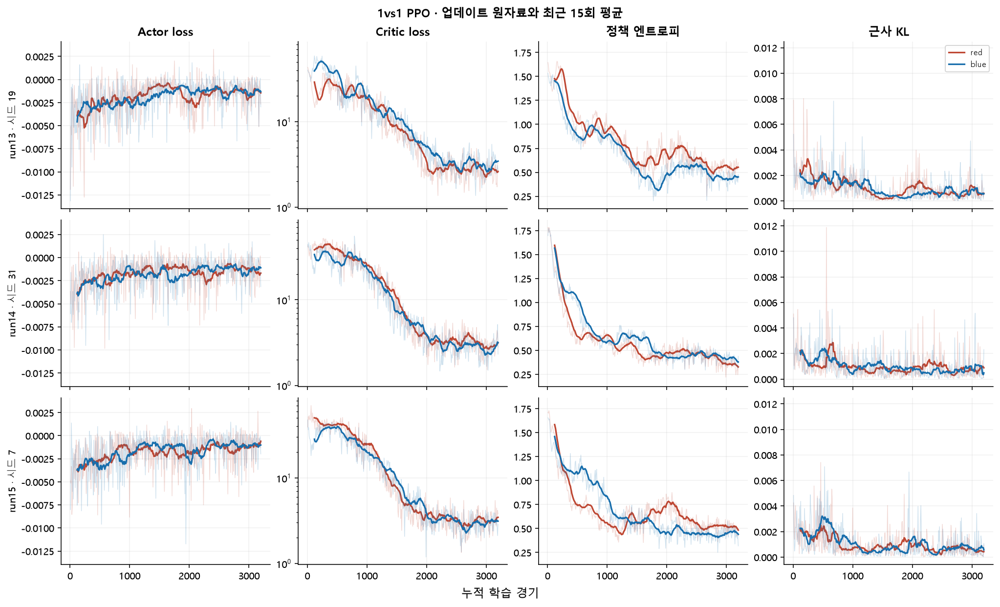
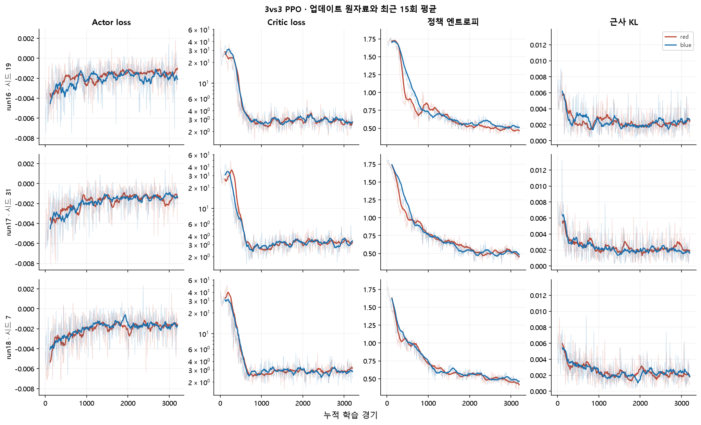
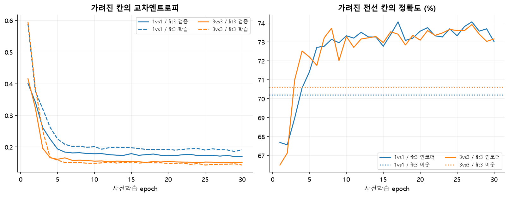
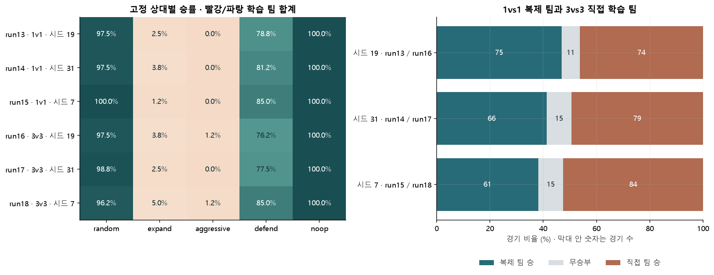

# exp3 · 업데이트 400 학습 및 3vs3 평가

평가 시드 20261120 · 학습 팀·상대 조합별 40경기 · 양 진영 절반씩. 승률은 승수/전체 경기 수입니다.

## 자기대전 학습

| 팀 인원 | 구간 | 업데이트 수 | actor_loss | critic_loss | entropy | approx_kl | 평균 보상 | 개인 점령 보상분 |
| --- | --- | --- | --- | --- | --- | --- | --- | --- |
| 1 | 처음 | 25 | -0.0037437 | 36.55 | 1.4347 | 0.0021053 | 35.80 | 3.80 |
| 1 | 마지막 | 25 | -0.0011916 | 3.0424 | 0.4473 | 0.00063492 | 46.76 | 14.76 |
| 3 | 처음 | 25 | -0.0039251 | 29.966 | 1.6366 | 0.0051032 | 34.63 | 2.63 |
| 3 | 마지막 | 25 | -0.0015257 | 2.9587 | 0.47826 | 0.0021196 | 44.34 | 12.34 |

양 팀을 동일 가중치로 평균한 구간입니다. 개인 점령 보상분은 평균 에이전트 보상에서 평균 경기 길이의 절반(점유율 보상)을 뺀 값입니다.

## 인코더 검증

| 인코더 | 최저 검증 loss epoch | 검증 loss | 전선 정확도 | 이웃 다수결 |
| --- | --- | --- | --- | --- |
| 1vs1 / fit3 | 29 | 0.1701 | 0.7369711995124817 | 0.7020233273506165 |
| 3vs3 / fit3 | 30 | 0.1502 | 0.731598973274231 | 0.7062183022499084 |

## 고정 상대

| 팀당 학습 인원 | 상대 | 경기 | 승 | 무 | 패 | 최종 격차 | 에이전트당 보상 | 승률 |
| --- | --- | --- | --- | --- | --- | --- | --- | --- |
| 1 | aggressive | 240 | 0 | 8 | 232 | -10.32 | 43.15 | 0.00% |
| 1 | defend | 240 | 196 | 12 | 32 | +10.41 | 47.95 | 81.67% |
| 1 | expand | 240 | 6 | 7 | 227 | -11.88 | 43.00 | 2.50% |
| 1 | noop | 240 | 240 | 0 | 0 | +24.32 | 60.62 | 100.00% |
| 1 | random | 240 | 236 | 2 | 2 | +14.20 | 56.85 | 98.33% |
| 3 | aggressive | 240 | 2 | 11 | 227 | -9.77 | 43.60 | 0.83% |
| 3 | defend | 240 | 191 | 19 | 30 | +11.78 | 49.03 | 79.58% |
| 3 | expand | 240 | 9 | 8 | 223 | -11.08 | 43.26 | 3.75% |
| 3 | noop | 240 | 240 | 0 | 0 | +29.98 | 12.89 | 100.00% |
| 3 | random | 240 | 234 | 5 | 1 | +13.56 | 52.73 | 97.50% |

## 맞대결 · 복제 팀 관점

| run 쌍 | 학습 시드 | 승 | 무 | 패 | 점령 격차 | 무승부 절반 점수 | 승률 |
| --- | --- | --- | --- | --- | --- | --- | --- |
| run13 / run16 | 19 | 75 | 11 | 74 | -0.17 | 50.31% | 46.88% |
| run14 / run17 | 31 | 66 | 15 | 79 | -1.20 | 45.94% | 41.25% |
| run15 / run18 | 7 | 61 | 15 | 84 | -1.23 | 42.81% | 38.12% |
| 합계 | 전체 | 202 | 41 | 237 | -0.87 | 46.35% | 42.08% |

## 원자료

| 실행 | 상대 | 경기 | 기록 |
| --- | --- | --- | --- |
| run13 | 고정 상대 | 400 | [경기별 CSV](../../../../run13/evaluation/eval1/games.csv) |
| run14 | 고정 상대 | 400 | [경기별 CSV](../../../../run14/evaluation/eval1/games.csv) |
| run15 | 고정 상대 | 400 | [경기별 CSV](../../../../run15/evaluation/eval1/games.csv) |
| run16 | 고정 상대 | 400 | [경기별 CSV](../../../../run16/evaluation/eval1/games.csv) |
| run17 | 고정 상대 | 400 | [경기별 CSV](../../../../run17/evaluation/eval1/games.csv) |
| run18 | 고정 상대 | 400 | [경기별 CSV](../../../../run18/evaluation/eval1/games.csv) |
| run13 | run16 | 160 | [경기별 CSV](../../../../comparison/eval7/games.csv) |
| run14 | run17 | 160 | [경기별 CSV](../../../../comparison/eval8/games.csv) |
| run15 | run18 | 160 | [경기별 CSV](../../../../comparison/eval9/games.csv) |

[학습 팀·실제 진영별 전체 평가표](evaluation_groups.csv)

조건 mask09_z8 · 이 실험에서 학습한 결과
