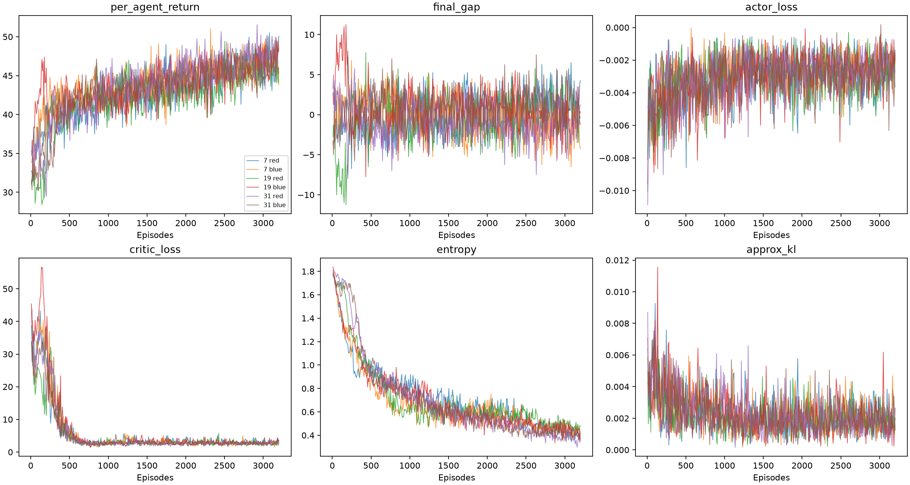
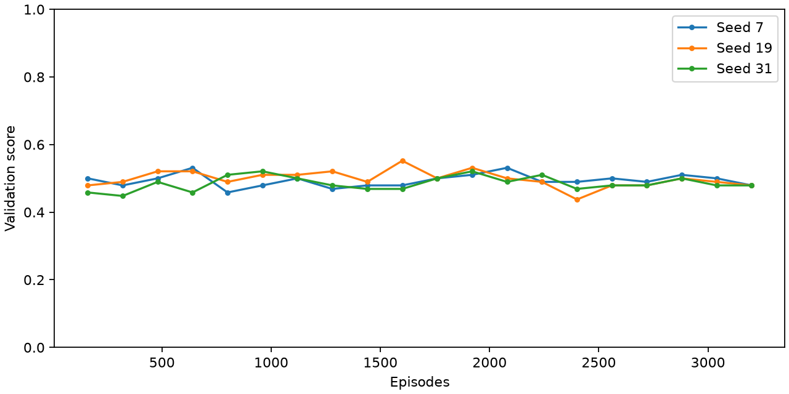

# Sequential exp1 — 순차 행동 공개와 3대3 자기대전

## Ⅰ. 측정 데이터

### 조건과 집계 단위

3×10 맵, 최대 64틱, 시드 7·19·31에서 각각 3,200경기를 진행했다. 한 팀의 세 개체는 정책을 공유하고 양 팀은 별도로 PPO를 학습했다. actor는 순번과 같은 틱에 앞선 아군이 확정한 행동을 받는다. critic은 독립 모델과 같은 입력을 사용한다. 보상은 틱 종료 후 자기 팀 점유율 + 개인 점령 기여(α=1)다.

최종 정책을 같은 시드의 exp2 raw 3대3 독립 팀 및 1대1 복제 팀과 비교했다. 시드·학습 상대당 160경기는 양 팀의 학습 정책 조합 4개 × 양 진영 합계 40경기다. 봇은 시드·상대당 80경기다. 승률의 분모에는 무승부가 포함된다.

### 학습 정책 간 맞대결 및 협력

비율 쌍은 순차 / 상대 순서다. 공동 공격률은 같은 틱·목표에 두 명 이상이 공격한 건수 / 전체 공격 목표 건수, 공동 점령률은 복수 기여 점령 / 전체 점령이다. 경기별 비율을 평균하지 않고 건수를 합산했다.

|시드|상대 (exp2)|승–무–패|승률|공동 공격률|공동 점령률|경기당 팀 사망|
|---:|---|---:|---:|---:|---:|---:|
|7|1대1 복제 run9|117–9–34|73.1%|1.27% / 1.63%|0.82% / 1.09%|16.1 / 22.0|
|7|3대3 독립 run12|67–44–49|41.9%|1.13% / 0.86%|0.80% / 0.59%|19.5 / 20.7|
|19|1대1 복제 run8|129–3–28|80.6%|1.31% / 0.70%|0.61% / 0.71%|14.4 / 23.5|
|19|3대3 독립 run11|65–34–61|40.6%|1.05% / 1.09%|0.65% / 0.71%|20.2 / 23.2|
|31|1대1 복제 run7|136–5–19|85.0%|1.38% / 0.73%|0.93% / 0.25%|13.6 / 18.6|
|31|3대3 독립 run10|63–51–46|39.4%|1.67% / 1.21%|0.62% / 0.77%|19.9 / 20.8|

### 고정 봇 상대 최종 승률

|시드|random|expand|aggressive|defend|noop|
|---:|---:|---:|---:|---:|---:|
|7|100.0%|3.8%|2.5%|91.2%|100.0%|
|19|100.0%|1.2%|1.2%|91.2%|100.0%|
|31|100.0%|3.8%|3.8%|86.2%|100.0%|

### 학습 곡선과 도달 속도

첫 320경기와 마지막 320경기의 시드별 평균 범위는 critic loss 26.50~28.38 → 2.73~2.79, 엔트로피 1.33~1.63 → 0.40~0.46, 에이전트당 비할인 보상 35.13~38.25 → 46.43~46.89였다. 최종 고정 봇 검증 점수는 세 시드 모두 47.9%였다.

아래 각 셀은 **순차 / 3대3 독립**이다. 보상은 양 학습 팀과 최근 20업데이트(160경기)에 대한 평균이 기준 이상이 된 첫 경기 수다. 검증은 160경기 간격으로 기록한 (승 + 0.5 × 무) / 검증 경기 수의 최초 도달 시점이다. 기준 40·42·44 및 검증 기준은 사후 비교용이다. 시간은 400개 업데이트의 기록 시간을 팀 간 중복 없이 합산한 값으로 검증·파일 저장 시간은 제외한다.

|시드|보상 40 (경기)|보상 42|보상 44|검증 50%|검증 52%|업데이트 누계 (분)|
|---:|---:|---:|---:|---:|---:|---:|
|7|344 / 384|928 / 776|1,720 / 1,808|160 / 800|640 / 960|15.6 / 8.5|
|19|368 / 480|880 / 936|2,216 / 1,776|480 / 320|480 / 1,600|15.4 / 9.0|
|31|496 / 368|848 / 832|1,648 / 1,680|800 / 160|960 / 160|12.9 / 9.0|

[경기별 원자료](experiment/exp1/result/evaluation1/games.csv) · [맞대결 집계](experiment/exp1/result/evaluation1/summary.csv) · [순차 학습 로그](experiment/exp1/runs/) · [독립 학습 로그](../SL-RL/experiment/exp2/)

### 후속 실험 — 같은 장면에서 행동 공개·비공개·독립 정책 비교

exp1 최종 순차 정책과 같은 시드의 exp2 raw 3대3 독립 정책이 치른 480경기(시드당 160경기)의 매 틱을 재생했다. 양 진영 각각에 대해 상태와 상대 팀의 세 행동을 고정하고 분석 대상 팀만 교체했다. 공개와 비공개는 같은 가중치를 사용한다. 비공개 조건에서는 순번과 앞선 송신자의 상태를 보존하고 이번 틱의 행동 코드만 가렸다. 장면 출처는 원래 해당 위치에 도달한 정책이다.

#### 실제 경기의 사망 단계

각 셀은 순차 / 독립이다. 공격 단계 사망은 공격 해결 후 현재 칸이 적 영토가 된 경우, 이동 단계 사망은 공격 단계를 살아남은 개체가 이동 해결 직후 적 영토 위에 있었던 경우다. 원래 경기를 재생해 사망 이벤트의 개체 ID와 단계로 집계했다.

|시드|공격 단계 사망|이동 단계 사망|전체 사망|독립 − 순차|
|---:|---:|---:|---:|---:|
|7|1,009 / 1,087|2,111 / 2,227|3,120 / 3,314|194|
|19|1,095 / 1,194|2,138 / 2,524|3,233 / 3,718|485|
|31|1,075 / 1,091|2,115 / 2,240|3,190 / 3,331|141|
|합계|3,179 / 3,372|6,364 / 6,991|9,543 / 10,363|820|

#### 동일 장면에서의 위험 노출과 협력

표 안의 세 값은 **공개 / 비공개 / 독립** 순서이고 괄호는 공통 기회 수다. 노출은 공격 가능한 적이 현재 위치에 인접한 상태다. 노출 후 사망은 해당 개체가 같은 틱에 죽은 비율이다. 구조는 아군이 생존했으나 해당 칸을 방어한 아군들의 공격만 정지로 바꿔 재실행하면 사망한 경우다. 점령–진입은 아군의 점령으로 다른 아군의 안전한 진입이 가능해진 경우, 연쇄 이동은 앞 개체가 비켜 뒤 개체가 그 칸으로 안전하게 이동한 경우다.

|시드|장면 출처|노출 / 생존 개체 1,000틱|노출 후 사망률|구조 건수 (기회)|점령–진입 건수 (기회)|연쇄 이동 건수 (기회)|
|---:|---|---:|---|---|---|---|
| 7 | 공개 | 178.3 | 19.9% / 19.9% / 20.1% | 49 / 50 / 53 (571) | 0 / 0 / 0 (1171) | 327 / 323 / 343 (7529) |
| 7 | 독립 | 181.5 | 21.8% / 21.9% / 21.1% | 38 / 36 / 72 (596) | 0 / 0 / 0 (1255) | 344 / 328 / 353 (8171) |
| 19 | 공개 | 139.2 | 27.6% / 27.4% / 29.1% | 75 / 75 / 33 (617) | 1 / 1 / 4 (990) | 392 / 385 / 420 (7853) |
| 19 | 독립 | 133.6 | 31.9% / 31.8% / 31.8% | 53 / 51 / 59 (617) | 2 / 3 / 3 (799) | 380 / 362 / 370 (7545) |
| 31 | 공개 | 165.0 | 23.0% / 23.0% / 23.5% | 70 / 70 / 60 (593) | 1 / 1 / 0 (963) | 371 / 373 / 380 (7534) |
| 31 | 독립 | 170.3 | 23.0% / 23.0% / 22.5% | 35 / 35 / 42 (585) | 0 / 0 / 0 (1188) | 298 / 306 / 352 (8004) |

**재현과 집계 이력.** 저장소 루트에서 `python -B Sequential/experiment/exp1/paired.py`를 실행한다. paired1은 짧은 검증용이다. 표에는 paired2의 시드 7과 paired3의 시드 19·31을 사용해 중복을 제외했다. 수정 전 paired2의 deaths 열은 양 팀 사망을 합산했으므로 사망 단계 표에는 사용하지 않았다. 노출·구조·점령–진입·연쇄 이동 열은 해당 오류의 영향을 받지 않았다.

[평가 코드](experiment/exp1/paired.py) · [시드 7 원자료](experiment/exp1/result/paired2/summary.csv) · [시드 19·31 원자료](experiment/exp1/result/paired3/summary.csv) · [시드 7 리플레이](experiment/exp1/result/paired2/replay.html) · [시드 19·31 리플레이](experiment/exp1/result/paired3/replay.html)

## Ⅱ. 해석

**학습 속도.** 보상 40에 처음 도달하기까지 세 시드 평균은 순차 403경기, 독립 411경기로 순차가 약 2% 빨랐다. 기준을 42로 높이면 885 대 848경기, 44에서는 1,861 대 1,755경기로 순차가 각각 약 4%, 6% 더 걸렸다. 시드 19는 초반 기준을 112경기 먼저 넘고도 44에는 440경기 늦게 도달했다. 따라서 초반의 작은 차이를 학습 전반의 가속으로 해석하기 어렵다. 검증 50% 최초 도달도 시드별 방향이 엇갈리고 이후 다시 하락했다. 최초 통과는 지속적인 성능 확보나 수렴 시점을 뜻하지 않는다.

**실행 시간.** 동일한 3,200경기의 업데이트 누계는 평균 약 14.6분 대 8.8분으로 순차가 약 1.66배 걸렸다. 같은 틱에 앞선 행동을 받아야 해서 팀원 셋의 정책 추론을 순서대로 수행하는 구조와 부합한다. 실행 시점과 시스템 부하를 통제한 벤치마크는 아니므로 전부를 순차 추론 비용으로 귀속할 수는 없다.

**승리 성능.** 복제 팀 상대는 382승 17무 81패(79.6%)로 모든 시드에서 우세했다. 이 비교에는 3대3으로 직접 학습한 효과도 포함된다. 동일 인원으로 학습한 독립 팀 상대는 195승 129무 156패로 순차 승률 40.6%, 상대 승률 32.5%, 무승부율 26.9%다. 무승부에 반 점을 주면 순차 점수는 54.1%다. 시드 19의 승패 차이는 단 4경기다. 세 학습 시드와 진영을 재사용한 평가이므로 480경기를 독립 학습 480회처럼 해석할 수 없다.

**협력과 생존.** 순차 팀은 여섯 비교 모두에서 경기당 사망이 적었지만 공동 공격·점령률의 우열은 바뀌었다. 특히 시드 7은 복제 팀보다 두 협력률이 모두 낮아도 73.1%를 이겼다. 이 결과는 생존 차이가 승패와 동반된다는 관찰을 지지한다. 행동 공개가 생존을 개선했는지, 영토 우세로 사망이 줄었는지까지는 구분하기 어렵다. 공동 목표 지표에는 목표 분담이나 길 양보도 직접 반영되지 않는다.

### 생존 차이의 위치와 원인

세 시드 모두 이동 단계에서 사망 격차가 더 컸다. 전체 차이 820건 중 627건(76.5%)이 이동 단계, 193건(23.5%)이 공격 단계에서 발생했다. 특히 시드 19는 순차 팀의 위험 노출이 더 잦았는데도(생존 개체 1,000틱당 139.2 대 133.6) 이동 단계에서 386회 덜 죽었다. 적과의 접촉을 일관되게 피했다는 설명보다 치명적인 이동 결과가 적었다는 설명이 관측에 부합한다. 이동 자체가 적었는지, 시도당 안전한 선택이 많았는지는 추가로 구분해야 한다.

### 현재 틱의 행동 공개와 협력

순차 팀이 방문한 장면의 엄호 기회 1,781건에서 공개 정책은 194명, 비공개 정책은 195명, 독립 정책은 146명을 구했다. 특히 시드 19에서는 순차 정책이 독립 정책보다 많이 구했지만(75 대 33), 행동을 가려도 75명이었다. 독립 팀이 방문한 장면에서도 순차 공개·비공개의 구조 건수는 126건과 122건이었다. 일부 장면에서 순차 정책의 엄호 능력이 더 높았으나, 현재 틱의 행동 공개가 전체 생존 격차의 주된 원인이었다는 근거는 약하다.

점령–진입은 각 장면 집합에서 조건별 성공이 0~4건에 그쳐 모델 순위를 정하기 어렵다. 연쇄 이동은 여섯 장면 집합 중 네 집합에서 공개가 비공개보다 많았고 두 집합에서는 적었다. 한 틱의 행동 가림은 학습된 정책이 그 순간 이용하는 정보의 효과를 측정한다. 학습 중 정보 공개가 정책 형성에 미친 효과나 여러 틱의 이동이 이후 위치와 위험을 바꾸는 효과까지 분리하지는 못한다.
