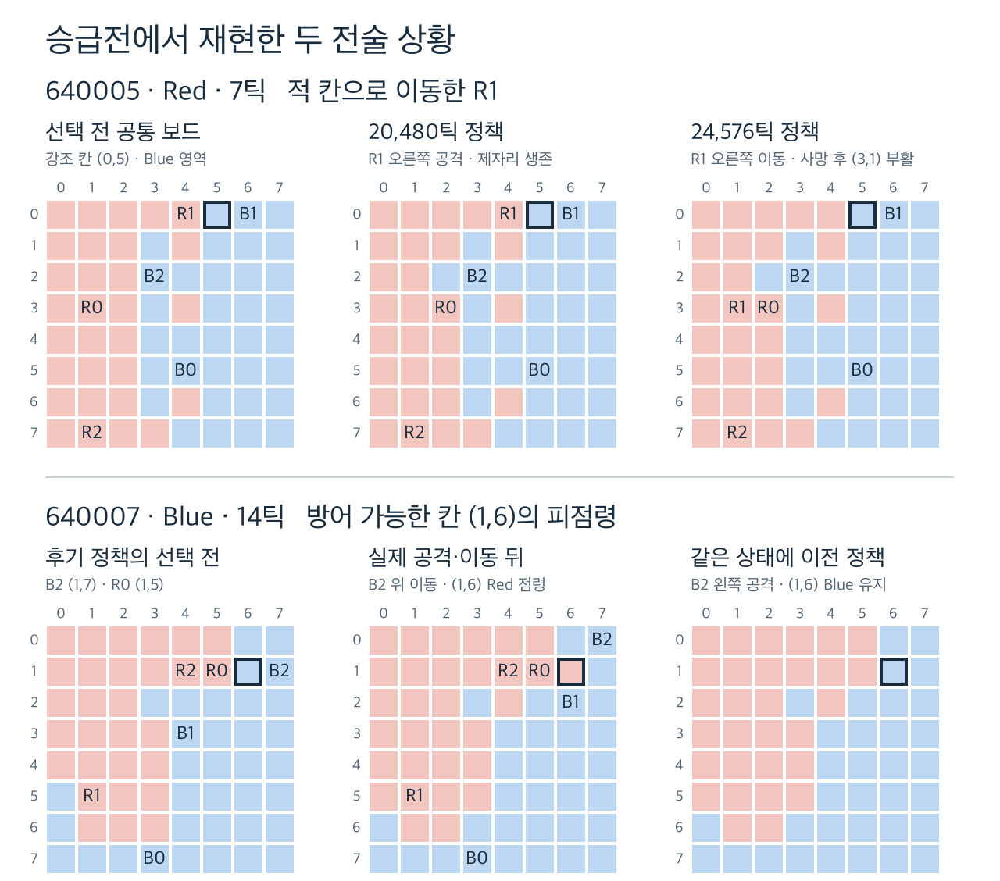
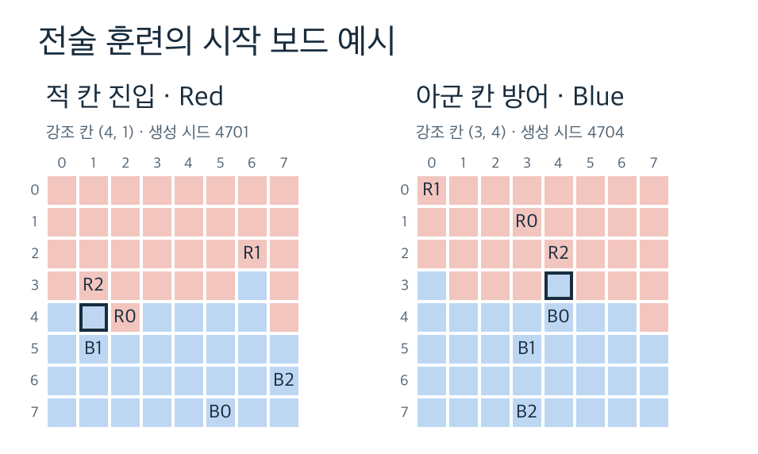
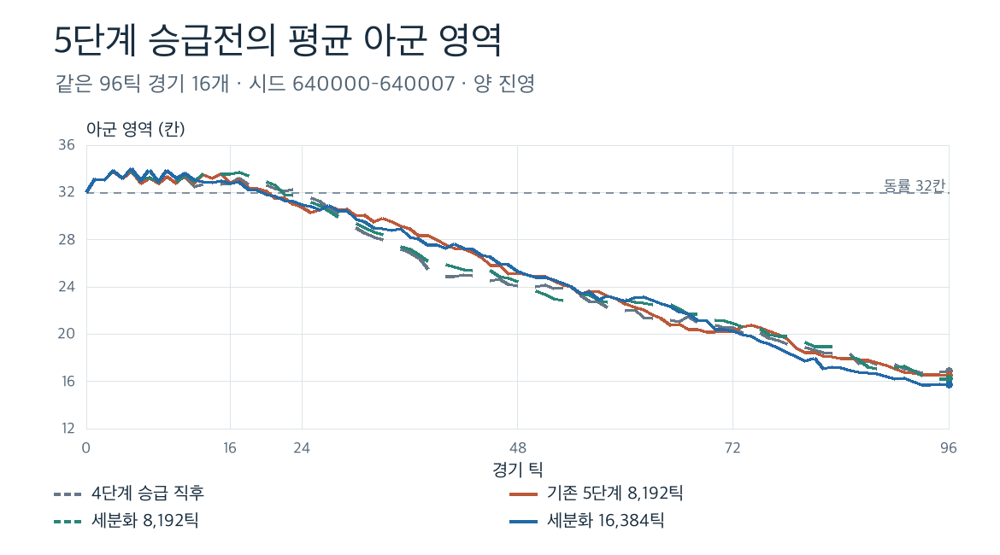

# 중앙집중형 팀 정책과 학습 프로토콜

**사전학습 전용 Qwen3.5-4B-Base를 게임에서 RL 튜닝하고, 한 모델이 매 틱 아군 세 명의 행동을 함께 제출한다.** 팀의 승패를 최적화하고, 점령과 진입을 함께 성공시킬 수 있다고 규칙으로 확인한 상황에서는 그 협력 행동을 선택하도록 한다. 검증에서 선정한 체크포인트 한 개를 고정해 후속 실험의 기준 팀으로 사용한다.

TypeSafe가 공개한 공식 Jev는 RLCD를 마친 호스팅 모델이다. RLCD 이전 공식 가중치는 공개 배포 경로에서 확인되지 않는다. 학습은 공개 사전학습 체크포인트 Qwen3.5-4B-Base에서 시작한다. 상태를 읽어 정해진 후보 집합에서 선택하는 Jev의 인터페이스를 팀 행동 선택에 적용한다. [TypeSafe 모델 문서](https://docs.typesafe.ai/models) · [Qwen3.5-4B-Base 모델 카드](https://huggingface.co/Qwen/Qwen3.5-4B-Base)

## 모델과 실행 인터페이스

기준 경기는 8×8, 최대 128틱, 전선 시작, 즉시 부활이다. 두 팀은 같은 틱 시작 상태에서 각자 행동을 정한다. 기준 팀은 아군 세 슬롯의 행동을 한 번에 결정하고, 러너가 양 팀 명령을 모아 환경을 한 번 진행한다. 환경은 `decision_strategy="independent"`로 실행하고, 아군 내 공동 결정은 모델 안에서 이루어진다. [환경 규칙과 관측 계약](../env.md)

~~~mermaid
flowchart LR
    S["틱 시작 공개 관측"] --> E["Qwen Base + LoRA"]
    S --> B["타일과 상태의 공간 인코더"]
    E --> H["팀 행동 점수 729개"]
    B --> H
    S --> M["합법 행동과 협력 제약"]
    H --> A["공동 행동 헤드"]
    M --> A
    A --> T["아군 3명 행동 동시 제출"]
~~~

| 요소 | 설계 |
| --- | --- |
| 상태 | 세 아군의 공개 `tilemap`에서 공통 보드와 생존자 좌표를 복원한다. `auxiliary`에서 공격 준비, 생존, 부활 대기, 남은 틱, 영역, 아군 행동 마스크를 읽는다. 직전 4틱의 관측 변화와 우리 팀이 제출한 행동을 같은 에피소드 안에서 유지한다. |
| 입력 표현 | 팀 슬롯 `0,1,2`를 고정하고 보드·에이전트·이력을 짧은 텍스트로 직렬화한다. 관측 회전은 0으로 고정하고 Blue는 좌우 반사해 아군이 왼쪽에서 시작하는 좌표계로 통일한다. 출력에서 이 변환을 되돌린다. 아군 번호를 섞는 증강을 할 때 보드 표기, 상태, 마스크, 행동을 함께 교환한다. |
| 인코더 | Qwen 텍스트 백본을 틱마다 한 번 순전파해 마지막 실제 토큰의 은닉 벡터를 읽고 256차원으로 투영한다. 타일·점유·쿨다운·남은 시간을 읽는 작은 CNN의 128차원 출력과 결합한다. CNN 입력은 8×10 캔버스에 패딩하며 실제 영역을 마스크로 표시한다. [Transformers의 Qwen3.5 텍스트 모델](https://huggingface.co/docs/transformers/en/model_doc/qwen3_5#transformers.Qwen3_5TextModel) |
| 공동 행동 | 각 슬롯의 인덱스 $a_i$는 0부터 8까지다. 공동 인덱스는 $81a_0+9a_1+a_2$이고 총 729개다. 상태당 한 번에 점수를 계산하고 마스크를 적용한다. 학습 중에는 공동 categorical 분포에서 하나를 샘플링하고 평가에서는 최댓값을 고른다. 사망 대기 슬롯은 환경 마스크에 따라 `NOOP`만 허용한다. |
| 출력 | 공동 인덱스를 세 인덱스로 분해해 슬롯 순서대로 돌려준다. `TerritoryParallelEnv.step`에는 관측 방향 0–8 인덱스 6개를 전달한다. 코어에 직접 제출하는 테스트에서는 실제 맵 방향 `Action` 1–9를 사용한다. [Parallel API](../territory_rl/parallel_env.py) · [행동 코드](../territory_rl/models.py) |

정책과 마스크는 틱 시작까지 공개된 정보만 사용한다. 적이 그 틱에 제출한 행동과 실제 전이는 양 팀 결정이 끝난 후 기록한다. 규칙 교사와 반사실 평가의 전이 재현에는 엔진 스냅샷을 사용한다.

## 협력을 보장하는 행동 제약

1. **환경상 합법인 조합을 만든다.** 세 `action_mask`의 곱집합을 열거한다. 점유된 칸이나 적 타일로의 이동은 그 틱에 비워지거나 점령될 수 있으므로 개별 행동 마스크에서 유지한다.
2. **아군끼리 충돌하는 이동 명령을 제거한다.** 아군 둘 이상이 같은 목적지로 이동하거나 아군 두 명이 서로의 시작 칸으로 이동하는 조합을 제거한다. 빈 칸으로 이어지는 연쇄 이동은 허용한다. 이 단계까지는 `(NOOP, NOOP, NOOP)`가 항상 후보에 있다.
3. **점령과 진입을 보장할 수 있으면 공동 행동을 요구한다.** 아래 조건을 만족하는 조합이 하나 이상 있으면 그런 조합 전체를 후보로 삼고 모델이 그중 하나를 고른다. 조건을 만족하는 조합이 없으면 2단계 후보에서 선택한다.

점령과 진입 제약은 공개 상태와 행동 조합으로 계산한다. 대상은 비어 있는 적 타일이며 시작 시점에 인접한 적이 없다. 한 아군이 그 칸으로 이동하고 다른 아군 정확히 한 명이 그 칸을 공격한다. 진입자와 점령자의 시작 칸 각각에 대해, 그 칸을 공격하는 아군의 수가 인접한 공격 가능 적의 수 이상이어야 한다. 남은 아군은 필요할 때 시작 칸을 엄호할 수 있다.

적은 대상 칸에 그 틱에 공격하거나 이동할 수 없다. 아군 시작 칸은 공격 수가 동률이어도 소유권을 유지한다. 점령이 이동 전에 적용되므로 진입자는 안전하게 도착하고, 점령 공격을 `NOOP`으로 바꾸면 진입자는 그 칸에서 생존할 수 없다. 이 보장은 조건을 만족하는 상태에서 성립한다. 방어 돌파, 위험한 아군 엄호, 교대와 역할 전환은 경기 및 장면 평가로 성공 여부를 확인한다. [공격 판정](../territory_rl/attack.py) · [동시 이동](../territory_rl/movement.py) · [틱 처리 순서](../territory_rl/environment.py)

### 엔진에서 확인한 예

8×8 기본 좌우 영역 분할에서 `(2,4)`를 Red, `(4,3)`을 Blue 소유로 바꾼다. 틱 0에 모두 공격할 수 있으며 리셋 시드는 7이다. Red의 `(3,3)`은 오른쪽 `(3,4)`로 이동한다. `(2,4)`는 아래쪽을 공격해 목표를 점령하고, `(3,2)`는 오른쪽을 공격해 진입자의 시작 칸을 엄호한다. 적은 `(4,3)`, `(1,6)`, `(6,5)`에 있으며 첫 번째 적은 진입자의 시작 칸을 공격할 수 있다. 좌우와 색을 바꾼 시작 상태에서도 검증했다.

| 개입 | Red | Blue |
| --- | ---: | ---: |
| 상대 합법 조합 전체에서 안전한 점령 후 진입 | 729/729 | 729/729 |
| 점령 공격을 정지로 바꿨을 때 안전한 진입 실패 | 729/729 | 729/729 |
| 적이 진입자 시작 칸을 공격하는 경우에 엄호를 정지로 바꿨을 때 안전한 진입 실패 | 81/81 | 81/81 |

기본 설정에서 Red `expand`가 `expand`, `aggressive`, `defend`와 각 16경기를 치른 예비 점검에서 조건을 충족한 틱은 각각 112/2,048, 122/2,048, 58/1,763이었다. 환경 시드는 `590000–590015`이며, 봇은 Red부터 Blue까지 ID순으로 `10 × 환경 시드 + 슬롯 번호(0–5)`를 썼다. 본 실험에서도 조건 충족 틱의 빈도, 그 틱에서의 성공률, 전체 경기의 협력 장면 성공률을 각각 기록한다.

## 학습 프로토콜

예산의 기본 단위는 **실제 환경 전이 1틱 = 아군 공동 행동 1개**다. 100만 환경 틱은 정지를 포함한 300만 슬롯 행동에 해당한다. 규칙 교사의 가상 전이, 검증 경기, 상대 모델 순전파, GPU 시간은 각각 기록한다. 아래 수치는 파일럿 시작 설정이다.

| 단계 | 실행과 예산 |
| --- | --- |
| 0. 환경과 상대 풀 확인 | 행동 인덱스 729개 왕복, Red/Blue 반사, 사망 대기, 이동 충돌, 공격 쿨다운, 종료, 규칙 제약을 검증한다. CPU에서 경량 CNN 공동 정책으로 상대 구성을 비교한다. CUDA에서는 Qwen 로딩과 LoRA 업데이트를 작은 배치로 확인한다. |
| 1. 규칙 교사로 초기화 | 훈련 시드당 5만 환경 틱을 수집한다. 리셋은 일반 경기 80%, 훈련용 전술 초기 상태 20%다. 공개 상태에서 예측한 적 행동 최대 4개를 공통으로 적용해 합법 후보를 최대 64개씩 비교한다. Qwen 백본을 동결하고 공간 인코더와 학습용 공동 행동 헤드를 교사의 후보 순위로 초기화한다. 네 알고리즘은 이 초기 가중치에서 각각 시작한다. |
| 2. RL 튜닝 | PPO를 첫 기준으로 실행하고 GRPO, DAPO, SDPO를 비교한다. 시드 7에서 누적 10만 환경 틱으로 비교하고, 상위 두 방법을 시드 19와 31에서도 같은 예산으로 재확인한다. 검증으로 고른 방법은 세 시드 모두 누적 100만 틱까지 학습한다. 공통 상대 풀을 쓰고 리셋 10%는 훈련용 전술 초기 상태에서 시작한다. Qwen 상위 8개 블록의 MLP 투영층을 LoRA로 튜닝하고 공간 인코더와 행동 헤드를 함께 학습한다. |
| 3. 최종 행동 헤드 | RL에 사용한 헤드의 가중치를 배포용 공동 행동 헤드로 옮긴다. 마스크를 적용한 729개 점수에서 하나를 골라 세 행동 인덱스를 직접 출력한다. 같은 입력과 마스크에서 학습용 정책과 평가 출력이 일치하는지 검사한다. 백본 리비전, LoRA, 공간 인코더, 행동 헤드를 하나의 정책으로 묶는다. |

규칙 교사는 실제 공격·이동 엔진을 사용하고 부활 전에 결과를 읽는다. 적 행동 가설은 `random`과 `expand`에서 공개 상태를 바탕으로 각 두 개를 샘플링한다. 예측과 실제 상대는 서로 다른 난수 스트림을 쓴다. 아군 후보는 규칙 기반으로 고른 조합과 균등 표본을 섞어 중복을 제거한다. 후보 점수는 적 행동 가설에 대한 평균 `영역 격차 변화 + 0.03 × (적 사망 수 − 아군 사망 수) + 0.01 × (아군의 정규화 전선 거리 감소)`로 시작한다. 전선 거리는 생존 아군이 자기 영역을 따라 인접 적 타일이 있는 아군 칸까지 가는 평균 최단 거리다. 보드 높이와 너비의 합으로 나눈 후 1에서 자르고, 도달 불가나 생존자 0명은 거리 1로 둔다. 교사 분포는 채점한 후보에서 softmax를 취하고, 학생 분포는 전체 허용 후보에서 정규화해 교차 엔트로피로 초기화한다. 평가할 때도 규칙 교사의 후보 생성과 점수식을 고정한다.

### 대전 상대와 데이터 품질

상대 풀은 경기에서 만나는 전술을 결정한다. 과거 정책이 아군 엄호, 집중 공격, 진입 시점을 바꿨을 때 결과가 달라지는 상태를 만들어 낸다면 학습에 쓸 가치가 있다. 같은 정책 계열의 최신 체크포인트만 반복하면 비슷한 전술에 적응할 수 있다. 학습된 Double DQN 팀이 있다면 과거 정책 후보 중 하나로 같은 기준을 적용한다. [정책 혼합과 상대 과적합에 관한 연구](https://arxiv.org/abs/1711.00832)

경량 CNN 공동 정책과 PPO를 고정한 CPU 파일럿에서 상대 구성만 바꾼다. 규칙 팀만 쓴 학습 조건은 `random` 10%, `expand` 30%, 훈련용 협력 규칙 팀 60%로 시작한다. 혼합 조건의 시작 비율은 각각 10%, 30%, 20%이고, 나머지 40%는 미리 동결한 과거 정책을 쓴다. 과거 정책은 규칙 팀과 학습한 경량 정책의 여러 시점에서 가져온다. 에피소드마다 상대를 추출한 후 끝까지 고정한다.

같은 초기 가중치, 학습 틱 수, 검증 상대·시드·진영으로 경기 점수와 일곱 장면 성과를 비교한다. 학습 중에는 상대별 협력 기회 수를 1,000틱당 기록하고, 같은 틱의 상대 행동을 고정한 재판정에서 필요한 아군 행동을 뺐을 때 성과가 달라진 횟수를 센다. 혼합 조건이 별도 검증 상대에서 경기 점수를 올리고 고정 협력 장면의 평균 성공률을 유지하면 Qwen 비교에도 그 풀을 사용한다. 동일한 상대 풀과 추출 비율을 네 방법에 적용한다.

### 팀 보상과 RL 업데이트

팀 영역 격차를 $d(s)=(A_{\mathrm{ours}}-A_{\mathrm{theirs}})/(HW)$로 정규화한다. 승리 +1, 무승부 0, 패배 −1을 실제 경기 종료에 한 번 부여한다. 중간에는 영역 격차에 potential-based shaping을 적용한다. $\Phi(s)=d(s)$이고 실제 종료 상태에서는 $\Phi(s)=0$이다.

$$
r_t = \mathbf{1}_{\mathrm{done}}\, \operatorname{sign}(d(s_{t+1}))
      + 0.25 \bigl(0.995\, \Phi(s_{t+1})-\Phi(s_t)\bigr)
$$

이 값을 공동 전이당 한 번 기록한다. PPO는 틱별 보상, GRPO와 DAPO는 에피소드의 할인 누적 보상을 쓴다. SDPO의 교사 입력은 규칙 엔진의 전술 피드백이다. 협력 사건은 모든 조건에서 같은 방식으로 집계한다. 최대 128틱 도달과 팀 탈락을 실제 종료로 처리한다. PPO에서 수집 배치를 자를 때는 다음 상태의 가치를 부트스트랩한다. [환경의 종료·승패 판정](../territory_rl/reward.py) · [Potential-based reward shaping](https://people.eecs.berkeley.edu/~pabbeel/cs287-fa09/readings/NgHaradaRussell-shaping-ICML1999.pdf)

학습용 헤드는 3개 슬롯의 점수, 3개 에이전트 쌍의 상호작용 점수, 729개 조합별 잔차를 합산한다. 롤아웃에는 정책 버전, 공개 상태, 공동 마스크, 선택한 공동 행동, 해당 행동의 로그 확률, 보상, 종료, 상대 버전을 저장한다. PPO·GRPO·DAPO의 확률비는 같은 마스크에서 공동 행동 하나의 로그 확률로 계산한다. 매 학습 배치는 동결한 수집 정책으로 생성한다.

| 방법 | 게임에서 적용하는 방식 |
| --- | --- |
| **PPO** | 같은 팀 인코더에 스칼라 가치 헤드 하나를 두고 틱별 GAE로 학습한다. 128틱 경기에서 엄호나 길 열기의 가치를 개별 결정에 배분하는 첫 기준이다. 학습은 GAE λ 0.95, clip 0.2, 미니배치 2 epoch에서 시작한다. [PPO](https://arxiv.org/abs/1707.06347) · [GAE](https://arxiv.org/abs/1506.02438) |
| **GRPO** | 같은 시작 상태와 상대 체크포인트·RNG 시드에서 아군 샘플링 시드만 바꿔 완결 경기 4개를 수집한다. 네 경기의 누적 보상을 그룹 안에서 정규화하고, 각 경기의 advantage를 그 경기의 공동 결정들에 쓴다. rollout별로 유효 결정의 손실을 평균한다. 초기 clip은 0.2, 초기화 정책에 대한 KL 계수는 0.01이다. [DeepSeekMath](https://arxiv.org/abs/2402.03300) |
| **DAPO 변형** | GRPO의 그룹 수집으로 시작해 clip 하단 0.20·상단 0.28과 KL 계수 0을 쓴다. 수익 표준편차가 `1e-6` 이하인 그룹을 건너뛰고, 허용 행동이 두 개 이상인 틱의 손실을 배치 전체에서 평균한다. 버린 그룹의 틱과 추가 추론도 예산에 포함한다. 128틱은 승패를 정하는 게임 종료이며 그대로 채점한다. [DAPO](https://arxiv.org/abs/2503.14476) |
| **SDPO 변형** | 현재 정책의 EMA 사본에 같은 틱의 관측과 엔진 피드백을 넣는다. 피드백은 방어 동률, 진입 전 사망, 이동 충돌처럼 실행된 행동의 결과를 설명한다. 학생은 배포 때와 같은 틱 시작 관측을 받고, 같은 공동 마스크에서 교사의 행동 분포를 Jensen–Shannon 손실로 증류받는다. 한 수집 배치 안에서 교사 출력을 고정하며, 교사가 규칙으로 검증한 대안에 확률을 더 주는지 훈련용 고정 장면에서 확인한다. [SDPO](https://arxiv.org/abs/2601.20802) |

### 그룹 보상 예비 점검

종료 상태의 potential을 0으로 두었으므로, 총 $T$틱을 진행한 경기의 할인 누적 보상은 $0.995^{T-1}z - 0.25\Phi(s_0)$다. $z$는 승·무·패이고, 같은 시작 상태에서는 shaping 항이 같은 상수로 합쳐진다. 시작 상태와 종료 틱, 승패가 같으면 그룹 advantage가 0이다. 종료 시점만 달라져 수익이 갈리는 경우도 있으므로 승·무·패 혼합률과 수익 분산을 함께 기록한다.

기본 8×8 엔진에서 Red `expand`에 15% 슬롯별 무작위 탐색을 넣고, 상대별 시작 상태 12개를 네 번씩 실행했다. 환경 시드는 `591000–591011`이며 상대 봇의 시드는 그룹 안에서 고정했다.

| 상대 | 승·무·패가 섞인 그룹 | 할인 누적 보상에 차이가 있는 그룹 | Red 전적 |
| --- | ---: | ---: | ---: |
| `expand` | 0/12 | 0/12 | 0승 0무 48패 |
| `aggressive` | 0/12 | 0/12 | 0승 0무 48패 |
| `defend` | 1/12 | 4/12 | 47승 0무 1패 |

이 점검은 규칙 팀으로 총 144경기를 실행했다. Qwen 파일럿에서는 상대별 수익 분산, 그룹 채택률, 채택된 공동 결정당 환경 틱, 검증 점수를 기록한다. DAPO의 추가 수집은 파일럿 예산 안에서 끝낸다. 그룹 채택률이 낮으면 훈련용 상대 강도와 초기 전술 상태의 분포를 조정하고 PPO와 다시 비교한다.

### GPU 환경과 실험 예산

게임 엔진, 규칙 교사, 경량 CNN의 상대 풀 비교는 CPU에서 실행할 수 있다. Qwen3.5-4B-Base의 첫 CUDA 파일럿은 이미 대여한 A100에서 진행한다. `nvidia-smi -L`과 PyTorch의 CUDA 장치 정보로 실제 할당된 VRAM과 가속기 프로필을 확인한다. 40억 개 BF16 가중치는 약 8 GB이며 활성값과 학습 상태는 추가 메모리를 쓴다. BF16 LoRA는 마이크로배치 1과 gradient accumulation으로 시작하고, 할당 메모리 안에서 롤아웃 배치를 늘린다. 메모리가 부족하면 모든 비교 조건을 동일한 4-bit QLoRA 구성에서 실행할 수 있는지 확인한다. [NVIDIA A100](https://www.nvidia.com/en-us/data-center/a100/) · [Qwen 모델 카드](https://huggingface.co/Qwen/Qwen3.5-4B-Base) · [Transformers의 QLoRA 문서](https://huggingface.co/docs/transformers/en/quantization/bitsandbytes)

순전파는 여러 CPU 환경의 관측을 모아 배치로 실행한다. 기준 정책, 수집 정책, 상대, SDPO 교사가 Qwen을 쓸 경우 동결된 베이스를 공유하고 각자의 LoRA·공간 인코더·헤드 가중치를 사용한다. GPU 파일럿에서 1,024틱의 롤아웃과 첫 업데이트를 실행해 최대 VRAM, 초당 환경 틱, 업데이트 시간, 교사 및 상대 순전파 횟수를 재고 본학습 시간을 추정한다.

#### 대여 A100에서 확인한 사전 테스트

2026-11-20에 20GiB A100 vGPU와 PyTorch 2.6.0/CUDA 12.4에서 Qwen3.5-4B-Base 리비전 `1001bb4d826a52d1f399e183466143f4da7b741b`를 검증했다. 146토큰 보드 입력 한 건과 729개 행동의 테스트 헤드로 LoRA 역전파 및 AdamW 업데이트를 한 번 실행했다. 텍스트 백본의 마지막 8개 블록에서 MLP 투영층 16개를 튜닝했다.

| 구성 | 최대 예약 VRAM | 첫 업데이트 시간 | 배치 4 순전파 |
| --- | ---: | ---: | ---: |
| BF16 LoRA | 8.63GiB | 1.43초 | 초당 10.24개 관측 |
| NF4 QLoRA · BF16 연산 | 8.01GiB | 1.39초 | 초당 7.87개 관측 |

로드된 NVIDIA 커널 모듈은 `550.90.07`이고 기본 NVML 라이브러리는 `580.178.04`였다. 테스트 프로세스는 커널과 같은 버전의 기존 라이브러리를 별도 경로에서 불러왔다. 가중치는 `/dev/shm`에 임시 저장했다. 순전파는 PyTorch 기본 구현과 하나의 보드 입력을 사용했다. 본학습 처리량은 환경 롤아웃과 PPO 업데이트를 합친 파일럿에서 측정한다.

초기 최적화 설정은 AdamW, 헤드·공간 인코더 학습률 `3e-4`, LoRA `1e-5`, rank 16, alpha 32, gradient norm clip 1.0이다. 검증은 누적 5만 틱마다 진행한다. 알고리즘별 동일한 총 환경 틱에서 검증 점수와 협력 장면 성적을 비교하고 GPU 시간도 기록한다. 규칙 교사 초기화와 온라인 학습의 환경 틱은 따로 집계한다.

## 평가 및 기준 팀 선정

**경기 점수**는 `(승 + 0.5 × 무승부) / 총 경기 수`로 계산한다. 순수 승률과 최종 정규화 영역 격차도 함께 공개한다. 검증은 시드 `610000–610015`에서 `random`, `expand`, 학습에 쓰지 않는 협력 규칙 팀의 검증용 변형을 상대로 Red/Blue 한 경기씩 치른다. 이 검증 상대는 모든 체크포인트에 동일하다. LoRA를 학습했고 엔진 제약을 통과한 모델 중 경기 점수가 가장 높은 체크포인트를 선택한다. 동률이면 평균 영역 격차, 더 이른 체크포인트, 더 작은 학습 시드 순으로 고른다.

**최종 경기**는 시드 `620000–620063`으로 동일 시드에서 양 진영으로 진행한다. 기준 점수는 8×8 즉시 부활에서 `aggressive`, `defend`, 사전에 고정한 협력형 규칙 팀을 상대별로 채점한 후 평균한다. 최종 협력형 상대는 훈련 교사와 다른 정책으로 동결한다. `random`·`expand` 전적과 3×10 및 무부활 변형은 별도로 기록한다. 3×10에서 관측 창은 엔진 규격에 맞춰 19×19로 늘린다. 비교는 상대·시드·진영을 맞추고, 시드의 Red/Blue 경기 쌍을 함께 재표집해 95% 신뢰구간을 구한다. 세 학습 시드의 결과를 모두 남긴다.

**협력 평가**는 기존 일곱 장면의 성공·기회 건수를 기록한다. 집중 공격, 위험한 아군 엄호, 점령 후 진입, 연쇄 이동, 공격 목표 분담, 쿨다운 교대, 역할 분담과 전환을 본다. 자연 경기 집계에 더해 장면당 64개의 고정 초기 조건을 양 진영으로 평가한다. 고정 장면은 상대가 쓸 규칙이나 행동열을 미리 지정하고, 실제 엔진으로 성공 가능한 조합을 확인한다. 필요한 아군 행동만 정지 또는 해당 장면의 대체 행동으로 바꾸고, 동일한 틱 시작 상태와 상대 명령으로 다시 판정한다. 교대와 역할 전환은 여러 틱에 걸친 판정을 쓴다. 부활 전 사건으로 생존·이동을 확인한다. 중앙 정책의 이동 양보는 확정 명령으로 연쇄 이동을 평가한다. 1차 제안 충돌과 기회 0건의 비율은 N/A로 남긴다. [협력 장면과 집계 코드](../team_policy/cooperation_scenes.py)

| 비교 | 해석 |
| --- | --- |
| 규칙 교사와 RL 전 모델 | 규칙 기반 선택과 초기 교사 학습 대비 RL이 올린 경기 점수 |
| 같은 체크포인트에서 점령·진입 제약 켬과 끔 | 제약이 만든 협력과 경기 점수 변화. 아군 충돌 제거는 양쪽에 적용 |
| 점령·진입 제약 없이 각각 학습한 공동 점수 모델과 슬롯별 점수 모델 | 같은 공개 입력, 보상, 샘플 예산, 고정 상대 풀에서 에이전트 쌍·공동 점수 경로가 만든 차이 |
| 같은 구조의 CNN 전용 공동 점수 모델 | 같은 환경 틱·제약에서 Qwen 백본을 추가했을 때 경기 점수와 틱당 추론 시간이 달라지는 정도 |

기준 팀 후보는 금지 행동 제출 0건, 아군의 동일 목적지·두 명 자리 교환 명령 0건, 조건을 충족하는 고정 점령·진입 장면 성공 100%를 충족해야 한다. 학습된 협력의 증거는 점령·진입 제약 없이 학습한 공동 점수 모델과 슬롯별 점수 모델의 쌍별 차이다. 고정 장면별 성공률의 평균 차이를 구하고, 장면 내 배치 쌍으로 재표집한 95% 신뢰구간의 하한이 0을 넘으면 개선으로 판정한다. 테스트에서 가장 강한 모델이라는 결론은 규칙 교사와 RL 전 모델을 포함한 비교군을 최종 경기 점수로 앞설 때 내린다.

후속 실험에서는 선정한 체크포인트와 환경 설정을 고정한다. 비교할 각 정책을 기준 팀과 같은 시드의 Red/Blue 양 진영으로 대전시키고, 환경 로그에서 상대전적과 협력 사건을 계산한다.

## 파일럿 구현과 재현

중앙 정책은 `python -m team_policy train`과 `python -m team_policy evaluate`로 실행한다. 게임 전이는 `TerritoryParallelEnv.step`을 쓰고, 공동 행동 평가에는 기존 일곱 장면 집계를 연결했다. 평가 행동은 공동 행동 헤드의 점수로 정하고, 스칼라 가치 헤드는 PPO에서 사용한다. 체크포인트에는 모델 리비전, 학습 가능한 가중치, 옵티마이저와 실행 설정을 저장한다. [정책](../team_policy/policy.py) · [경기 러너](../team_policy/match.py) · [학습·평가](../team_policy/experiment.py)

| 파일럿 | 실행 설정 |
| --- | --- |
| Qwen CUDA | 학습 시드 7, BF16 LoRA, 교사 데이터 256틱·2 epoch, 온라인 PPO 1,024틱·2 epoch. 병렬 환경 8개, 추론 배치 4, PPO 미니배치 32, 마이크로배치 4. 수집 상대는 `random`, `expand`, `aggressive`, `defend`를 같은 확률로 추출했다. |
| CNN 상대 풀 | 공통 초기화는 시드 41에서 규칙 교사 4,096틱·3 epoch로 만들었다. 비교 조건마다 시드 7, 19, 31에서 온라인 PPO 16,384틱을 실행했다. 조건별로 한 정책이 아군 세 명을 제어하며 점령·진입 제약을 적용했다. |
| 엔진 검증 | Red와 Blue 각각 729개 합법 상대 조합에서 점령·진입을 판정했다. 점령 공격을 제외한 729개 경우와 상대가 진입자의 시작 칸을 공격할 때 엄호를 제외한 81개 경우도 확인했다. |

게임 의존성은 `pip install -e .`로 설치한다. 필요한 PyTorch와 Qwen 의존성 버전은 [요구 사항 파일](../team_policy/requirements.txt)에 기록했다. CUDA에서 실행한 파일럿의 명령은 아래와 같다. 모델 리비전은 코드에 고정되어 있으며 로컬 캐시를 쓰려면 해당 스냅샷 디렉터리를 `--base`로 전달한다.

```bash
python -m team_policy train --device cuda:0 --backbone bf16 \
  --warmup-ticks 256 --ticks 1024 --eval-pairs 1 \
  --output runs/team_policy/qwen-bf16-s7
```

### A100 PPO 파일럿 결과

2026-11-21에 엔진 `d0dc7c22fce1f1bf8050759a4d1e96f11ff2a9f6`과 20GiB A100 vGPU에서 실행했다. 교사 초기화는 256틱에서 62,536개 가상 전이를 채점했다. 매 epoch의 평균 교차 엔트로피는 5.337에서 5.277로 내려갔다. PPO는 1,024틱을 수집해 옵티마이저를 64회 업데이트했다. 모델 입력은 평균 265토큰, 최대 338토큰이었다. 수집한 8개 완결 경기의 성적은 4승 4패였고, 승리한 4경기의 상대는 모두 `random`이었다. 점령·진입 보장 조건이 성립한 수집 틱에서 20회 모두 엔진에서 점령과 안전한 진입을 확인했다. [실행 로그](../runs/team_policy/qwen-bf16-s7/metrics.jsonl)

| 평가 지표 | 교사 초기화 직후 | 기본 학습률 PPO 직후 | 1/4 학습률 PPO 직후 |
| --- | ---: | ---: | ---: |
| `expand` 상대 승·무·패 | 0·0·2 | 0·0·2 | 0·0·2 |
| 평균 정규화 영역 격차 | −0.828 | −0.953 | −0.922 |
| 자연 경기의 보장 조건 충족 틱 성공 | 12/12 | 8/8 | 5/5 |
| 고정 장면에서 점령·진입, 제약 켬 | 2/2 | 2/2 | 2/2 |
| 고정 장면에서 점령·진입, 제약 끔 | 0/2 | 0/2 | 0/2 |

평가는 시드 `610000`의 Red와 Blue 한 경기씩 진행했다. 고정 장면은 같은 초기 배치를 두 진영으로 사용했다. 이 실험에서 확인한 협력 성과는 행동 제약이 적용된 경우다. 일반적인 점령·진입 기회는 일곱 장면 집계에서 더 넓게 정의하며 별도 분모를 쓴다. [기본 학습률 체크포인트](../runs/team_policy/qwen-bf16-s7/ppo.pt)

| 지표 | 기본 학습률 | 1/4 학습률 및 활성값 재계산 |
| --- | ---: | ---: |
| 헤드 · LoRA 학습률 | `3e-4` · `1e-5` | `7.5e-5` · `2.5e-6` |
| PPO 롤아웃과 다음 상태 가치 추정 | 76.5초 · 13.38틱/초 | 89.7초 · 11.42틱/초 |
| PPO 업데이트 64회 | 267.7초 | 404.9초 |
| 온라인 PPO 합계 | 344.3초 · 2.97틱/초 | 494.7초 · 2.07틱/초 |
| 최대 예약 VRAM | 13.31GiB | 9.04GiB |
| PPO 확률비 클리핑 범위 이탈률 | 77.9% | 42.4% |
| 평균 근사 KL | 0.259 | 0.032 |

1/4 학습률은 같은 교사 초기화 가중치와 학습 시드에서 시작했다. 두 수집의 완결 경기 8개, 보장 조건 충족 20틱, 토큰 길이 집계가 일치했다. 공유 GPU의 여유가 줄어 메모리 오류가 발생했고, LoRA가 적용된 텍스트 블록 8개의 활성값을 역전파 때 재계산해 배치 32와 마이크로배치 4를 유지했다. 저장한 체크포인트를 다시 불러와 평가했다. 다음 PPO 파일럿에는 1/4 학습률을 시작점으로 적용한다. [학습률 비교 실행 로그](../runs/team_policy/qwen-bf16-lr-quarter-s7/metrics.jsonl) · [평가 로그](../runs/team_policy/qwen-bf16-lr-quarter-s7/eval.json) · [체크포인트](../runs/team_policy/qwen-bf16-lr-quarter-s7/ppo.pt)

실측 속도에서 온라인 10만 틱은 약 9.3–13.4시간, 100만 틱은 약 93–134시간이다. 설계한 비교 예산은 첫 시드의 네 방법 40만 틱, 상위 두 방법의 추가 두 시드 40만 틱, 선정 방법의 연장 학습 270만 틱으로 온라인 총 350만 틱이다. 초기화 15만 틱과 검증 70회, 최종 상대 세 팀에 대한 세 체크포인트 평가를 모두 게임 제한 틱으로 잡으면 순전파 약 116만 틱이다. 두 파일럿의 PPO 및 순전파 속도로 환산한 주요 비교의 합계는 약 **351–498 GPU시간**이다. GRPO·DAPO·SDPO의 추가 수집과 교사 추론, 변형 맵 및 통제군 비용은 별도 측정 항목이다.

```bash
python -m team_policy train --device cuda:0 --backbone bf16 \
  --initialize runs/team_policy/qwen-bf16-s7/warmup.pt --warmup-ticks 0 \
  --ticks 1024 --head-lr 0.000075 --lora-lr 0.0000025 --activation-checkpointing \
  --output runs/team_policy/qwen-bf16-lr-quarter-rerun
python -m team_policy evaluate runs/team_policy/qwen-bf16-lr-quarter-rerun/ppo.pt \
  --device cuda:0 --eval-pairs 1
```

### CPU 상대 풀 비교 결과

세 학습 시드 모두 시드 41의 동일한 CNN 초기 가중치를 썼다. 규칙 풀은 `random` 10%, `expand` 30%, `cooperative` 60%를 에피소드 단위로 추출했다. 혼합 풀은 앞의 세 상대를 10%, 30%, 20%로 두고 규칙 풀에서 학습한 2,048틱과 8,192틱 CNN 스냅샷을 각각 20%로 사용했다. 검증은 학습과 다른 환경 시드 `610000–610007`에서 `expand`, `aggressive`, 엄호 가중치를 높인 `cooperative_holdout`에 대해 양 진영으로 진행했다. [공통 초기 가중치](../runs/team_policy/cnn-history-s41/warmup.pt)

| 정책 | 경기 수 | 승·무·패 | 경기 점수 | 평균 정규화 영역 격차 |
| --- | ---: | ---: | ---: | ---: |
| 규칙 교사 | 48 | 36·4·8 | 79.2% | +0.120 |
| 교사 초기화 후 CNN | 48 | 0·0·48 | 0.0% | −0.885 |
| 규칙 풀 PPO CNN | 144 | 0·0·144 | 0.0% | −0.848 |
| 혼합 풀 PPO CNN | 144 | 0·0·144 | 0.0% | −0.882 |

규칙 교사는 `expand`에 15승 1패, `aggressive`에 13승 3무, `cooperative_holdout`에 8승 1무 7패를 기록했다. 가상 전이는 경기 시드에 900,000을 더한 교사 난수 시드로 재현한다. [규칙 교사 검증 로그](../runs/team_policy/teacher-eval.json)

혼합 풀에서 저장된 CNN 상대는 실제 수집 틱의 45.3%를 차지했다. 이 상대들과의 점령·진입 보장 기회는 1,000틱당 7.6개였다. 규칙 풀의 `expand`와 `cooperative`에서는 각각 65.9개와 65.8개였다. 혼합 풀의 경기 점수와 영역 격차를 기준으로 다음 Qwen 실험의 비교 상대는 규칙 풀로 유지한다. Double DQN 체크포인트가 준비되면 같은 규격으로 대전 데이터와 기회 빈도를 측정한다. [규칙 풀 시드 7](../runs/team_policy/cnn-rules-s7/eval.json) · [시드 19](../runs/team_policy/cnn-rules-s19/eval.json) · [시드 31](../runs/team_policy/cnn-rules-s31/eval.json) · [혼합 풀 시드 7](../runs/team_policy/cnn-mixed-s7/eval.json) · [시드 19](../runs/team_policy/cnn-mixed-s19/eval.json) · [시드 31](../runs/team_policy/cnn-mixed-s31/eval.json)

### 교사 초기화의 행동 일치율

CNN의 교사 초기화 데이터를 16,384틱으로 늘리고 8 epoch, 교사 softmax 온도 0.01로 실행한 조건도 검증 48경기를 모두 패했다. 평균 영역 격차는 −0.926이었다. `expand`와 시드 `611000–611003`의 양 진영에서 4틱마다 교사의 최상위 공동 행동과 CNN의 최상위 행동을 비교했다. 행동 후보가 두 개 이상인 틱을 세고, 교사 점수가 동률이면 모두 정답으로 인정했다. [추가 초기화 평가](../runs/team_policy/cnn-warm-sharp-s41/eval.json) · [행동 일치율 원자료](../runs/team_policy/cnn-teacher-agreement.json)

| 관측을 생성한 정책 | 4,096틱으로 초기화한 CNN | 16,384틱으로 초기화한 CNN |
| --- | ---: | ---: |
| 규칙 교사 | 37/256 (14.5%) | 45/256 (17.6%) |
| 16,384틱으로 초기화한 CNN | 27/247 (10.9%) | 30/247 (12.1%) |

16,384틱 체크포인트에서 같은 시드 53으로 추가 초기화 8,192틱과 4 epoch를 비교했다. 두 조건 모두 규칙 교사의 분포를 학습했다. 두 번째 조건은 리셋마다 50% 확률로 초기 CNN의 최상위 행동을 실행해 학생이 방문한 상태를 수집했다. 실제 학생 방문은 4,508틱이었다.

| 추가 초기화 데이터 | 검증 승·무·패 | 평균 정규화 영역 격차 |
| --- | ---: | ---: |
| 교사 방문 상태 | 0·0·48 | −0.855 |
| 교사와 학생 방문 상태 혼합 | 0·0·48 | −0.809 |

학생 방문 상태를 섞은 조건은 같은 경기에서 평균 영역 격차가 0.046만큼 개선됐다. 경기 점수는 두 조건에서 0점이었다. [교사 방문 상태 평가](../runs/team_policy/cnn-labels-expert-s53/eval.json) · [혼합 상태 평가](../runs/team_policy/cnn-labels-mixed-s53/eval.json)

핵심 엔진 및 협력 장면 테스트 220건이 통과했다. 로컬 Tk 창 초기화가 프로세스를 종료시켜 GUI 관련 테스트 6건은 해당 실행에서 제외했다. [공동 행동과 엔진 검증](../tests/test_team_policy.py)

## 두 번째 파일럿

시드 53에서 Qwen 초기화 체크포인트에 교사 라벨 4,096틱을 추가했다. 환경 16개를 사용했고 2,190틱은 초기 Qwen이 행동한 경기에서 나왔다. 규칙 교사는 955,296개 가상 전이를 채점했다. 동결 Qwen의 인코딩을 재사용해 6 epoch를 실행했고 교차 엔트로피는 4.404에서 4.188로 내려갔다. 저장한 체크포인트를 불러와 `expand`, `cooperative_holdout`과 Red·Blue로 한 경기씩 진행한 결과는 4패, 평균 영역 격차 −0.836이었다. [공통 초기 체크포인트](../runs/team_policy/stage2-qwen-init-4096/warmup.pt) · [초기화 로그](../runs/team_policy/stage2-qwen-init-4096/metrics.jsonl) · [초기화 직후 평가](../runs/team_policy/stage2-qwen-init-4096/eval.json)

### 알고리즘 비교 설정

Qwen 네 조건은 같은 초기 가중치, 학습 시드 7, 규칙 상대 풀, 온라인 1,024틱 상한, 1 epoch를 사용했다. 헤드·LoRA 학습률은 `7.5e-5`와 `2.5e-6`이며 BF16과 활성값 재계산을 썼다. 각 그룹 경기의 시작 상태와 상대 난수 시드를 공유하고 학습 정책의 샘플링 난수만 바꿨다. 그룹이 완결될 수 있게 시작 전에 최대 512틱을 확보하며, 종료 뒤 실제 전이 수를 차감한다. 고정 참조 정책과 EMA 교사는 같은 Qwen 베이스를 공유한다. [GRPO와 DAPO 수집 및 손실](../team_policy/group_learning.py) · [SDPO 피드백과 손실](../team_policy/distillation.py)

GRPO는 유효 행동의 손실을 경기별로 평균하고 초기 정책과의 KL 추정항을 더했다. 참조 가중치가 현재 정책과 같고 그룹 보상이 일정하면 업데이트를 생략한다. DAPO는 상단 clip 0.28을 적용하고 수익 분산이 있는 그룹의 유효 결정을 함께 평균한다. 버린 그룹도 수집 예산을 차감한다. Qwen에서 두 방법 모두 1,024틱을 사용했다. 각 방법의 두 그룹에서 네 경기 모두 128틱 패배였고, 평균 영역 격차가 다른 경기들 사이에서도 할인 누적 보상은 같았다. GRPO의 업데이트는 0회였고 DAPO는 1,024틱을 모두 버렸다. [DeepSeekMath](https://arxiv.org/html/2402.03300v3) · [DAPO](https://arxiv.org/html/2503.14476v2)

SDPO에서 엔진은 실제 상대 행동을 고정한 채 합법 대안을 재판정한다. 팀 점수가 0.01 이상 높은 대안이 있으면 시도한 행동, 점령 변화, 사망·충돌·동률, 더 높은 점수의 대안을 교사 문맥에 붙인다. EMA 교사가 같은 관측에서 검증한 대안에 부여하는 확률의 합을 높인 사례에 Jensen–Shannon 손실을 적용한다. 배포 때 학생은 틱 시작 관측을 입력받는다. [SDPO](https://arxiv.org/html/2601.20802v2)

### A100 공통 보상 결과

`expand`와 `cooperative_holdout`에 동일한 시드 `610000`, Red·Blue 한 경기씩을 적용했다. 두 그룹 방법의 저장 가중치는 초기 가중치와 일치했고 모든 체크포인트를 다시 불러와 평가했다.

| 조건 | 수집 틱 | 업데이트에 사용한 사례 | 옵티마이저 업데이트 | 검증 승·무·패 | 평균 영역 격차 |
| --- | ---: | ---: | ---: | ---: | ---: |
| 공통 초기화 직후 | 해당 없음 | 해당 없음 | 해당 없음 | 0·0·4 | −0.836 |
| PPO | 1,024 | 1,024틱 | 32 | 0·0·4 | −0.820 |
| GRPO | 1,024 | 0틱 | 0 | 0·0·4 | −0.836 |
| DAPO | 1,024 | 0틱 | 0 | 0·0·4 | −0.836 |
| SDPO | 1,024 | 277틱 | 9 | 0·0·4 | −0.891 |
| 규칙 교사 | 해당 없음 | 해당 없음 | 해당 없음 | 3·0·1 | +0.086 |

PPO는 선택지가 둘 이상인 1,020틱에 정책 손실을 적용했고, 가치 손실은 전체 1,024틱에 적용했다. 수집과 업데이트에 282.1초가 걸렸고 평균 근사 KL은 0.041이었다. SDPO는 664틱에서 재판정으로 더 높은 점수의 대안을 찾았다. 그중 277틱에서 대안의 확률 합이 높아졌다. 교사 순전파 1,328건을 포함해 232.8초가 걸렸다. 훈련용 고정 장면 두 건에서는 대안 채택이 0건이었다. PPO와 SDPO가 수집한 경기의 보장 점령·진입은 각각 73/73이었다. [PPO 로그](../runs/team_policy/stage2-qwen-ppo-s7/metrics.jsonl) · [GRPO 로그](../runs/team_policy/stage2-qwen-grpo-s7/metrics.jsonl) · [DAPO 로그](../runs/team_policy/stage2-qwen-dapo-s7/metrics.jsonl) · [SDPO 로그](../runs/team_policy/stage2-qwen-sdpo-s7/metrics.jsonl) · [규칙 교사 평가](../runs/team_policy/stage2-teacher-natural.json)

```bash
python -m team_policy train --algorithm ppo --device cuda:0 --backbone bf16 \
  --initialize runs/team_policy/stage2-qwen-init-4096/warmup.pt --warmup-ticks 0 \
  --ticks 1024 --epochs 1 --opponents random,expand,cooperative --opponent-weights 0.1,0.3,0.6 \
  --head-lr 0.000075 --lora-lr 0.0000025 --activation-checkpointing \
  --output runs/team_policy/stage2-qwen-ppo-rerun
```

### CPU에서 확인한 그룹 수익 분산

공통 CNN 초기 가중치와 약 16,384틱 예산으로 세 정책을 실행했다. 그룹이 끝날 때까지 수집해 남은 예산이 한 그룹의 최대 길이보다 작으면 종료했다. 검증은 `expand`, `aggressive`, `cooperative_holdout`에 시드 `610000–610007` 양 진영을 적용했다.

| 방법 | 수집 틱 | 수익 차이가 난 그룹 | 검증 승·무·패 | 평균 영역 격차 |
| --- | ---: | ---: | ---: | ---: |
| PPO | 16,384 | 해당 없음 | 0·0·48 | −0.798 |
| GRPO | 16,369 | 1/32 | 0·0·48 | −0.807 |
| DAPO | 16,322 | 2/32 | 0·0·48 | −0.820 |

GRPO와 DAPO 모두 한 그룹 안에서 승패가 달라진 경우는 0/32였다. 수익 차이가 있던 그룹은 경기 길이가 달랐다. 기존 로그의 종료 보상에 최종 영역 격차의 0.25배를 더하면 같은 데이터에서 두 조건 모두 32/32 그룹의 수익에 차이가 생긴다. 이 계산은 수집을 그대로 둔 보상 비교다. [PPO](../runs/team_policy/stage2-cnn-ppo-s7/eval.json) · [GRPO](../runs/team_policy/stage2-cnn-grpo-current-s7/metrics.jsonl) · [DAPO](../runs/team_policy/stage2-cnn-dapo-s7/metrics.jsonl)

종료 보상을 $z+0.25d(s_T)$로 바꿔 CPU 학습도 다시 실행했다. GRPO 16,309틱과 DAPO 16,192틱에서 각각 32/32 그룹이 수익 차이를 보였고, 두 조건 모두 256회 업데이트했다. 검증 전적은 각각 0승 48패였고 평균 영역 격차는 −0.830과 −0.819였다. 이 조건은 `--terminal-margin-weight 0.25`로 재현한다. 비교의 경기 점수는 기존 승·무·패 공식으로 계산했다. [GRPO 영역 격차 보상](../runs/team_policy/stage2-cnn-grpo-margin-s7/metrics.jsonl) · [DAPO 영역 격차 보상](../runs/team_policy/stage2-cnn-dapo-margin-s7/metrics.jsonl)

같은 영역 격차 보상을 Qwen의 첫 그룹에 적용했다. 두 조건에 수집한 512틱과 마지막 영역 격차가 일치했고, 그룹 내 할인 누적 보상의 표준편차는 0.00462였다. GRPO와 DAPO는 각각 유효 결정 511개로 16회 업데이트했다. 수집과 업데이트에는 각각 135.0초와 143.5초가 들었다. 이 비교는 첫 그룹의 학습 신호와 가중치 변경을 검증했다. [Qwen GRPO 영역 격차 보상](../runs/team_policy/stage2-qwen-grpo-margin-s7/metrics.jsonl) · [Qwen DAPO 영역 격차 보상](../runs/team_policy/stage2-qwen-dapo-margin-s7/metrics.jsonl)

### 일곱 고정 협력 장면

각 장면에 장면당 64쌍을 구성했다. 지형과 상대 위치를 먼저 분할하고 슬롯 순열과 진영 반사를 적용했다. 훈련·검증·최종 평가 분할 각각의 초기 상태 896개를 해시해 분할 사이 중복이 없는 것을 확인했다. 각 케이스는 엔진에서 미리 지정한 협력 행동으로 성공하고, 필요한 행동 하나를 정지로 바꾸면 실패하는 조건을 만족한다. 평가는 상대의 명령열을 고정하고 모델이 새로 선택한 행동을 실행한다. [고정 장면 생성 및 평가 코드](../team_policy/fixed_scenes.py)

| 장면 | 규칙 교사 | CNN PPO | CNN PPO, 점령·진입 제약 끔 |
| --- | ---: | ---: | ---: |
| 집중 공격 | 0/128 | 66/128 | 66/128 |
| 엄호 | 53/128 | 4/128 | 4/128 |
| 점령 후 진입 | 128/128 | 128/128 | 0/128 |
| 연쇄 이동 | 0/128 | 0/128 | 0/128 |
| 목표 분담 | 128/128 | 54/128 | 54/128 |
| 쿨다운 교대 | 0/128 | 0/128 | 0/128 |
| 역할 전환 | 0/128 | 0/128 | 0/128 |

일곱 장면의 비율은 검증 분할에서 측정했다. 평가하는 모델에는 상대의 현재 명령이나 검증에 사용한 행동열을 주지 않는다. [규칙 교사](../runs/team_policy/stage2-teacher-fixed.json) · [CNN PPO 제약 켬](../runs/team_policy/stage2-cnn-ppo-s7/fixed-on.json) · [CNN PPO 제약 끔](../runs/team_policy/stage2-cnn-ppo-s7/fixed-off.json)

Qwen 공통 초기화, PPO, SDPO 체크포인트를 같은 검증 케이스 112개에서 비교했다. 장면별 8쌍으로 구성했고 마스크 조건과 체크포인트 사이에 초기 상태 해시가 일치했다. 세 정책 모두 목표 분담 16/16을 기록했다. 점령 후 진입은 제약을 켰을 때 16/16, 껐을 때 0/16이었다. 나머지 다섯 장면의 성공 수는 각 조건에서 0이었다. [Qwen 초기화](../runs/team_policy/stage2-qwen-init-4096/fixed-on.json) · [PPO 제약 켬](../runs/team_policy/stage2-qwen-ppo-s7/fixed-on.json) · [PPO 제약 끔](../runs/team_policy/stage2-qwen-ppo-s7/fixed-off.json) · [SDPO](../runs/team_policy/stage2-qwen-sdpo-s7/fixed-on.json)

```bash
python -m team_policy evaluate runs/team_policy/stage2-cnn-ppo-s7/ppo.pt \
  --eval-pairs 0 --scene-pairs 64 --scene-split validation --inference-batch 16
```

## 탐색 상대와 커리큘럼

직전 A100 비교는 고정 규칙 상대와 대전했다. 커리큘럼에서는 쉬운 시나리오부터 공동 행동을 학습하고, 검증을 통과할 때마다 탐색 예산과 경기 길이를 높인다. 이전 PPO 파일럿의 Qwen 체크포인트에서 시작한다. [Qwen PPO 초기 가중치](../runs/team_policy/stage2-qwen-ppo-s7/ppo.pt)

탐색 상대는 틱 시작의 공개 상태에서 합법인 세 에이전트 조합을 추린다. 유망한 조합을 고를 때 서로 다른 공격 계획을 남겨 한 공격의 이동 변형만 후보에 몰리는 것을 줄인다. 아군 후보와 상대의 가상 응답을 교차해 엔진으로 한 틱을 재판정하고, 부활 전 영역 변화·사망·전선 거리로 점수를 계산한다. 난이도가 올라가면 후보와 가상 응답 수가 늘고, 평균 점수에 가장 불리한 가상 응답의 점수를 더 높은 비중으로 반영한다. 무작위 행동도 줄인다. 재판정은 가상 응답으로 진행하며 실제 제출 명령은 양 팀 결정이 끝난 뒤 엔진에 모은다. [탐색 코드](../team_policy/search.py) · [전이 점수](../team_policy/teacher.py)

### 단계별 상대와 경기 설정

| 단계 | 주 상대 | 경기 한도 | 후보 × 가상 응답 | 무작위 행동 확률 | 연습 상황 |
| --- | --- | ---: | ---: | ---: | --- |
| 0 | `noop` | 32틱 | 해당 없음 | 0% | 상대가 정지한 동안 공격과 이동으로 영역을 넓힌다. |
| 1 | `random` | 48틱 | 해당 없음 | 100% | 임의 이동과 공격을 상대로 점령을 유지한다. |
| 2 | `search_opening` | 64틱 | 최대 8 × 1 | 90% | 가끔 유망한 공격과 점령을 고르는 상대에 대응한다. |
| 3 | `search_intro` | 64틱 | 최대 8 × 1 | 70% | 상대가 의도적으로 영역을 넓히는 빈도를 높인다. |
| 4, 중간 단계 옵션 | `search_intermediate` | 80틱 | 최대 8 × 1 | 55% | 탐색 기반 행동이 더 잦은 상대에서 점령을 지킨다. |
| 4, 중간 단계 사용 시 5 | `search_tactical` | 96틱 | 최대 12 × 3 | 35% | 여러 응답을 고려해 공격과 방어를 고르는 상대와 대전한다. |
| 5, 중간 단계 사용 시 6 | `search_strong` | 128틱 | 최대 20 × 5 | 0% | 탐색 결과만으로 행동을 고르는 가장 강한 설정과 대전한다. |

무작위 행동 확률은 탐색 상대가 매 틱 적용한다. 2·3단계와 중간 단계에서 탐색을 실행할 때는 우리 팀이 정지한다고 가정한다. `search_tactical`과 `search_strong`은 각각 점수의 20%, 40%에 가장 불리한 가상 응답의 점수를 반영하고, 나머지에는 가상 응답 전체의 평균을 사용한다. 중간 단계는 `--curriculum-intermediate-search`로 적용한다.

64틱으로 통일한 사전 대전에서 각 상대 쌍을 시드 `643000–643007`, 양 진영으로 검증했다. `random`은 `noop`에 15승 1무, `search_opening`은 `random`에 15승 1무였다. 기본 구성에서 뒤따르는 `search_intro`, `search_tactical`, `search_strong`은 각각 직전 상대에 16승이었다. `search_strong`은 이전 검증 상대인 `cooperative_holdout`에도 13승 3패를 기록했다. 이 순위를 난이도 설정에 사용한다. 별도의 128틱 경기에서 `search_strong`은 이전 규칙 교사에 11승 2무 3패였다. [상대 강도 검증 로그](../runs/team_policy/curriculum-search-calibration.json) · [규칙 교사 대전](../runs/team_policy/curriculum-rule-teacher-vs-search.json)

### 승급전 운영

승급전은 다음 훈련 상대와 경기 길이를 결정한다. 기준 팀을 선정할 때는 위의 고정 128틱 검증과 협력 장면 평가를 적용한다.

**수집.** 경기 시작 때 현재 단계의 주 상대를 80%, 직전 단계 상대를 20% 확률로 고른다. 0단계의 상대는 `noop`이다. 상대를 뽑은 뒤 해당 경기의 제한 틱은 현재 단계 설정을 따른다. 훈련 리셋 10회마다 일반 전선 시작 대신 점령·진입 시나리오를 쓴다. 같은 환경 틱 수에서도 초기 단계는 경기가 짧아 완결 경기와 종료 보상을 더 자주 수집한다.

훈련 보상은 이전의 영역 잠재 보상을 유지하고, 종료 시 승·무·패 점수 $z \in \{1,0,-1\}$에 정규화 영역 격차 $d(s_T)$의 0.25배를 더한다. 이 항은 같은 패배 안에서도 마지막 영역 격차에 따라 다른 보상을 준다. 승급 점수에는 승·무·패 실적을 사용한다.

**검증.** 각 단계에 들어간 뒤 Qwen 기본 실행은 4,096틱, CNN은 8,192틱을 수집해 PPO 업데이트를 마치면 승급전을 연다. 한 틱은 아군 세 명의 공동 결정 한 번이다. 시드 `640000–640007`마다 Red와 Blue를 한 번씩 맡아 총 16경기에서 현재 단계의 주 상대와 대전한다. 경기 한도는 해당 단계 설정을 사용한다. 이때 정책은 마스크 안에서 가장 높은 점수의 공동 행동을 고른다. 승급 점수는 다음 식으로 계산한다.

$$
\text{승급 점수} = \frac{\text{승리 수} + 0.5 \times \text{무승부 수}}{16}
$$

**판정.** 62.5% 이상이면 다음 단계로 한 칸 올라간다. 10승 6패와 9승 2무 5패는 모두 62.5%다. 통과 시 `lesson-{단계 번호}.pt`에 해당 가중치를 보존한다. 다음 단계에서 이어갈 때 기존 수집의 마지막 상태 가치는 PPO에 반영하고, 진행 중이던 경기는 새 단계 설정으로 리셋한다. 승급에 미달하면 같은 단계에서 다음 검증까지 그 단계의 수집 간격만큼 추가 학습한다. 마지막 단계에서는 같은 상대 상대로 검증을 반복한다.

**기록.** 승급 로그는 전체 누적 틱, 현재 단계, 경기 길이, 전적과 평균 영역 격차, 다음 단계 번호를 남긴다. 별도 128틱 검증은 시드 `645000`부터 같은 상대·시드·진영으로 시작 정책과 학습한 정책을 대전시킨다. Qwen 기본 실행은 네 상대에 6시드씩 양 진영으로 48경기, CNN 기본 실행은 여섯 상대에 8시드씩 양 진영으로 96경기를 치른다. [커리큘럼](../team_policy/curriculum.py) · [학습과 승급](../team_policy/experiment.py)

저장한 체크포인트에서 해당 승급전만 다시 실행할 수 있다. 아래 명령으로 시드 7 CNN의 3단계 승급전 16경기를 다시 실행해 경기별 결과가 원본 로그와 일치하는 것을 확인했다.

```bash
python -m team_policy evaluate runs/team_policy/curriculum-cnn-s7/lesson-3.pt \
  --eval-max-ticks 64 --eval-pairs 8 --eval-seed 640000 \
  --eval-opponents search_intro --inference-batch 16
```

### Qwen 승급전 기록

| 완료한 단계 | 학습 누적 틱 | 완료한 훈련 경기 | 승급전 상대 | 승·무·패 | 승급 점수 | 평균 영역 격차 |
| --- | ---: | ---: | --- | ---: | ---: | ---: |
| 0 | 4,096 | 128 | `noop` | 16·0·0 | 100% | +0.521 |
| 1 | 8,192 | 80 | `random` | 16·0·0 | 100% | +0.322 |
| 2 | 12,288 | 64 | `search_opening` | 14·0·2 | 87.5% | +0.307 |
| 3 | 16,384 | 64 | `search_intro` | 13·0·3 | 81.25% | +0.096 |

16,384틱 실행은 3단계 승급전에서 종료했다. 이 실행은 기본 6단계 설정으로 진행했다. 중간 단계 옵션을 켜고 4단계에서 이어가면 다음 훈련 상대는 `search_intermediate`다. [승급전 원자료](../runs/team_policy/curriculum-qwen-s7/metrics.jsonl) · [3단계 승급 체크포인트](../runs/team_policy/curriculum-qwen-s7/lesson-3.pt)

### Qwen 128틱 대전 검증

16,384틱 동안 훈련 경기 336개를 마치고 PPO를 256회 업데이트했다. 롤아웃 828.3초, 업데이트 7.6초, 승급전 165.7초를 써서 수집 속도는 초당 19.8틱이었다. 총 과정의 최대 예약 VRAM은 9.80GiB였다. 시작과 끝의 체크포인트를 동일한 48경기에서 평가했다.

| 검증 상대 | 경기 수 | 학습 전 승·무·패 | 학습 후 승·무·패 | 평균 영역 격차 전 → 후 |
| --- | ---: | ---: | ---: | ---: |
| `noop` | 12 | 12·0·0 | 12·0·0 | +0.492 → +0.576 |
| `random` | 12 | 10·1·1 | 12·0·0 | +0.177 → +0.260 |
| `search_opening` | 12 | 7·0·5 | 7·0·5 | +0.021 → −0.034 |
| `search_strong` | 12 | 0·0·12 | 0·0·12 | −0.872 → −0.945 |
| 전체 | 48 | 29·1·18 | 31·0·17 | −0.046 → −0.036 |

경기 점수는 61.5%에서 64.6%로 올랐다. 같은 시드의 양 진영과 네 상대를 묶어 재표집한 95% 구간은 학습 전후 점수 차이 기준 −4.2~+11.5%p였다. 이 값은 한 학습 시드에서 평가 경기의 변동을 나타낸다. 강한 탐색 상대에 대한 승리는 0건이었다. [전체 실행 로그와 경기별 기록](../runs/team_policy/curriculum-qwen-s7/metrics.jsonl) · [16,384틱 체크포인트](../runs/team_policy/curriculum-qwen-s7/ppo.pt)

### A100 실행 설정

Qwen PPO에는 `--freeze-text-backbone`을 사용했다. 수집 시 계산한 텍스트 백본 출력을 PPO 미니배치에서 재사용한다. 텍스트 투영, 공간 CNN, 공동 행동 헤드와 가치 헤드는 업데이트하며 LoRA는 동결한다. 이 구성은 A100에서 수집 예산을 이전 1,024틱에서 16,384틱으로, 검증은 4경기에서 학습 전후 각 48경기로 늘린다. CPU CNN은 커리큘럼과 5단계 상대 단독의 대조 조건을 같은 131,072틱 예산에서 비교한다.

```bash
python -m team_policy train --algorithm ppo --device cuda:0 --backbone bf16 \
  --initialize runs/team_policy/stage2-qwen-ppo-s7/ppo.pt --warmup-ticks 0 \
  --freeze-text-backbone --curriculum --curriculum-interval 4096 --curriculum-pairs 8 \
  --ticks 16384 --envs 16 --rollout-steps 64 --inference-batch 16 \
  --batch-size 128 --microbatch 32 --epochs 2 --head-lr 0.000075 --terminal-margin-weight 0.25 \
  --eval-pairs 6 --eval-opponents noop,random,search_opening,search_strong --eval-seed 645000 \
  --output runs/team_policy/curriculum-qwen-rerun
```

CPU 시드 7과 19가 `search_intro`를 통과한 뒤 `search_tactical`의 첫 승급전에서 각각 0승 16패였다. 이 간격에서 `--curriculum-intermediate-search`로 80틱 중간 단계를 삽입할 수 있게 했다. 새 상대 `search_intermediate`는 55% 확률로 무작위 행동을 하고 나머지 틱에 8개 후보를 탐색한다. 64틱 사전 대전 16경기에서 중간 상대와 `search_tactical`은 각각 바로 아래 상대에 16승을 기록했다. 평균 영역 격차는 중간 단계 대 `search_intro`가 +0.287, `search_tactical` 대 중간 단계가 +0.389였다. 한 번에 `search_intro`에서 `search_tactical`로 넘어갔을 때의 +0.605보다 두 간격이 작았다.

### Qwen 중간 단계 승급전

16,384틱 Qwen 체크포인트에서 이어서 시드 19로 4,096틱을 학습했다. `--curriculum-intermediate-search --curriculum-start 4`로 `search_intermediate`부터 시작하고, `--search-imitation-weight 0.2`를 적용해 방문한 상태에서 얻은 탐색 교사 라벨 1,020개를 사용했다. Qwen 백본은 동결하고 PPO 옵티마이저는 새로 초기화했다. 80틱 훈련 경기 48개와 PPO 업데이트 64회를 완료했다.

| 80틱 평가 | 누적 학습 틱 | 승·무·패 | 승급 점수 | 평균 영역 격차 |
| --- | ---: | ---: | ---: | ---: |
| 중간 단계 진입 시 | 16,384 | 0·1·15 | 3.125% | −0.484 |
| 첫 중간 단계 승급전 | 20,480 | 1·1·14 | 9.375% | −0.324 |

두 평가는 동일한 16경기였다. 평균 영역 격차를 줄였으며 승급 기준 62.5%에 미달해 4단계에 머물렀다. 롤아웃 246.4초, 업데이트 2.2초, 승급전 70.8초가 걸렸다. 최대 예약 VRAM은 9.74GiB였다. [중간 단계 진입 평가](../runs/team_policy/curriculum-qwen-search-guided-s19/qwen-intermediate-before.json) · [추가 학습 및 승급전 로그](../runs/team_policy/curriculum-qwen-search-guided-s19/metrics.jsonl) · [20,480틱 체크포인트](../runs/team_policy/curriculum-qwen-search-guided-s19/ppo.pt)

128틱 검증에서 `search_opening`과 `search_strong`의 동일한 24경기를 다시 치렀다.

| 검증 상대 | 경기 수 | 추가 학습 전 → 후 승·무·패 | 평균 영역 격차 전 → 후 |
| --- | ---: | ---: | ---: |
| `search_opening` | 12 | 7·0·5 → 7·0·5 | −0.034 → +0.112 |
| `search_strong` | 12 | 0·0·12 → 0·0·12 | −0.945 → −0.854 |

Qwen 추가 학습은 시드 19 한 번으로 진행했다. 같은 학습 예산에서 탐색 지도의 효과를 비교한 CNN 실험을 아래에 기록했다. [추가 학습 후 24경기 원자료](../runs/team_policy/curriculum-qwen-search-guided-s19/eval.json)

### Qwen 4단계 장기 학습

20,480틱 체크포인트의 가중치와 64회 업데이트를 거친 AdamW 상태를 복원했다. 훈련 환경은 시드 31로 새로 시작했다. 4단계 80틱 경기에서 현재 상대를 80%, 직전 상대를 20% 확률로 뽑고, 방문 상태에 대한 `search_strong` 라벨의 손실 가중치를 0.2로 유지했다. Qwen과 LoRA는 계속 동결했다. 이 체크포인트의 계보에서는 행동 헤드를 교사 데이터 256틱으로 먼저 학습하고, 4,096틱을 추가로 지도 학습한 뒤 LoRA PPO를 실행했다. [시작 체크포인트](../runs/team_policy/curriculum-qwen-search-guided-s19/ppo.pt) · [첫 교사 워밍업](../runs/team_policy/qwen-bf16-s7/metrics.jsonl) · [추가 교사 워밍업](../runs/team_policy/stage2-qwen-init-4096/metrics.jsonl)

기본 예산은 추가 32,768틱, 승급전 간격은 4,096틱이다. 16경기에서 62.5%를 달성하면 남은 예산을 다음 단계에 배정한다. 마지막 승급전에서 통과하면 다음 단계에서 8,192틱을 더 수집한다. 별도 128틱 평가는 직전 체크포인트의 `search_opening`, `search_strong` 대전과 시드·진영을 맞춘 24경기다.

```bash
python -m team_policy train --algorithm ppo --device cuda:0 --backbone bf16 --seed 31 \
  --initialize runs/team_policy/curriculum-qwen-search-guided-s19/ppo.pt \
  --warmup-ticks 0 --resume-optimizer --freeze-text-backbone \
  --curriculum --curriculum-intermediate-search --curriculum-start 4 \
  --curriculum-interval 4096 --curriculum-pairs 8 --search-imitation-weight 0.2 \
  --ticks 32768 --envs 16 --rollout-steps 64 --inference-batch 16 \
  --batch-size 128 --microbatch 32 --epochs 2 --head-lr 0.000075 --terminal-margin-weight 0.25 \
  --output runs/team_policy/curriculum-qwen-long-s31
```

| 이번 실행의 추가 틱 | 커리큘럼 누적 틱 | 4단계 승·무·패 | 승급 점수 | 평균 영역 격차 |
| ---: | ---: | ---: | ---: | ---: |
| 0 | 20,480 | 1·1·14 | 9.375% | −0.324 |
| 4,096 | 24,576 | 1·0·15 | 6.25% | −0.293 |
| 8,192 | 28,672 | 1·0·15 | 6.25% | −0.281 |
| 12,288 | 32,768 | 2·2·12 | 18.75% | −0.209 |
| 16,384 | 36,864 | 4·0·12 | 25% | −0.123 |
| 20,480 | 40,960 | 3·1·12 | 21.875% | −0.152 |
| 24,576 | 45,056 | 6·0·10 | 37.5% | −0.051 |
| 28,672 | 49,152 | 2·1·13 | 15.625% | −0.195 |
| 32,768 | 53,248 | 2·2·12 | 18.75% | −0.170 |

승급전 최고 점수는 37.5%였고, 여덟 번 모두 승급 기준에 미달했다. 훈련 경기 400개를 완료했고 탐색 교사 라벨 8,154개를 사용했다. `search_intermediate`와의 훈련 경기 323개에서는 9승 2무 312패였다. PPO 업데이트 512회를 더해 저장된 AdamW 스텝은 576이 됐다. 롤아웃 37.1분과 승급전 10.7분을 포함해 이 구간은 48.1분이 걸렸다. 최대 예약 VRAM은 10.00GiB였다. [장기 학습 및 승급전 원자료](../runs/team_policy/curriculum-qwen-long-s31/metrics.jsonl) · [53,248틱 체크포인트](../runs/team_policy/curriculum-qwen-long-s31/ppo.pt)

| 128틱 검증 상대 | 경기 수 | 장기 학습 전 승·무·패 | 장기 학습 후 승·무·패 | 평균 영역 격차 전 → 후 |
| --- | ---: | ---: | ---: | ---: |
| `search_opening` | 12 | 7·0·5 | 11·0·1 | +0.112 → +0.177 |
| `search_strong` | 12 | 0·0·12 | 0·0·12 | −0.854 → −0.896 |
| 전체 | 24 | 7·0·17 | 11·0·13 | −0.371 → −0.359 |

검증 점수는 29.2%에서 45.8%로 올라갔다. 추가 승리는 모두 `search_opening`전에서 나왔다. 이 비교는 장기 학습 시드 한 번을 같은 24경기로 평가한 결과다. [직전 평가](../runs/team_policy/curriculum-qwen-search-guided-s19/eval.json) · [장기 학습 후 평가](../runs/team_policy/curriculum-qwen-long-s31/eval.json)

### 4단계에서 6승 이후 하락한 구간

기존 장기 학습의 24,576틱 승급전과 28,672틱 승급전을 시드·진영으로 짝지었다. 앞 승급전의 6승 중 5경기가 패배로 바뀌었고 한 경기가 승리를 유지했다. 다른 경기에서는 패배 한 건이 승리로, 한 건이 무승부로 바뀌었다. Red는 3승에서 0승, Blue는 3승에서 2승으로 바뀌었다. 평균 영역 격차는 −0.051에서 −0.195로 변했다.

| 가장 크게 뒤집힌 경기 | 24,576틱 영역 격차 | 28,672틱 영역 격차 |
| --- | ---: | ---: |
| 시드 `640001` Red | +0.375 | −0.344 |
| 시드 `640003` Blue | +0.250 | −0.469 |
| 시드 `640003` Red | +0.344 | −0.219 |
| 시드 `640000` Red | +0.125 | −0.344 |

| 4,096틱 구간 종료 | 훈련에서 `search_intermediate` 틱 비율 | 해당 상대 훈련 경기 평균 영역 격차 | PPO 근사 KL | 클립 비율 | 교사 라벨 수 | 교사 교차 엔트로피 |
| ---: | ---: | ---: | ---: | ---: | ---: | ---: |
| 24,576 | 85.5% | −0.316 | 0.01185 | 18.0% | 1,028 | 4.622 |
| 28,672 | 81.6% | −0.365 | 0.00999 | 13.9% | 989 | 4.664 |
| 32,768 | 70.3% | −0.367 | 0.01132 | 17.2% | 1,058 | 4.574 |

24,576틱 이후 4,096틱 구간에서는 강한 상대가 차지한 틱 비율과 PPO 근사 KL이 낮아졌고, 같은 상대와의 훈련 영역 격차는 악화했다. 승급전의 점령·진입 보장 기회는 각각 41개와 34개였으며 모두 성공했다. 어떤 전술 변화가 역전을 만들었는지 확인하려면 당시 가중치로 틱별 행동을 재생할 수 있어야 한다. 기존 실행에서 6승 시점에는 승급 기준에 미달해 그 체크포인트를 보존하지 않았다. [기존 승급전과 롤아웃 원자료](../runs/team_policy/curriculum-qwen-long-s31/metrics.jsonl)

### 4단계 훈련 상대를 다섯 수준으로 나눈 대조

두 조건은 20,480틱 Qwen 체크포인트와 AdamW 상태, 학습 시드 31, 추가 학습 32,768틱, 80틱 경기, 보상과 PPO 설정을 공유한다. 탐색 교사는 같은 `search_strong` 정책이며, 후보가 둘 이상인 방문 상태를 25% 확률로 뽑아 교차 엔트로피에 가중치 0.2를 적용한다. 4단계 승급전은 `search_intermediate`, 80틱, 시드 `640000–640007`의 Red·Blue 총 16경기, 기준 62.5%로 고정한다. 모든 승급전의 가중치를 `gate-{추가 학습 틱}.pt`에 보존한다.

훈련 경기의 20%는 계속 `search_intro`다. 나머지 80%는 처음 네 번의 승급전 뒤 무작위 행동 확률을 3%p씩 낮춘 탐색 상대를 다음 경기부터 적용한다. 난이도 순서는 시드 `643200–643215`의 양 진영 32경기에서 각 후보가 같은 `search_intro`를 상대하는 방식으로 확인했다.

| 단계 내 추가 학습 시작 틱 | 주 훈련 상대 | 상대의 무작위 행동 확률 | 사전 대전 승·무·패 | 사전 평균 영역 격차 |
| ---: | --- | ---: | ---: | ---: |
| 0 | `search_explore_67` | 67% | 19·0·13 | +0.030 |
| 4,096 | `search_explore_64` | 64% | 23·3·6 | +0.122 |
| 8,192 | `search_explore_61` | 61% | 27·2·3 | +0.188 |
| 12,288 | `search_explore_58` | 58% | 29·0·3 | +0.259 |
| 16,384 이후 | `search_intermediate` | 55% | 30·0·2 | +0.293 |

16,384틱 이후에는 기존 장기 학습과 동일한 상대 혼합으로 계속 수집한다. 사전 대전과 4단계 승급전은 서로 다른 시드를 사용한다. [상대 강도 검증 원자료](../runs/team_policy/curriculum-fine-search-calibration.json) · [훈련 상대 전환 코드](../team_policy/curriculum.py)

```bash
python -m team_policy train --algorithm ppo --device cuda:0 --backbone bf16 --seed 31 \
  --initialize runs/team_policy/curriculum-qwen-search-guided-s19/ppo.pt \
  --warmup-ticks 0 --resume-optimizer --freeze-text-backbone \
  --curriculum --curriculum-intermediate-search --curriculum-start 4 \
  --curriculum-fine-search --keep-curriculum-checkpoints \
  --curriculum-interval 4096 --curriculum-pairs 8 --curriculum-seed 640000 --curriculum-target 0.625 \
  --search-imitation-weight 0.2 --ticks 32768 --envs 16 --rollout-steps 64 --inference-batch 16 \
  --batch-size 128 --microbatch 32 --epochs 2 --head-lr 0.000075 --terminal-margin-weight 0.25 \
  --output runs/team_policy/curriculum-qwen-fine-search-s31
```

| 추가 학습 틱 | 기존 승·무·패 | 세분화 승·무·패 | 승급 점수 기존 → 세분화 | 평균 영역 격차 기존 → 세분화 |
| ---: | ---: | ---: | ---: | ---: |
| 4,096 | 1·0·15 | 2·2·12 | 6.25% → 18.75% | −0.293 → −0.082 |
| 8,192 | 1·0·15 | 2·0·14 | 6.25% → 12.5% | −0.281 → −0.227 |
| 12,288 | 2·2·12 | 4·2·10 | 18.75% → 31.25% | −0.209 → −0.129 |
| 16,384 | 4·0·12 | 7·1·8 | 25% → 46.875% | −0.123 → −0.043 |
| 20,480 | 3·1·12 | 6·3·7 | 21.875% → 46.875% | −0.152 → −0.027 |
| 24,576 | 6·0·10 | 4·1·11 | 37.5% → 28.125% | −0.051 → −0.113 |
| 28,672 | 2·1·13 | 4·1·11 | 15.625% → 28.125% | −0.195 → −0.104 |
| 32,768 | 2·2·12 | 7·1·8 | 18.75% → 46.875% | −0.170 → −0.029 |

세분화 조건은 8번 중 7번 더 높은 점수를 얻었다. 전체 승급전 평균은 18.75%에서 32.42%, 두 조건에 같은 상대 구성을 적용한 후반 네 번의 평균은 23.44%에서 37.50%였다. 마지막 점수 차이는 +28.125%p였으며 두 조건 모두 4단계에 머물렀다. 이 비교는 하나의 학습 시드와 같은 승급전 16경기를 사용했다.

세분화 조건에서도 20,480틱의 6승이 다음 검사에서 모두 패배로 바뀌었다. 같은 검사에서 다른 4경기가 새로 승리했다. 그 구간의 평균 근사 KL은 0.01110에서 0.01246으로 높아져, 기존 실행의 하락 구간과 변화 방향이 달랐다. 세분화 조건은 승급전 점수를 높였고, 체크포인트 사이의 승패 변동은 계속 관측됐다. [세분화 승급전 원자료](../runs/team_policy/curriculum-qwen-fine-search-s31/metrics.jsonl) · [6승 시점 가중치](../runs/team_policy/curriculum-qwen-fine-search-s31/gate-20480.pt) · [다음 승급전 가중치](../runs/team_policy/curriculum-qwen-fine-search-s31/gate-24576.pt)

두 조건은 훈련을 완료한 400경기 모두 시드·진영·실제 경기 길이가 일치했다. 16,384틱에서 상대를 전환했을 때 진행 중이던 `search_explore_58` 경기에서 192틱을 더 수집했다. 세분화 실행의 라벨은 8,138개, PPO 업데이트는 512회였고 승급전을 포함해 46.3분이 걸렸다. 최종 가중치는 커리큘럼 누적 53,248틱이며 8개 승급전 가중치와 함께 저장했다. [세분화 최종 체크포인트](../runs/team_policy/curriculum-qwen-fine-search-s31/ppo.pt)

| 별도 128틱 검증 상대 | 경기 수 | 기존 승·무·패 | 세분화 승·무·패 | 평균 영역 격차 기존 → 세분화 |
| --- | ---: | ---: | ---: | ---: |
| `search_opening` | 12 | 11·0·1 | 11·0·1 | +0.177 → +0.190 |
| `search_strong` | 12 | 0·0·12 | 0·0·12 | −0.896 → −0.865 |
| 전체 | 24 | 11·0·13 | 11·0·13 | −0.359 → −0.337 |

시드 `645000–645005`에서 진영을 짝지은 24경기의 전체 점수는 두 조건 모두 45.8%였다. 평균 영역 격차는 개선됐고 `search_strong`전은 두 조건 각각 12패였다. [기존 128틱 검증](../runs/team_policy/curriculum-qwen-long-s31/eval.json) · [세분화 128틱 검증](../runs/team_policy/curriculum-qwen-fine-search-s31/eval.json)

### 역전 여섯 경기의 틱별 재생

세분화 실행의 추가 20,480틱과 24,576틱 가중치로 `search_intermediate` 상대 80틱 승급전을 각각 재생했다. 원래와 같은 시드·진영·추론 배치 16을 사용했다. 두 실행의 경기별 점수, 최종 영역 격차, 협력 집계가 원래 승급전 로그와 같았다. 승리에서 패배로 바뀐 여섯 경기에서 매 틱 양 팀 행동, 좌표, 타일 소유권, 공격·이동·사망·부활 사건을 기록했다. 좌표는 0부터 시작하는 `(행, 열)`이다. [전체 틱별 로그](../runs/team_policy/curriculum-qwen-fine-search-s31/gate-pair-ticks.json) · [재생 코드](../runs/team_policy/curriculum-qwen-fine-search-s31/replay_gate_pair.py)

| 시드·진영 | 같은 상태에서 처음 바뀐 아군 행동 | 그 틱 종료 영역 기존 → 후기 | 후기 영역이 처음 더 적었던 틱 | 80틱 아군 영역 기존 → 후기 |
| --- | --- | ---: | ---: | ---: |
| `640001` Red | 12틱 `red_2` 위 이동 → 아래 이동 | 42 → 42 | 13 | 36 → 29 |
| `640005` Red | 7틱 `red_1` 오른쪽 공격 → 오른쪽 이동 | 29 → 29 | 9 | 38 → 29 |
| `640006` Red | 13틱 `red_0` 위 공격 → 오른쪽 공격, `red_1` 위 이동 → 위 공격, `red_2` 오른쪽 공격 → 오른쪽 이동 | 39 → 39 | 22 | 34 → 25 |
| `640006` Blue | 9틱 `blue_1` 왼쪽 이동 → 왼쪽 공격 | 38 → 39 | 11 | 36 → 28 |
| `640007` Red | 9틱 `red_1` 오른쪽 이동 → 오른쪽 공격 | 40 → 41 | 13 | 37 → 28 |
| `640007` Blue | 4틱 `blue_0` 왼쪽 이동 → 아래 이동 | 38 → 38 | 30 | 33 → 16 |

첫 분기 틱의 시작 상태와 상대 명령은 여섯 경기 모두 같았다. 분기 직후 후기 정책의 영역은 네 경기에서 같았고 두 경기에서 한 칸 더 많았다. 차이는 그 뒤에 나타났다. 아래 첫 손실은 후기 정책이 뺏겼고 이전 정책은 같은 틱 종료까지 보유한 칸을 뜻한다. 지속 열세는 이후 경기 종료까지 32칸 미만을 유지한 첫 틱이다.

| 시드·진영 | 후기 정책의 첫 점령 손실 차이 | 지속 열세 시작 | 시작 틱에서 빼앗긴 칸 |
| --- | --- | --- | --- |
| `640001` Red | 13틱 `(1,6)` | 60틱, 33 → 31칸 | `(3,7)`, `(7,5)` |
| `640005` Red | 12틱 `(0,4)` | 78틱, 32 → 30칸 | `(3,4)`, `(5,5)` |
| `640006` Red | 19틱 `(4,3)` | 27틱, 32 → 31칸 | `(3,3)` |
| `640006` Blue | 12틱 `(4,4)`, `(6,0)` | 68틱, 33 → 30칸 | `(1,1)`, `(2,0)`, `(7,1)` |
| `640007` Red | 18틱 `(0,4)` | 75틱, 32 → 29칸 | `(1,1)`, `(4,5)`, `(6,3)` |
| `640007` Blue | 14틱 `(1,6)` | 22틱, 32 → 31칸 | `(0,6)`, `(6,0)`, `(5,0)` 한 칸 획득 |

`640005` Red의 첫 분기는 7틱 `(0,4)`에서 시작했다. 이전 `red_1`은 오른쪽 칸 `(0,5)`을 공격해 1대1 동률이 되었고 제 위치에 남았다. 후기 `red_1`은 같은 칸으로 이동해 적 영역에서 사망한 뒤 `(3,1)`로 부활했다. 9틱에는 두 정책 모두 `(2,1)`을 잃었고, 이전 정책의 `red_1`만 `(0,5)`를 점령하면서 29칸 대 28칸이 되었다. 78틱 후기 보드에 이전 정책의 행동을 적용했을 때는 같은 두 칸을 잃는 동안 `(0,2)`, `(5,6)`, `(6,3)` 세 칸을 얻어 30칸 대신 33칸을 기록했다.

가장 큰 역전은 `640007` Blue의 33칸 대 16칸이었다. 4틱 `blue_0`의 아래 이동은 `(3,3)`의 `blue_1`에 막혔다. 이전 정책에서는 왼쪽 `(2,2)`으로 이동한 뒤 사망해 `(3,7)`에서 부활했다. 14틱 후기 정책의 `blue_2`는 `(1,7)`에서 위로 이동했고 `red_0`가 `(1,6)`을 점령했다. 같은 후기 보드와 상대 공격을 고정하고 이전 정책을 대입하자 `blue_2`의 왼쪽 공격으로 1대1이 되어 해당 칸을 지켰다. 후기 정책은 22틱에 `(0,6)`과 `(6,0)`을 잃고 `(5,0)`을 얻어 31칸이 됐으며, 이후 동점인 32칸을 회복하지 못했다.

후기 상태와 그 틱의 상대 명령을 고정한 17개 재판정 중, 이전 정책은 1개에서 실제로 뺏긴 타일을 지켰다. 순영역은 5개에서 늘고 12개에서 같았다. 재판정은 그 틱에 공격으로 바뀐 소유권까지 비교한다. 이후 경로와 최종 승패는 위의 전체 재생에서 확인한다. [틱별 엔진 사건과 한 틱 재판정](../runs/team_policy/curriculum-qwen-fine-search-s31/gate-pair-ticks.json)

### 게임 규칙과 재생 보드

4단계 승급전은 8×8 보드에 Red와 Blue 각각 세 명이 출전하고 최대 80틱을 진행한다. 두 팀은 같은 틱 시작 보드를 보고 공동 행동을 정한다. 엔진은 각 칸의 양 팀 공격 수로 점령을 판정하고, 동수면 원래 소유권을 유지한다. 그 뒤 적 영역에서의 사망, 동시 이동, 이동 후 사망, 부활 순으로 처리한다. 공격을 사용한 에이전트는 다음 틱에 공격할 수 없다. 사망자는 같은 틱 후반에 아군 영역에서 부활하며 종료 틱에는 부활을 생략한다. 경기 승패는 종료 영역이 32칸보다 많은지로 판정한다. [게임 엔진](../territory_rl/environment.py) · [공격 규칙](../territory_rl/attack.py)



색은 소유권, `R0–R2`와 `B0–B2`는 에이전트, 검은 테두리는 해당 장면의 대상 칸이다. 위쪽은 공통 선택 전 보드와 두 정책의 틱 종료 보드를 보여 준다. 아래쪽 오른편은 후기 정책의 시작 상태와 상대 명령에서 이전 정책을 적용한 **공격 단계의 타일 소유권**이다. 여섯 경기 전체의 보드·위치·행동은 틱별 원자료에 있다. [재생 보드 전체](../runs/team_policy/curriculum-qwen-fine-search-s31/gate-pair-ticks.json)

### 전술 상황을 섞은 4단계 계속 학습

세분화 실행의 최신 누적 53,248틱 Qwen 가중치와 AdamW 상태 576스텝을 복원했다. 학습 시드는 47이다. Qwen 백본과 LoRA를 동결하고, `search_strong` 교사를 방문한 유효 상태의 25%에서 호출해 교차 엔트로피 가중치 0.2로 사용했다. 16개 환경 중 12개는 기존 80틱 대전에서 `search_intermediate` 80%, `search_intro` 20%로 수집했다. 나머지 네 환경을 다음 두 유형에 두 개씩 배정했다.

| 16틱 연습 유형 | 첫 틱의 선택 | 배치 변형 |
| --- | --- | --- |
| `enemy_entry` | 적 영역 목표에 아군이 바로 이동해 사망하거나, 공격·정지로 생존할 수 있다. 일부에서는 상대도 같은 목표를 공격해 공격 한 번만으로는 점령할 수 없다. | 전선 행, 주변 소유권, 상대 방어 여부, 진영·슬롯·보드 회전을 바꾼다. |
| `tile_defense` | 상대가 아군 칸을 공격한다. 인접하고 공격 준비된 아군이 같은 칸을 공격하면 동률로 보유한다. | 위험한 칸의 아군 점유 여부, 주변 소유권, 진영·슬롯·보드 회전을 바꾼다. |



연습의 첫 틱에는 정해진 상대 명령을 환경에 적용한다. 아군 정책에는 공개 시작 상태만 들어간다. 이후에는 뽑힌 탐색 상대와 플레이한다. 학습 중 첫 틱에 대상 칸에서 해당 실수가 발생하면 기존 PPO 보상에서 0.15를 한 번 차감한다. 128개 생성 시드를 양 진영과 두 유형에 적용한 512개 보드에서 합법 행동으로 각각 실수를 재현하고 피할 수 있음을 엔진으로 확인했다. [전술 보드와 집계 코드](../team_policy/tactics.py)

**동일 승급전.** `search_intermediate`와 80틱으로 시드 `640000–640007`의 양 진영 16경기를 진행한다. 4,096틱마다 기준 점수 62.5%로 승급을 판정한다. 적 칸 진입 사망은 틱 시작에 적 소유였던 칸으로 이동에 성공한 뒤 이동 단계에서 사망한 경우를 센다. 방어 가능 피점령은 실제 상대 공격을 고정하고 현재 공동 마스크에 그 공격 수 이상으로 대응할 후보가 있는 아군 칸의 피점령을 센다. 성공 이동 수와 방어 가능 공격 수를 분모로 함께 기록한다. 방어 후보의 장기 교환 가치는 이 한 틱 지표의 범위 밖이다. 같은 시작 보드에서의 행동 차이는 별도의 생성 시드 `650000–650015`, 양 진영·유형당 32개 첫 틱으로 확인한다.

```bash
python -m team_policy train --algorithm ppo --device cuda:0 --backbone bf16 --seed 47 \
  --initialize runs/team_policy/curriculum-qwen-fine-search-s31/ppo.pt \
  --warmup-ticks 0 --resume-optimizer --freeze-text-backbone \
  --curriculum --curriculum-intermediate-search --curriculum-start 4 --keep-curriculum-checkpoints \
  --curriculum-interval 4096 --curriculum-pairs 8 --curriculum-seed 640000 --curriculum-target 0.625 \
  --tactical-exercises --tactical-metrics --search-imitation-weight 0.2 \
  --ticks 16384 --envs 16 --rollout-steps 64 --inference-batch 16 \
  --batch-size 128 --microbatch 32 --epochs 2 --head-lr 0.000075 --terminal-margin-weight 0.25 \
  --output runs/team_policy/curriculum-qwen-tactics-s47
```

| 추가 학습 틱 | 같은 승급전 승·무·패 | 승급 점수 | 평균 영역 격차 | 적 칸 진입 사망 / 성공 이동 | 방어 가능 피점령 / 방어 가능 공격 |
| ---: | ---: | ---: | ---: | ---: | ---: |
| 0 | 7·1·8 | 46.875% | −0.029 | 329/1,913 (17.2%) | 60/83 (72.3%) |
| 4,096 | 4·0·12 | 25% | −0.135 | 401/2,115 (19.0%) | 73/99 (73.7%) |
| 8,192 | 6·0·10 | 37.5% | −0.090 | 348/2,006 (17.3%) | 61/89 (68.5%) |
| 12,288 | 2·3·11 | 21.875% | −0.182 | 479/2,285 (21.0%) | 78/94 (83.0%) |
| 16,384 | 6·0·10 | 37.5% | −0.092 | 314/1,966 (16.0%) | 64/99 (64.6%) |

같은 16경기에서 최종 적 칸 진입 사망은 15회 줄었고 성공 이동당 비율은 1.2%p 내려갔다. 방어 가능한 칸을 지킨 횟수는 23회에서 35회로 늘었다. 피점령은 4회 늘었으며 방어 기회당 피점령 비율은 7.6%p 내려갔다. 승급 점수는 9.375%p 내려갔고 4단계에 머물렀다. [학습 전 16경기](../runs/team_policy/curriculum-qwen-tactics-s47/before.json) · [학습 및 승급전 로그](../runs/team_policy/curriculum-qwen-tactics-s47/metrics.jsonl)

전술 연습은 유형당 2,048틱과 첫 틱 128개를 수집했다. 학습 중 샘플링한 행동으로 첫 틱 실수가 적 칸 진입 21회, 방어 가능 피점령 85회 발생했다. 전체 훈련 경기는 400개, 탐색 교사 라벨은 4,118개, PPO 업데이트는 256회였다. 승급전을 포함해 22.4분이 걸렸다. [누적 69,632틱 체크포인트](../runs/team_policy/curriculum-qwen-tactics-s47/ppo.pt)

| 같은 시작 상태와 상대 명령을 사용한 첫 틱 검사 | 학습 전 | 학습 후 |
| --- | ---: | ---: |
| 적 칸 진입 사망 | 2/32 (6.25%) | 8/32 (25%) |
| 방어 가능 피점령 | 4/32 (12.5%) | 6/32 (18.75%) |

최종 체크포인트를 다시 불러 같은 16경기에서 마지막 승급전 결과와 실수 집계를 모두 재현했다. 고정 연습 보드에서는 두 실수 모두 횟수가 늘었다. 같은 8개 시드의 양 진영을 묶어 재표집한 95% 구간은 승급 점수 차이 −31.3~+12.5%p, 이동당 진입 사망률 차이 −3.0~+0.3%p, 기회당 피점령률 차이 −18.8~+2.8%p였다. 이 결과의 변동 범위는 한 학습 시드에서 평가 경기 쌍을 바꿨을 때를 나타낸다. [저장 후 재평가와 고정 보드 원자료](../runs/team_policy/curriculum-qwen-tactics-s47/after.json)

### 고정 보드에서 늘어난 실수의 행동 로그

53,248틱 가중치와 전술 연습을 적용한 69,632틱 가중치로 고정 보드 64개의 첫 틱을 재생했다. 원래 평가의 경기별 오류와 영역 격차가 일치했고, 모든 경기의 시작 보드·아군 및 적 위치·상대 명령이 동일했다. 적 칸 진입에서는 새로 사망한 사례가 6개였다. 칸 방어에서는 새로 빼앗긴 사례가 4개, 기존에 빼앗겼던 칸을 지킨 사례가 2개였다.

| 유형과 시드 | 목표 칸 Red / Blue | 학습 전 → 전술 연습 후 |
| --- | --- | --- |
| 적 칸 진입 `650007` | `(3,3)` / `(3,4)` | 슬롯 1의 위 공격으로 동률 → 위 이동으로 적 칸 진입 후 사망 |
| 적 칸 진입 `650011` | `(3,4)` / `(3,3)` | 슬롯 1의 위 공격으로 점령 → 위 이동으로 미점령 칸에 진입해 사망 |
| 적 칸 진입 `650014` | `(3,6)` / `(3,1)` | 슬롯 1의 위 공격으로 동률 → 위 이동으로 적 칸 진입 후 사망 |
| 칸 방어 `650000` | `(3,4)` / `(3,3)` | 슬롯 1의 위 공격으로 동률 → 위 이동을 골라 피점령, 칸 위에 있던 슬롯 0과 진입한 슬롯 1 사망 |
| 칸 방어 `650003` | `(3,5)` / `(3,2)` | 슬롯 1의 위 공격으로 동률 → 위 이동을 골라 피점령과 진입 사망 |
| 칸 방어 `650012` | `(4,5)` / `(4,2)` | 슬롯 0의 가로 공격으로 피점령 → 아래 공격으로 동률을 만들어 보유 |

새로 틀린 10개 보드에서 모두 `(위 공격, 위 이동, 위 공격)`이라는 같은 공동 행동을 골랐다. 이 행동은 학습 전 64개 중 0개, 전술 연습 후 14개에서 선택됐다. 후기 정책의 다른 두 명과 상대 명령을 고정하고 슬롯 1만 이전의 위 공격으로 바꾸면 10개 모두 오류가 사라졌다. 슬롯 0만 이전 행동으로 바꾸면 10개 모두 같은 오류가 났다. 재판정에서 확인한 인과관계는 슬롯 1의 선택과 첫 틱의 엔진 결과 사이의 작용이다. [학습 전 행동 로그](../runs/team_policy/curriculum-qwen-tactics-control-s47/probe-before.json) · [전술 연습 후 행동 로그](../runs/team_policy/curriculum-qwen-tactics-control-s47/probe-treatment.json) · [슬롯별 재판정](../runs/team_policy/curriculum-qwen-tactics-control-s47/probe-action-counterfactuals.json)

### 전술 연습을 뺀 16,384틱 대조

같은 53,248틱 Qwen 체크포인트, 저장된 AdamW 상태, 시드 47, PPO 설정으로 시작한다. `search_strong` 교사 호출 비율 25%와 손실 가중치 0.2를 공유한다. 대조 조건은 16개 환경 모두에서 기존 보상을 사용한 80틱 일반 경기를 수집한다. 일반 경기의 10회 리셋마다 기존 점령·진입 시작 상태를 넣는다. 두 조건의 예산은 각각 16,384틱이다. 승급전 16경기와 고정 보드 64개는 동일한 규칙·시드·진영·추론 배치에서 비교한다.

대조 조건은 추가 8,192틱에서 4단계 승급전을 10승 1무 5패(65.625%)로 통과했다. 이때까지 두 조건은 같은 단계의 탐색 상대 풀에서 학습했다. 이후 대조 조건은 5단계에 들어갔고, 전술 연습 조건은 4단계에 머물렀다. 12,288틱과 16,384틱 가중치는 대조 조건의 정식 5단계 승급전과 별도로 기존 4단계 상대·80틱·16경기 조건에서 평가한다.

```bash
python -m team_policy train --algorithm ppo --device cuda:0 --backbone bf16 --seed 47 \
  --initialize runs/team_policy/curriculum-qwen-fine-search-s31/ppo.pt \
  --warmup-ticks 0 --resume-optimizer --freeze-text-backbone \
  --curriculum --curriculum-intermediate-search --curriculum-start 4 --keep-curriculum-checkpoints \
  --curriculum-interval 4096 --curriculum-pairs 8 --curriculum-seed 640000 --curriculum-target 0.625 \
  --tactical-metrics --search-imitation-weight 0.2 \
  --ticks 16384 --envs 16 --rollout-steps 64 --inference-batch 16 \
  --batch-size 128 --microbatch 32 --epochs 2 --head-lr 0.000075 --terminal-margin-weight 0.25 \
  --output runs/team_policy/curriculum-qwen-tactics-control-s47
```

| 추가 학습 틱 | 전술 연습 조건의 4단계 점수 | 대조 조건을 같은 4단계에서 평가한 점수 |
| ---: | ---: | ---: |
| 4,096 | 25.0% | 40.625% |
| 8,192 | 37.5% | 65.625% |
| 12,288 | 21.875% | 15.625% |

같은 4단계에서 수집한 마지막 시점인 8,192틱의 고정 보드에서도 두 조건을 비교했다. 적 칸 진입 사망은 전술 연습 2/32, 대조 0/32였고, 방어 가능 피점령은 두 조건 모두 4/32였다. `(위 공격, 위 이동, 위 공격)`은 이 시점의 두 조건 모두 0/64였다. 전술 연습 조건에서 이 공동 행동의 선택이 증가한 시점은 8,192틱 이후다. [승급 시점 전술 연습 고정 보드](../runs/team_policy/curriculum-qwen-tactics-control-s47/probe-8192-treatment.json) · [승급 시점 대조 고정 보드](../runs/team_policy/curriculum-qwen-tactics-control-s47/probe-8192-control.json) · [12,288틱 대조의 4단계 재평가](../runs/team_policy/curriculum-qwen-tactics-control-s47/stage4-12288.json)

| 동일 평가 항목 | 53,248틱 시작점 | 전술 연습 후 | 전술 연습을 뺀 대조 후 |
| --- | ---: | ---: | ---: |
| 4단계 16경기 승·무·패 | 7·1·8 | 6·0·10 | 8·0·8 |
| 4단계 경기 점수 | 46.875% | 37.5% | 50.0% |
| 평균 영역 격차 | −0.029 | −0.092 | −0.014 |
| 적 칸 진입 사망 / 성공 이동 | 329/1,913 (17.2%) | 314/1,966 (16.0%) | 297/1,816 (16.4%) |
| 방어 가능 피점령 / 방어 가능 공격 | 60/83 (72.3%) | 64/99 (64.6%) | 65/89 (73.0%) |
| 고정 보드 적 칸 진입 사망 | 2/32 | 8/32 | 2/32 |
| 고정 보드 방어 가능 피점령 | 4/32 | 6/32 | 6/32 |

대조의 최종 4단계 점수는 전술 연습 조건보다 12.5%p 높았다. 진입 사망 횟수는 17회 적었고 성공 이동당 사망 비율은 0.4%p 높았다. 방어 기회당 피점령 비율은 대조에서 8.4%p 높았다. 시험의 8개 시드에 양 진영을 묶어 재표집한 점수 차이의 95% 구간은 −31.25~+50.0%p였다. 두 학습 실행은 같은 시드 47을 한 번씩 사용했다. [전술 연습 후 평가](../runs/team_policy/curriculum-qwen-tactics-s47/after.json) · [대조 후 동일 평가와 행동 로그](../runs/team_policy/curriculum-qwen-tactics-control-s47/after.json)

고정 보드에서 전술 연습 후 새로 틀렸던 10개는 대조 후 모두 통과했다. `(위 공격, 위 이동, 위 공격)`의 선택 빈도는 대조 후 0/64였다. 대조의 고정 보드 방어 오류 6개는 시작점의 오류 4개와 새 오류 2개로 이루어졌다.

대조는 4단계 96경기, 5단계 80경기를 완료했다. 탐색 교사 라벨은 4,055개, PPO 업데이트는 256회였다. 5단계 `search_tactical` 상대 96틱 정식 승급전은 12,288틱과 16,384틱에서 각각 16패였다. 승급전을 포함해 22.3분이 걸렸다. [대조 학습과 정식 승급전 로그](../runs/team_policy/curriculum-qwen-tactics-control-s47/metrics.jsonl) · [4단계 승급 체크포인트](../runs/team_policy/curriculum-qwen-tactics-control-s47/lesson-4.pt) · [누적 69,632틱 대조 체크포인트](../runs/team_policy/curriculum-qwen-tactics-control-s47/ppo.pt)

### 기존 5단계 전패 기록

누적 61,440틱에서 4단계를 넘은 뒤 기존 실행은 5단계에 8,192틱을 사용했다. 훈련 경기는 `search_tactical`에 60패, `search_intermediate`에 20패였다. 학습 정책이 샘플링한 경기에서 `search_tactical`전 평균 영역 격차는 처음 4,096틱 구간 −0.667, 다음 구간 −0.693이었다. 같은 구간 `search_intermediate`전은 각각 −0.392와 −0.355였다.

| 5단계에서 더 모은 틱 | 승급전 승·무·패 | 아군 평균 종료 영역 | 가장 많이 확보한 종료 영역 | 보장된 점령·진입 성공 |
| ---: | ---: | ---: | ---: | ---: |
| 4,096 | 0·0·16 | 17.6칸 | 31칸 | 30/30 |
| 8,192 | 0·0·16 | 16.5칸 | 30칸 | 55/55 |

두 구간의 PPO 평균 근사 KL은 0.00982와 0.01114였고, 승급전에서 보장된 점령·진입은 모두 성공했다. [기존 5단계 훈련과 승급전 로그](../runs/team_policy/curriculum-qwen-tactics-control-s47/metrics.jsonl)

기존 두 승급전을 원래와 동일한 전적으로 재생했다. 4단계 승급 체크포인트를 바로 같은 5단계 시험에 붙였을 때도 0승 16패였다. 아래 수치는 16경기에서 평가 정책이 소유한 칸의 평균이다.

| 가중치 | 16틱 | 24틱 | 48틱 | 72틱 | 96틱 |
| --- | ---: | ---: | ---: | ---: | ---: |
| 4단계 승급 직후 | 32.75 | 31.75 | 24.13 | 20.56 | 16.88 |
| 기존 5단계 4,096틱 | 32.63 | 31.31 | 26.63 | 22.00 | 17.63 |
| 기존 5단계 8,192틱 | 32.75 | 30.75 | 25.19 | 20.25 | 16.50 |

기존 마지막 승급전에서는 아군이 16틱까지 224칸, 상대가 212칸을 점령했다. 17–48틱에는 아군 294칸, 상대 415칸으로 바뀌어 아군 평균 영역이 7.56칸 줄었다. 48틱에는 16경기 중 14경기가, 72틱에는 16경기 모두가 32칸 밑이었다. 전체 공격 사건은 아군 2,179회와 상대 1,679회이며, 소유권을 바꾼 칸은 아군 962개와 상대 1,210개였다. 공격 직후 사망은 아군 193회와 상대 129회였다. 한 칸을 겨냥한 복수 공격과 방어도 공격 사건에 포함된다. [출발 가중치의 96틱 재생](../runs/team_policy/curriculum-qwen-fine-tactical-s47/start-stage5.json) · [기존 첫 5단계 재생](../runs/team_policy/curriculum-qwen-fine-tactical-s47/coarse-4096-stage5.json) · [기존 두 번째 5단계 재생](../runs/team_policy/curriculum-qwen-fine-tactical-s47/coarse-8192-stage5.json)

### 5단계 훈련 상대를 네 수준으로 나눈 추가 학습

4단계 승급 체크포인트의 Qwen 가중치와 AdamW 704스텝 상태를 복원한다. 온라인 학습 시드는 기존 5단계 실행과 같은 47이며 수집·미니배치 난수 스트림은 새로 시작한다. Qwen 백본과 LoRA를 동결하고, `search_strong` 교사 호출 비율 25%와 손실 가중치 0.2를 사용한다. 16개 환경 모두 일반 대전을 수집한다.

주 훈련 상대는 경기 시작 때 80% 확률로 뽑으며 직전 단계 `search_intermediate`는 20%다. 5단계 주 상대의 무작위 행동 확률과 후보·가상 응답의 수를 4,096틱 간격으로 조정한다. 훈련 상대는 다음 새 경기부터 바뀐다. 기준별 96틱 사전 대전은 `search_intermediate`를 상대로 시드 `643400–643415`에서 양 진영을 맡은 32경기였다.

| 5단계 추가 틱부터 | 주 훈련 상대 | 후보 × 가상 응답 | 무작위 행동 확률 | 사전 승·무·패 | 사전 평균 영역 격차 |
| ---: | --- | ---: | ---: | ---: | ---: |
| 0 | `search_tactical_50` | 8 × 1 | 50% | 22·0·10 | +0.126 |
| 4,096 | `search_tactical_45` | 10 × 2 | 45% | 25·1·6 | +0.228 |
| 8,192 | `search_tactical_40` | 10 × 2 | 40% | 29·0·3 | +0.398 |
| 12,288 | `search_tactical` | 12 × 3 | 35% | 32·0·0 | +0.428 |

가상 응답이 하나인 상대는 우리 팀이 정지한다고 가정한다. 응답이 둘인 두 상대는 후보 점수에 최악 응답의 가중치 0.1을, 응답이 셋인 `search_tactical`은 가중치 0.2를 적용한다.

16,384틱 동안 5단계 승급전은 `search_tactical` 상대 96틱, 시드 `640000–640007`의 양 진영 16경기와 기준 62.5%를 사용한다. 별도의 고정 보드는 시드 `650000–650015`, 유형당 양 진영 32개 첫 틱이다. 기존 5단계 실행과 같은 추가 8,192틱에서 비교하고, 세분화 실행의 16,384틱 결과를 따로 기록한다. [사전 대전 원자료](../runs/team_policy/curriculum-fine-tactical-calibration.json) · [훈련 상대 전환 코드](../team_policy/curriculum.py)

```bash
python -m team_policy train --algorithm ppo --device cuda:0 --backbone bf16 --seed 47 \
  --initialize runs/team_policy/curriculum-qwen-tactics-control-s47/lesson-4.pt \
  --warmup-ticks 0 --resume-optimizer --freeze-text-backbone \
  --curriculum --curriculum-intermediate-search --curriculum-fine-tactical --curriculum-start 5 \
  --curriculum-interval 4096 --curriculum-pairs 8 --curriculum-seed 640000 --curriculum-target 0.625 \
  --keep-curriculum-checkpoints --tactical-metrics --search-imitation-weight 0.2 \
  --ticks 16384 --envs 16 --rollout-steps 64 --inference-batch 16 \
  --batch-size 128 --microbatch 32 --epochs 2 --head-lr 0.000075 --terminal-margin-weight 0.25 \
  --output runs/team_policy/curriculum-qwen-fine-tactical-s47
```

| 5단계 추가 틱 | 직전 4,096틱 구간의 주 상대 | 동일 승급전 승·무·패 | 평균 영역 격차 |
| ---: | --- | ---: | ---: |
| 4,096 | `search_tactical_50` | 0·0·16 | −0.600 |
| 8,192 | `search_tactical_45` | 0·0·16 | −0.492 |
| 12,288 | `search_tactical_40` | 0·0·16 | −0.484 |
| 16,384 | `search_tactical` | 0·0·16 | −0.510 |

첫 4,096틱의 주 상대 `search_tactical_50`전은 23패였다. 첫 구간의 주 상대와 대전했을 때 평균 영역 격차는 기존 −0.667에서 세분화 조건 −0.503으로 좁아졌다. 전체 160경기에서는 `search_tactical_50`에 1승 34패, `search_intermediate`에 2승 29패였다. 더 강한 세 주 상대에는 각각 40패, 42패, 12패였다. A100에서 탐색 교사 라벨 4,070개를 수집하고 PPO 업데이트 256회를 수행했다. 네 승급전을 포함해 22.7분이 걸렸다. [수집 및 승급전 로그](../runs/team_policy/curriculum-qwen-fine-tactical-s47/metrics.jsonl)

| 동일 평가 항목 | 4단계 승급 직후 | 기존 8,192틱 | 세분화 8,192틱 | 세분화 16,384틱 |
| --- | ---: | ---: | ---: | ---: |
| 5단계 승·무·패 | 0·0·16 | 0·0·16 | 0·0·16 | 0·0·16 |
| 평균 영역 격차 | −0.473 | −0.484 | −0.492 | −0.510 |
| 아군 평균 종료 영역 | 16.88칸 | 16.50칸 | 16.25칸 | 15.69칸 |
| 승급전 적 칸 진입 사망 / 성공 이동 | 406/2,133 (19.0%) | 342/1,979 (17.3%) | 335/1,959 (17.1%) | 321/1,816 (17.7%) |
| 승급전 방어 가능 피점령 / 방어 가능 공격 | 98/153 (64.1%) | 86/143 (60.1%) | 85/154 (55.2%) | 75/135 (55.6%) |
| 고정 보드 적 칸 진입 사망 | 0/32 | 2/32 | 2/32 | 4/32 |
| 고정 보드 방어 가능 피점령 | 4/32 | 6/32 | 8/32 | 6/32 |



추가 8,192틱까지 두 실행에서 완료한 훈련 경기 80개의 환경 시드·진영·경기 길이는 모두 일치했다. 같은 8,192틱에서 세분화 조건은 승급전 중 방어 기회당 피점령률이 4.9%p 낮았고, 고정 방어 보드 오류는 2개 많았다. 16,384틱의 고정 보드에서는 기존 8,192틱 대비 적 칸 진입 사망이 2개 늘었고 방어 오류는 6/32로 같았다. 세분화 실행에서 영역 열세가 가장 작았던 시점은 12,288틱(−0.484)이었으며, 이때도 16패였다. 이 비교는 학습 시드 47의 한 실행을 사용했다. [세분화 8,192틱 재생과 고정 보드](../runs/team_policy/curriculum-qwen-fine-tactical-s47/fine-8192-stage5.json) · [세분화 16,384틱 재생과 고정 보드](../runs/team_policy/curriculum-qwen-fine-tactical-s47/fine-16384-stage5.json) · [누적 77,824틱 체크포인트](../runs/team_policy/curriculum-qwen-fine-tactical-s47/ppo.pt)

### 성적에 따라 5단계 훈련 상대를 조절하는 설계

`search_strong`은 학생이 방문한 상태에서 공동 행동을 라벨링하고, 상대의 탐색 설정은 PPO가 수집할 경기 상태를 결정한다. 가장 쉬운 기존 5단계 주 상대 `search_tactical_50`에도 첫 4,096틱 동안 23패했고, 전체 실행에서 1승 34패였다. 다음 PPO 대조는 누적 61,440틱의 4단계 승급 체크포인트와 AdamW 상태에서 시작하며, `search_strong` 호출 확률 25%와 모방 손실 가중치 0.2를 적용한다. 96틱 경기, 보상, 전술 연습을 뺀 수집 설정을 공유한다. [기존 5단계 실행 로그](../runs/team_policy/curriculum-qwen-fine-tactical-s47/metrics.jsonl) · [공통 시작점](../runs/team_policy/curriculum-qwen-tactics-control-s47/lesson-4.pt)

CPU에서는 탐색 설정 15개를 각각 `search_intermediate`와 96틱 32경기씩 대전시켰다. 환경 시드는 `643400–643415`이고 시드마다 양 진영을 맡았다. 후보 8개와 가상 응답 1개를 쓰는 설정 중 무작위 행동 확률 64%, 61%, 55%, 52%, 50%의 점수는 각각 18.8%, 37.5%, 42.2%, 73.4%, 68.8%였다. 52%와 50%의 평균 영역 격차는 모두 +0.126이었다. 사전 대전은 탐색 설정의 대략적인 범위를 제공한다. 시작 난이도와 실제 전환은 Qwen이 직접 치른 대전으로 결정한다. [탐색 설정과 CPU 480경기 원자료](../runs/team_policy/curriculum-adaptive-tactical-calibration.json)

| 훈련 상대 후보 범위 | 후보 × 가상 응답 | 무작위 행동 확률 | 최악 응답 가중치 |
| --- | ---: | --- | ---: |
| 초기 진입 후보 | 8 × 1 | 75%, 70%, 67%, 64%, 61%, 58%, 55% | 0 |
| 기존 첫 5단계 상대 | 8 × 1 | 50% | 0 |
| 두 응답을 보는 중간 상대 | 8 × 2 | 50%, 48% | 0.10 |
| 기존 중간 5단계 상대 | 10 × 2 | 45%, 40% | 0.10 |
| 세 응답을 보는 중간 상대 | 10 × 3 | 38% | 0.15 |
| 5단계 승급전 상대 `search_tactical` | 12 × 3 | 35% | 0.20 |

1. **시작점 찾기.** 4단계 승급 가중치를 고정하고 96틱, 시드 `646000–646007`의 양 진영 16경기로 각 후보를 측정한다. `search_explore_61` 부근에서 탐색을 시작해, 탐색 후보 중 점수가 25% 이상 62.5% 미만이며 50%에 가장 가까운 상대를 고른다. 후보가 그 범위를 건너뛰면 바로 위아래 상대를 섞어 확인하고, 가장 쉬운 후보의 점수도 25% 미만이면 `search_opening`부터 더 쉬운 대전을 확인한다. 이 검사는 훈련과 같은 공동 행동 샘플링을 사용한다. 같은 경기 조건은 후보 간에 난수 시드까지 맞춘다.
2. **큰 난이도 차이를 경기 비율로 나누기.** 예를 들어 `search_intermediate`와 `search_tactical_50` 사이에서 처음에는 경기의 25%에만 후자를 배정한다. 다음 수준에서 그 비율을 50%, 75%, 100%로 올린다. 각 경기는 시작 시 할당된 상대를 사용한다. 두 상대의 경기 수·점수·영역 격차를 기록한다.
3. **성과에 따라 한 수준씩 이동하기.** 4,096틱을 수집한 뒤 현재 상대 또는 상대 혼합에서 16경기를 검사한다. `646100–646131`에서 검사마다 새 시드 8개를 쓰고, 시드 양 진영을 묶어 혼합 비율만큼 배정한다. 점수 62.5% 이상이면 한 수준 올리고, 25% 미만이면 한 수준 내린다. 그 사이와 목록의 끝에서는 현재 난이도를 유지한다. 전환은 다음 새 경기부터 적용한다. 첫 비교 예산은 16,384틱이다.
4. **기존 실행과 경기 조건을 맞춰 비교하기.** 추가 8,192틱과 16,384틱 체크포인트를 기존 `search_tactical` 상대 96틱 승급전과 두 유형의 고정 보드로 비교한다. 정식 승급전의 16경기, 시드 `640000–640007`, 양 진영, 최고 점수 행동 선택, 승급 기준 62.5%를 적용한다. 내부 난이도 검사는 훈련 상대의 선택에 쓰며, 6단계 진입 판정은 정식 승급전 점수로 한다.

교사 탐색량의 효과는 같은 수집 상대와 시드에서 별도로 비교할 수 있다. 후보 × 응답을 12 × 3, 16 × 4, 20 × 5로 늘리고, 최악 응답 점수의 비중을 각각 0.20, 0.30, 0.40으로 둔다. 나머지는 응답 평균으로 채운다. 무작위 행동 확률은 세 설정 모두 0이며 같은 행동 마스크를 적용한다. 동일 관측에서 교사 명령과 학생 명령을 같은 상대 응답으로 재판정해 영역 변화·진입 사망·피점령을 기록한 뒤 학습 효과를 비교한다. [탐색과 행동 라벨 코드](../team_policy/search.py) · [라벨 수집 코드](../team_policy/experiment.py)

### 리프 상한만 바꾼 5단계 학습

누적 61,440틱의 4단계 승급 체크포인트와 AdamW 상태에서 시작한다. Qwen 백본과 LoRA 동결, `search_strong` 교사 호출 확률 25%, 모방 손실 가중치 0.2, 96틱 환경과 팀 보상을 기존 5단계 실행에서 이어받는다. 전술 연습을 끄고 16개 환경에서 기존 점령·진입 리셋과 일반 대전을 수집한다. [4단계 승급 체크포인트](../runs/team_policy/curriculum-qwen-tactics-control-s47/lesson-4.pt)

모든 훈련 상대는 1틱 탐색, 가상 응답 2개, 무작위 행동 확률 50%, 최악 응답 가중치 0.10을 사용한다. 후보 수 4·6·8·10·12가 각각 리프 평가 상한 8·12·16·20·24에 해당한다. 경기는 선택된 리프 설정의 상대에 배정한다. 이전 단계 상대를 섞으면 응답 수가 달라지므로 이 실험의 훈련 풀은 해당 리프 설정 하나로 구성한다. [리프 설정](../team_policy/search.py) · [난이도 전환](../team_policy/curriculum.py)

학습 전 시드 `646000–646007`에서 양 진영으로 상대당 16경기를 수행하고, 같은 환경 시드와 학생 행동 난수 스트림을 다섯 상대에 적용한다. 점수 25% 이상 62.5% 미만에서 50%에 가장 가까운 상대를 고른다. 해당 범위가 비면 62.5% 미만인 첫 수준에서 시작하고, 다섯 수준을 모두 62.5% 이상으로 통과하면 리프 24에서 시작한다. 4,096틱마다 현재 상대에게 새 시드 8개의 양 진영 16경기를 치른다. 현재 점수가 62.5% 이상이면 한 수준 올리고 25% 미만이면 한 수준 내린다. 샘플링 판정은 시드 `646100–646131`을 사용하며, 전환 이후 새 경기에 새 상대를 적용한다.

정식 승급전은 기존 `search_tactical` 상대, 96틱, 시드 `640000–640007`, 양 진영 16경기, 최고 점수 행동 선택, 기준 62.5%다. 정식 승급전과 리프 판정은 4,096틱마다 실행하고, 수집 예산 16,384틱을 5단계에서 사용한다. 고정 보드는 8,192틱과 16,384틱 저장 가중치에서 진입 사망과 방어 가능 피점령을 유형당 32개씩 재검사한다.

```bash
python -m team_policy train --algorithm ppo --device cuda:0 --backbone bf16 --seed 47 \
  --initialize runs/team_policy/curriculum-qwen-tactics-control-s47/lesson-4.pt \
  --warmup-ticks 0 --resume-optimizer --freeze-text-backbone \
  --curriculum --curriculum-intermediate-search --curriculum-leaf-budget --curriculum-start 5 \
  --curriculum-interval 4096 --curriculum-pairs 8 --curriculum-seed 640000 --curriculum-target 0.625 \
  --keep-curriculum-checkpoints --tactical-metrics --search-imitation-weight 0.2 \
  --ticks 16384 --envs 16 --rollout-steps 64 --inference-batch 16 \
  --batch-size 128 --microbatch 32 --epochs 2 --head-lr 0.000075 --terminal-margin-weight 0.25 \
  --output runs/team_policy/curriculum-qwen-leaf-budget-s47
```

| 시작 난이도 측정의 리프 상한 | 4단계 승급 가중치의 승·무·패 | 점수 | 평균 영역 격차 |
| ---: | ---: | ---: | ---: |
| 8 | 0·0·16 | 0% | −0.447 |
| 12 | 0·0·16 | 0% | −0.547 |
| 16 | 0·0·16 | 0% | −0.361 |
| 20 | 0·0·16 | 0% | −0.453 |
| 24 | 1·0·15 | 6.25% | −0.410 |

다섯 설정의 초기 점수가 모두 25% 미만이었으므로 리프 8에서 시작했다. 평균 영역 열세는 리프 16에서 가장 작았고, 유일한 승리는 리프 24에서 나왔다.

| 5단계 추가 틱 | 리프 8 내부 검사 승·무·패 | 내부 점수 | 정식 승급전 승·무·패 | 정식 승급전 평균 영역 격차 |
| ---: | ---: | ---: | ---: | ---: |
| 4,096 | 0·0·16 | 0% | 0·0·16 | −0.439 |
| 8,192 | 0·0·16 | 0% | 0·1·15 | −0.482 |
| 12,288 | 0·0·16 | 0% | 0·0·16 | −0.404 |
| 16,384 | 1·0·15 | 6.25% | 0·0·16 | −0.449 |

내부 점수가 네 번 모두 승격 기준 62.5%에 못 미쳐 전체 16,384틱을 리프 8 상대에 사용했다. 완결 훈련 경기 160개는 1승 1무 158패, 평균 영역 격차 −0.452였다. 이전 세분화 실행과 완결 경기 160개의 환경 시드·진영·경기 길이가 일치했다. A100에서 교사 라벨 4,025개를 수집하고 AdamW를 256회 업데이트했다. 시작 난이도 검사에 7.6분, 학습과 총 여덟 번의 내부·정식 검사에 30.9분이 걸렸다. [시작 검사·훈련·승급전 로그](../runs/team_policy/curriculum-qwen-leaf-budget-s47/metrics.jsonl)

| 같은 평가 항목 | 4단계 승급 직후 | 기존 8,192틱 | 리프 조절 8,192틱 | 기존 16,384틱 | 리프 조절 16,384틱 |
| --- | ---: | ---: | ---: | ---: | ---: |
| 5단계 승·무·패 | 0·0·16 | 0·0·16 | 0·1·15 | 0·0·16 | 0·0·16 |
| 평균 영역 격차 | −0.473 | −0.492 | −0.482 | −0.510 | −0.449 |
| 승급전 적 칸 진입 사망 / 성공 이동 | 406/2,133 (19.0%) | 335/1,959 (17.1%) | 302/1,828 (16.5%) | 321/1,816 (17.7%) | 390/2,037 (19.1%) |
| 승급전 방어 가능 피점령 / 방어 가능 공격 | 98/153 (64.1%) | 85/154 (55.2%) | 85/148 (57.4%) | 75/135 (55.6%) | 104/169 (61.5%) |
| 고정 보드 적 칸 진입 사망 | 0/32 | 2/32 | 2/32 | 4/32 | 2/32 |
| 고정 보드 방어 가능 피점령 | 4/32 | 8/32 | 6/32 | 6/32 | 10/32 |

8,192틱의 무승부는 시드 `640004`의 Blue 경기였다. 16,384틱에서는 기존 실행과의 평균 영역 격차 차이가 +0.061로, 아군 종료 영역이 경기당 평균 1.94칸 늘었다. 동일한 고정 보드에서 기존 16,384틱 모델의 진입 사망 4개 중 2개를 해소했다. 방어 보드에서는 기존 오류 6개 중 2개를 해소했고 다른 보드에서 오류 6개가 새로 생겼다. 이 비교는 학습 시드 47 한 번이며, 기존 방식에서 리프 조절 방식으로 바꾸면서 상대 혼합과 전환 규칙도 달라졌다. [8,192틱 고정 보드](../runs/team_policy/curriculum-qwen-leaf-budget-s47/leaf-8192-probes.json) · [16,384틱 고정 보드](../runs/team_policy/curriculum-qwen-leaf-budget-s47/leaf-16384-probes.json) · [누적 77,824틱 체크포인트](../runs/team_policy/curriculum-qwen-leaf-budget-s47/ppo.pt)

승급전 수치는 학습 도중 기록한 정식 평가를 사용했다. 학습 이후의 재생 프로세스에서 CUDA 실행 오류가 한 번 발생해, 저장한 두 가중치의 고정 보드를 새 CUDA 프로세스에서 다시 평가했다. 시작 가중치와 최종 가중치에서 LoRA 텐서가 일치했고 최종 AdamW 스텝은 960이었다. 엔진·팀 정책·협력 관련 검증은 240건을 통과했다. 별도 통신 PPO 테스트의 관측 키 오류 10건은 변경 전 커밋에서도 동일하게 재현됐다.

### 리프 8 실행의 방어 오류가 늘어난 보드

추가 8,192틱과 16,384틱의 방어 보드 32개에서 시작 소유권·에이전트 위치·방어 칸·상대 명령을 맞췄다. 두 가중치의 실제 공동 행동을 엔진에서 재생해 저장된 종료 보드와 피점령을 확인했다. 22개는 두 가중치 모두 유지했고, 6개는 둘 다 내줬다. 공동 행동이 달라진 6개 중 4개는 8,192틱에 지켰다가 16,384틱에 내줬고, `650010`의 양 진영은 두 시점 모두 지켰다. [32개 보드의 행동 대조와 재판정](../runs/team_policy/curriculum-qwen-leaf-budget-s47/defense-8192-vs-16384.json)

| 시드·진영 | 대상 칸 | 엄호한 슬롯 | 8,192틱 행동 | 16,384틱 행동 |
| --- | --- | --- | --- | --- |
| `650003` Red | `(3,5)` | `red_1` | 위 공격 | 왼쪽 공격 |
| `650003` Blue | `(3,2)` | `blue_1` | 위 공격 | 오른쪽 공격 |
| `650009` Red | `(5,3)` | `red_0` | 왼쪽 공격 | 위 이동 |
| `650009` Blue | `(5,4)` | `blue_0` | 오른쪽 공격 | 위 이동 |

네 경우 모두 상대의 대상 칸 공격 1회가 그대로 들어왔다. 아군 엄호가 1회에서 0회로 줄어 1대1 동률 방어가 0대1 피점령으로 바뀌었다. `650003`의 늦은 가중치는 엄호 슬롯의 공격을 아군의 다른 공격과 같은 칸에 겹쳤고, `650009`는 엄호 슬롯을 이동시켰다. 늦은 가중치가 정한 나머지 아군 행동과 상대 명령을 고정하고 엄호 슬롯 하나의 예전 명령을 복원하자 네 칸 모두 다시 1대1로 유지됐다. [8,192틱 행동 로그](../runs/team_policy/curriculum-qwen-leaf-budget-s47/leaf-8192-probes.json) · [16,384틱 행동 로그](../runs/team_policy/curriculum-qwen-leaf-budget-s47/leaf-16384-probes.json)

### 무작위 행동 확률만 바꾼 리프 8 추가 학습

앞선 리프 8 실행과 같은 누적 61,440틱의 4단계 승급 가중치·AdamW 상태, 시드 47, 96틱 경기, 16개 환경을 사용한다. 탐색 상대의 깊이는 1틱, 후보는 4개, 가상 응답은 2개, 리프 상한은 8개, 최악 응답 가중치는 0.10이다. 무작위 행동 분기에서 상대는 허용된 공동 행동 중 하나를 균등 샘플링한다. Qwen 백본과 LoRA를 동결하고 `search_strong`의 호출 확률 25%와 모방 손실 가중치 0.2를 사용한다. 일반 대전과 기존 점령·진입 리셋으로 수집하며 전술 연습은 끈다. [탐색 설정](../team_policy/search.py) · [공통 시작 체크포인트](../runs/team_policy/curriculum-qwen-tactics-control-s47/lesson-4.pt)

시작 가중치에서 무작위 행동 확률 95·85·75·65·55%를 각각 같은 시드 `646000–646007`의 양 진영 16경기에서 검사한다. 학생은 훈련과 같은 행동 샘플링을 사용한다. 점수 25% 이상 62.5% 미만인 후보에서 점수가 50%에 가장 가까운 상대를 고른다. 해당 범위가 비면 62.5% 미만인 첫 상대에서 시작하고, 검사한 후보가 모두 기준을 넘으면 55%에서 시작한다. 첫 세 차례 4,096틱 내부 판정에서 점수 62.5% 이상은 무작위 행동 확률을 5%p 낮추고 25% 미만은 5%p 높인다. 55–95% 범위 안에서 새 경기의 상대에 적용한다. 16,384틱 내부 판정은 종료 성과를 기록한다.

정식 승급전은 이전과 동일한 `search_tactical` 상대 96틱, 시드 `640000–640007`, 양 진영 16경기, 최고 점수 행동 선택, 기준 62.5%다. 저장한 8,192틱과 16,384틱 가중치는 시드 `650000–650015`의 양 진영 고정 보드에서 진입 사망과 방어 가능 피점령을 각각 32개씩 평가한다.

```bash
python -m team_policy train --algorithm ppo --device cuda:0 --backbone bf16 --seed 47 \
  --initialize runs/team_policy/curriculum-qwen-tactics-control-s47/lesson-4.pt \
  --warmup-ticks 0 --resume-optimizer --freeze-text-backbone \
  --curriculum --curriculum-intermediate-search --curriculum-tactical-exploration --curriculum-start 5 \
  --curriculum-interval 4096 --curriculum-pairs 8 --curriculum-seed 640000 --curriculum-target 0.625 \
  --keep-curriculum-checkpoints --tactical-metrics --search-imitation-weight 0.2 \
  --ticks 16384 --envs 16 --rollout-steps 64 --inference-batch 16 \
  --batch-size 128 --microbatch 32 --epochs 2 --head-lr 0.000075 --terminal-margin-weight 0.25 \
  --output runs/team_policy/curriculum-qwen-exploration-s47
```

| 시작 난이도 검사 상대의 무작위 행동 확률 | 4단계 승급 가중치의 승·무·패 | 점수 | 평균 영역 격차 |
| ---: | ---: | ---: | ---: |
| 95% | 16·0·0 | 100% | +0.334 |
| 85% | 16·0·0 | 100% | +0.299 |
| 75% | 9·3·4 | 65.625% | +0.063 |
| 65% | 3·0·13 | 18.75% | −0.162 |
| 55% | 0·0·16 | 0% | −0.424 |
| 50% · 이전 리프 8 실행 | 0·0·16 | 0% | −0.447 |

새로 검사한 다섯 후보의 점수는 25% 이상 62.5% 미만 구간을 건너뛰었다. 시작점 선택 기준에 따라 65%에서 수집을 시작했다.

| 5단계 추가 틱 | 내부 검사 상대의 무작위 행동 확률 | 내부 검사 승·무·패 | 내부 검사 점수 | 정식 승급전 승·무·패 | 정식 승급전 평균 영역 격차 |
| ---: | ---: | ---: | ---: | ---: | ---: |
| 4,096 | 65% | 2·0·14 | 12.5% | 0·0·16 | −0.520 |
| 8,192 | 70% | 6·1·9 | 40.625% | 0·1·15 | −0.459 |
| 12,288 | 70% | 4·1·11 | 28.125% | 0·0·16 | −0.543 |
| 16,384 | 70% | 7·0·9 | 43.75% | 0·0·16 | −0.582 |

첫 내부 검사 직후 새 경기의 확률을 70%로 올렸다. 진행 중이던 경기 때문에 65% 상대에게 4,608틱과 완결 48경기(6승 4무 38패), 70% 상대에게 11,776틱과 완결 112경기(34승 9무 69패)를 수집했다. 이전 50% 실행과 환경 시드·진영·완결 경기 길이가 160경기 모두 일치했다. A100에서 교사 라벨 4,042개를 수집하고 AdamW를 256회 업데이트했다. 시작 검사에 7.0분, 학습과 내부·정식 검사에 27.7분이 걸렸다. [시작 검사·훈련·승급전 로그](../runs/team_policy/curriculum-qwen-exploration-s47/metrics.jsonl)

| 같은 평가 항목 | 이전 50% 8,192틱 | 이번 8,192틱 | 이전 50% 16,384틱 | 이번 16,384틱 |
| --- | ---: | ---: | ---: | ---: |
| 5단계 승·무·패 | 0·1·15 | 0·1·15 | 0·0·16 | 0·0·16 |
| 평균 영역 격차 | −0.482 | −0.459 | −0.449 | −0.582 |
| 승급전 적 칸 진입 사망 / 성공 이동 | 302/1,828 (16.5%) | 342/1,871 (18.3%) | 390/2,037 (19.1%) | 319/1,915 (16.7%) |
| 승급전 방어 가능 피점령 / 방어 가능 공격 | 85/148 (57.4%) | 73/122 (59.8%) | 104/169 (61.5%) | 91/146 (62.3%) |
| 고정 보드 적 칸 진입 사망 | 2/32 | 0/32 | 2/32 | 2/32 |
| 고정 보드 방어 가능 피점령 | 6/32 | 6/32 | 10/32 | 8/32 |

이번 8,192틱의 무승부는 시드 `640007`의 Blue 경기였다. 16,384틱에서는 이전 50% 실행보다 16경기 중 11경기의 영역 격차가 악화됐고, 아군 종료 영역이 평균 4.25칸 줄었다. 무작위 행동을 늘린 훈련 상대에서의 완결 전적은 40승 13무 107패였으며, 해당 강도의 내부 검사와 `search_tactical` 승급전에서 얻은 전적을 각각 기록했다. [승급전 경기별 로그](../runs/team_policy/curriculum-qwen-exploration-s47/metrics.jsonl)

최종 고정 방어 보드에서는 이전 50% 실행 대비 `650000`과 `650003` 양 진영에서 4개를 회복하고, `650010` 양 진영에서 2개를 새로 내줬다. 이전 실행에서 8,192틱 이후 늘어난 네 오류 중 `650003`의 두 오류는 회복했고, `650009`의 두 오류는 두 시점에서 이어졌다. 이번 실행에서도 8,192틱 이후 `650010`의 `red_2`와 `blue_2`가 대상 칸을 엄호하는 위 공격을 각각 오른쪽·왼쪽 이동으로 바꾸면서 방어 오류가 6개에서 8개로 늘었다. [8,192틱 고정 보드](../runs/team_policy/curriculum-qwen-exploration-s47/exploration-8192-probes.json) · [16,384틱 고정 보드](../runs/team_policy/curriculum-qwen-exploration-s47/exploration-16384-probes.json)

이 결과는 학습 시드 47 한 번의 비교다. 최종 체크포인트의 LoRA 텐서는 시작 가중치와 일치했고 AdamW 상태는 스텝 960이었다. [누적 77,824틱 체크포인트](../runs/team_policy/curriculum-qwen-exploration-s47/ppo.pt)

### Qwen 본체를 동결하고 LoRA와 헤드를 함께 학습한 대조

누적 61,440틱의 4단계 승급 가중치에서 다시 시작한다. Qwen 본체를 동결하고 마지막 8개 텍스트 층의 MLP `up_proj`·`down_proj`에 붙은 랭크 16 LoRA와 기존 투영층·CNN·공동 행동 헤드·가치 헤드를 함께 학습한다. 저장된 헤드 AdamW 모멘텀과 스텝을 복원하고, 복원된 LoRA 가중치에 새 AdamW 상태를 할당한다. 헤드 학습률은 `7.5e-5`, LoRA 학습률은 앞선 파일럿의 고정값 `2.5e-6`이다. LoRA 순전파의 활성값을 저장하는 대신 필요한 역전파에서 다시 계산한다. [정책과 LoRA 구성](../team_policy/policy.py) · [옵티마이저 복원](../team_policy/experiment.py)

상대는 직전 동결 LoRA 실행의 실현 순서를 재현한다. 훈련 상대의 깊이 1틱, 응답 2개, 리프 상한 8과 최악 응답 가중치 0.10을 적용하고, 경기 시작 시점이 첫 4,096틱 내이면 무작위 행동 확률 65%, 이후이면 70%를 사용한다. 진행 중인 경기는 시작할 때 설정한 상대와 끝까지 진행한다. 내부 검사와 정식 승급전은 각각 이전과 같은 시드에서 4,096틱마다 수행한다. `search_strong` 교사 호출 확률 25%, 모방 손실 가중치 0.2, 팀 보상과 종료 영역 격차 계수를 공유한다. 전술 연습을 끄고 일반 경기와 기존 점령·진입 리셋을 사용한다. [동결 LoRA 실행의 상대 일정](../runs/team_policy/curriculum-qwen-exploration-s47/metrics.jsonl)

학습 시드 47에서 수집 16,384틱, 환경 16개, PPO 배치 128, 2 epoch로 비교한다. 정식 승급전은 `search_tactical` 상대 96틱, 시드 `640000–640007`, 양 진영 16경기, 승급 기준 62.5%다. 8,192틱과 16,384틱 고정 보드는 시드 `650000–650015` 양 진영에서 진입 사망과 방어 가능 피점령을 각각 32개씩 확인한다.

```bash
python -m team_policy train --algorithm ppo --device cuda:0 --backbone bf16 --seed 47 \
  --initialize runs/team_policy/curriculum-qwen-tactics-control-s47/lesson-4.pt \
  --warmup-ticks 0 --resume-optimizer --activation-checkpointing \
  --curriculum --curriculum-intermediate-search --curriculum-tactical-exploration --curriculum-start 5 \
  --curriculum-exploration-schedule 65 70 70 70 \
  --curriculum-interval 4096 --curriculum-pairs 8 --curriculum-seed 640000 --curriculum-target 0.625 \
  --keep-curriculum-checkpoints --tactical-metrics --search-imitation-weight 0.2 \
  --ticks 16384 --envs 16 --rollout-steps 64 --inference-batch 16 \
  --batch-size 128 --microbatch 32 --epochs 2 --head-lr 0.000075 --lora-lr 0.0000025 \
  --terminal-margin-weight 0.25 --output runs/team_policy/curriculum-qwen-lora-s47
```

실제 수집량은 무작위 행동 65%에서 4,608틱, 70%에서 11,776틱이었다. 두 조건의 완결 훈련 160경기에서 환경 시드·진영·경기 길이·상대가 모두 일치했다. 완결 경기 전적은 동결 조건 40승 13무 107패, LoRA 학습 조건 49승 8무 103패였다. 교사 라벨 4,125개와 AdamW 업데이트 256회를 사용했다. [학습과 평가 로그](../runs/team_policy/curriculum-qwen-lora-s47/metrics.jsonl)

각 수집 후 역전파에 사용하는 마이크로배치는 A100에서 16개로 줄었고 유효 배치는 128개였다. 내부 검사와 승급전을 포함해 80.1분이 걸렸으며, 그중 업데이트는 52.0분이었다. 최대 CUDA 예약 메모리는 15.04GiB였다. 최종 체크포인트에서 LoRA 텐서 32개 모두가 갱신됐고, 초기 가중치 대비 LoRA 변화량의 L2 노름은 0.06615였다. 최종 AdamW 스텝은 헤드 960, LoRA 256이었다. [최종 체크포인트](../runs/team_policy/curriculum-qwen-lora-s47/ppo.pt)

| 5단계 추가 틱 | 같은 훈련 상대의 내부 검사 승·무·패 | 정식 승급전 승·무·패 | 정식 승급전 평균 영역 격차 |
| ---: | ---: | ---: | ---: |
| 4,096 | 0·2·14 | 0·0·16 | −0.525 |
| 8,192 | 2·5·9 | 0·0·16 | −0.455 |
| 12,288 | 3·1·12 | 0·0·16 | −0.453 |
| 16,384 | 6·1·9 | 1·0·15 | −0.523 |

| 같은 평가 항목 | LoRA 동결 8,192틱 | LoRA 학습 8,192틱 | LoRA 동결 16,384틱 | LoRA 학습 16,384틱 |
| --- | ---: | ---: | ---: | ---: |
| 5단계 승·무·패 | 0·1·15 | 0·0·16 | 0·0·16 | 1·0·15 |
| 평균 영역 격차 | −0.459 | −0.455 | −0.582 | −0.523 |
| 승급전 적 칸 진입 사망 / 성공 이동 | 342/1,871 (18.3%) | 311/2,069 (15.0%) | 319/1,915 (16.7%) | 288/1,894 (15.2%) |
| 승급전 방어 가능 피점령 / 방어 가능 공격 | 73/122 (59.8%) | 76/126 (60.3%) | 91/146 (62.3%) | 86/153 (56.2%) |
| 고정 보드 적 칸 진입 사망 | 0/32 | 0/32 | 2/32 | 2/32 |
| 고정 보드 방어 가능 피점령 | 6/32 | 4/32 | 8/32 | 4/32 |

최종 승리는 시드 `640002` Red 경기에서 33칸 대 31칸이었다. 동결 조건의 같은 시점과 짝지었을 때 9경기에서 종료 영역이 늘고 6경기에서 줄었으며 1경기는 같았다. 아군 평균 종료 영역 차이는 +1.875칸이었다. 최종 승급 점수는 6.25%로 5단계에 머물렀다. [정식 승급전 경기별 결과](../runs/team_policy/curriculum-qwen-lora-s47/metrics.jsonl)

최종 고정 방어 보드에서는 동결 조건이 내준 `650010`과 `650012`의 양 진영을 모두 회복했다. LoRA 학습 조건의 8,192틱과 16,384틱에서 방어 보드 결과는 32개 모두 일치했다. 진입 사망은 최종 두 조건이 각각 2회였고, 동결 조건의 오류는 `650007` 양 진영, LoRA 학습 조건의 오류는 `650006` 양 진영에서 발생했다. 이 비교는 학습 시드 47 한 번이다. [LoRA 학습 8,192틱 고정 보드](../runs/team_policy/curriculum-qwen-lora-s47/lora-8192-probes.json) · [LoRA 학습 16,384틱 고정 보드](../runs/team_policy/curriculum-qwen-lora-s47/lora-16384-probes.json)

### 시드 640002 Red 승리 경기의 틱별 재생

이전 LoRA 동결 16,384틱, LoRA 학습 8,192틱, LoRA 학습 16,384틱을 같은 5단계 승급전 배치에서 다시 평가했다. 세 재생 각각의 승급전 16경기 기록, 종합 결과와 전술 오류 집계가 원본 로그와 일치했다. 시드 `640002` Red의 종료 영역은 각각 16대48, 24대40, 33대31이었다. [LoRA 동결 16,384틱](../runs/team_policy/curriculum-qwen-lora-continuation-s47/replays/frozen-16384-replay.json) · [LoRA 학습 8,192틱](../runs/team_policy/curriculum-qwen-lora-continuation-s47/replays/lora-8192-replay.json) · [LoRA 학습 16,384틱](../runs/team_policy/curriculum-qwen-lora-continuation-s47/replays/lora-16384-replay.json)

세 정책은 9틱까지 양 팀의 명령과 적용 후 보드가 모두 같았다. 10틱에 `a`는 모두 아래로 이동했다. 동결 정책에서 `b`는 아래 `(4,0)`를 공격했고, 두 LoRA 정책에서는 오른쪽 `(3,1)`을 공격했다. 두 칸의 소유권은 그대로였다. `c`는 동결과 LoRA 8,192틱에서 오른쪽 `(0,6)`으로, LoRA 16,384틱에서 아래 `(1,5)`로 이동했다. 10틱 종료 영역은 모두 33대31이었다.

11틱에 승리한 정책의 `c`가 아래를 공격해 `(2,5)`를 점령했다. `a`는 세 정책 모두 `(2,7)`을 점령했다. 그래서 11틱 종료 영역은 16,384틱 LoRA가 34대30, 나머지 둘은 33대31로 갈렸다. LoRA 두 경로에서 10틱에 달라진 아군 명령은 `c`의 이동 하나였고, 11틱의 승리 정책 명령과 상대 명령을 두 경로에 똑같이 적용했을 때도 `(2,5)`는 아래로 이동한 쪽에서만 점령됐다. 95틱 종료에는 승리 정책도 31대33이었다. 마지막 96틱에 `a`가 `(1,1)`, `b`가 `(5,7)`을 점령해 33대31로 끝났다. [11틱과 96틱 이벤트 원자료](../runs/team_policy/curriculum-qwen-lora-continuation-s47/replays/lora-16384-replay.json)

### 70% 상대에서 LoRA와 헤드를 이어 학습한 비교

5단계 승급전에서 1승을 기록한 누적 77,824틱 가중치와 두 AdamW 파라미터 그룹을 복원한다. Qwen 본체 동결, 기존 LoRA와 투영층·CNN·헤드의 공동 학습, 헤드·LoRA 학습률 `7.5e-5`와 `2.5e-6`을 유지한다. 환경과 행동 샘플링 난수 스트림은 시드 47에서 다시 시작한다. 이전 실행에서 확인한 마이크로배치 16과 유효 배치 128을 사용한다. [시작 체크포인트](../runs/team_policy/curriculum-qwen-lora-s47/ppo.pt)

16,384틱 전체를 깊이 1틱, 가상 응답 2개, 리프 상한 8, 무작위 행동 확률 70%인 상대에 사용한다. `search_strong` 교사 호출 확률 25%와 손실 가중치 0.2를 적용한다. 일반 경기와 기존 점령·진입 리셋으로 수집하고 전술 연습은 끈다. 정책 입력은 기존 텍스트 포맷이다. 정식 승급전은 `search_tactical` 상대 96틱, 같은 시드 `640000–640007`과 양 진영 16경기로 진행한다. 8,192틱과 16,384틱 저장 가중치를 시드 `650000–650015` 양 진영 고정 보드에서 유형별 32개씩 평가한다.

```bash
python -m team_policy train --algorithm ppo --device cuda:0 --backbone bf16 --seed 47 \
  --initialize runs/team_policy/curriculum-qwen-lora-s47/ppo.pt \
  --warmup-ticks 0 --resume-optimizer --activation-checkpointing \
  --curriculum --curriculum-intermediate-search --curriculum-tactical-exploration --curriculum-start 5 \
  --curriculum-exploration-schedule 70 70 70 70 \
  --curriculum-interval 4096 --curriculum-pairs 8 --curriculum-seed 640000 --curriculum-target 0.625 \
  --keep-curriculum-checkpoints --tactical-metrics --search-imitation-weight 0.2 \
  --ticks 16384 --envs 16 --rollout-steps 64 --inference-batch 16 \
  --batch-size 128 --microbatch 16 --epochs 2 --head-lr 0.000075 --lora-lr 0.0000025 \
  --terminal-margin-weight 0.25 --output runs/team_policy/curriculum-qwen-lora-continuation-s47
```

추가 16,384틱을 모두 70% 상대에서 소비했다. 훈련 160경기는 55승 14무 91패, 교사 라벨은 4,089개, AdamW 업데이트는 256회였다. 내부 검사와 정식 승급전을 포함해 78.8분이 걸렸다. 최종 체크포인트에서 LoRA 텐서 32개가 갱신됐고, AdamW는 헤드 1,216스텝과 LoRA 512스텝이었다. [학습·승급전 로그](../runs/team_policy/curriculum-qwen-lora-continuation-s47/metrics.jsonl) · [누적 94,208틱 체크포인트](../runs/team_policy/curriculum-qwen-lora-continuation-s47/ppo.pt)

| 추가 학습 틱 | 70% 상대 내부 검사 승·무·패 | 정식 5단계 승·무·패 | 정식 평균 영역 격차 | `640002` Red 종료 영역 |
| ---: | ---: | ---: | ---: | ---: |
| 0 | 6·1·9 | 1·0·15 | −0.523 | 33대31 |
| 4,096 | 7·2·7 | 0·0·16 | −0.529 | 15대49 |
| 8,192 | 7·0·9 | 0·0·16 | −0.494 | 24대40 |
| 12,288 | 4·0·12 | 0·0·16 | −0.369 | 28대36 |
| 16,384 | 8·2·6 | 0·0·16 | −0.430 | 23대41 |

| 동일 평가 항목 | 출발 가중치 | 추가 8,192틱 | 추가 16,384틱 |
| --- | ---: | ---: | ---: |
| 승급전 적 칸 진입 사망 / 성공 이동 | 288/1,894 (15.2%) | 400/2,004 (20.0%) | 441/2,150 (20.5%) |
| 승급전 방어 가능 피점령 / 방어 가능 공격 | 86/153 (56.2%) | 103/165 (62.4%) | 93/149 (62.4%) |
| 고정 보드 적 칸 진입 사망 | 2/32 | 2/32 | 6/32 |
| 고정 보드 방어 가능 피점령 | 4/32 | 6/32 | 8/32 |

같은 시드·진영의 16경기를 출발 가중치와 짝지었을 때 최종 아군 종료 영역은 9경기에서 늘고 6경기에서 줄었으며 1경기는 같았다. 평균 3.00칸을 더 확보했으나 승급전 점수는 0%였다. 최종 고정 보드에는 기존 진입 오류 2개를 회복하고 새 진입 오류 6개가 생겼다. 방어는 `650000`과 `650010` 양 진영의 네 칸에서 1대1 동률로 유지하던 엄호가 빠지면서 피점령으로 바뀌었다. 고정 보드는 시작 배치·대상 칸·상대 명령을 모두 맞췄다. 이 비교는 시드 47 한 번이다. [출발 고정 보드](../runs/team_policy/curriculum-qwen-lora-s47/lora-16384-probes.json) · [추가 8,192틱 고정 보드](../runs/team_policy/curriculum-qwen-lora-continuation-s47/continue-8192-probes.json) · [추가 16,384틱 고정 보드](../runs/team_policy/curriculum-qwen-lora-continuation-s47/continue-16384-probes.json)

### 8×8 점령·동률·엄호 프롬프트 초안

규칙 안내를 게임 상태 앞에 놓고 기존 행동 번호와 마지막 `Team action:`을 사용한다. 예시는 시드 `640002` Red의 10틱 명령을 내리기 직전 공통 관측이다. [공격·동률 판정](../territory_rl/attack.py) · [공격과 이동의 처리 순서](../territory_rl/environment.py)

```text
8x8 territory. Choose one legal joint action for allies a, b, c.
Own more tiles than the enemy at the end.

A ready agent can attack one orthogonally adjacent tile. Count valid
attacks from both teams on each tile. The team with more attacks takes
the tile. A tie keeps its current owner. An allied attack on our tile
counts as defense. One allied attack can hold against one enemy attack.

Attacks resolve before movement. An ally on a tile captured by the enemy
dies before moving. Enter an enemy tile only if the joint action can
capture it in that tick. Use nearby enemies and their ready flags to
estimate threats. When possible, assign a nearby ready ally to match the
attacks on a threatened ally's starting tile while that ally moves or attacks.

R ours, E enemy, abc allies, xyz enemies. Ready flags are in abcxyz order.
RRRRRcRa
RRRRERRR
RRREzEEE
bRREEEEE
RRREEEEE
RRREEEEE
RRRxEEEE
RRRRyEEE
Tick 9/96. Area 34/30. Attack ready 010110. Respawn wait 0 0 0 0 0 0.
Past tick, our actions, changed cells: 5 444 05aR 06Ra 15bR 16Rb 24Ez 34zE 53RE
6 888 07ER 14RE 17ER 54xE 64Ex
7 444 05Rc 06aR 07Ra 16bR 17Rb 63cE 65yE 75Ey
8 626 17bR 23RE 30Rb 63Ex 64xE 74Ey 75yE
Actions 0 hold, 1-4 move up/down/left/right, 5-8 attack up/down/left/right.
Team action:
```

### 규칙·엄호 프롬프트의 고정 가중치 대조와 추가 학습

`--rules-prompt`는 Qwen 텍스트 입력의 맵 크기·기호 안내와 보드 사이에 규칙·엄호 문구를 삽입한다. 보드, 상태 수치, 직전 4틱 이력, 행동 번호와 마지막 `Team action:`은 그대로 사용한다. PPO와 평가에서 같은 입력 생성 경로를 사용하고, 학습한 체크포인트는 프롬프트 설정을 가지고 다시 로드된다. `--no-rules-prompt`로 평가에서 명시적으로 끌 수 있다. [문구와 관측 직렬화](../team_policy/state.py) · [Qwen 입력과 행동 헤드](../team_policy/policy.py) · [학습·평가 연결](../team_policy/experiment.py)

1승을 기록한 누적 77,824틱 LoRA 체크포인트를 고정한다. 프롬프트를 끈 평가와 켠 평가 모두 `search_tactical` 상대 96틱, 시드 `640000–640007`, 양 진영 16경기를 사용한다. 고정 보드는 유형별 시드 `650000–650015`와 양 진영 32개씩을 적용한다. 최초 가중치와 행동 마스크는 두 조건에서 같다. [공통 시작 체크포인트](../runs/team_policy/curriculum-qwen-lora-s47/ppo.pt)

프롬프트를 켠 PPO는 같은 가중치와 저장된 두 AdamW 상태에서 시작한다. 직전 프롬프트 없는 추가 학습과 같이 16,384틱 모두 탐색 깊이 1틱, 응답 2개, 리프 상한 8, 무작위 행동 70% 상대에서 수집한다. `search_strong` 교사의 호출 확률 25%와 모방 가중치 0.2를 사용한다. 전술 연습을 끄고 일반 경기와 기존 점령·진입 리셋을 수집한다. Qwen 본체를 동결하고 LoRA와 헤드를 학습한다. 시드 47에서 환경과 샘플링 난수를 다시 시작하고, 승급전과 고정 보드는 기존 평가 설정을 적용한다. [프롬프트 없는 추가 학습 로그](../runs/team_policy/curriculum-qwen-lora-continuation-s47/metrics.jsonl)

```bash
python -m team_policy train --algorithm ppo --device cuda:0 --backbone bf16 --seed 47 \
  --initialize runs/team_policy/curriculum-qwen-lora-s47/ppo.pt \
  --warmup-ticks 0 --resume-optimizer --activation-checkpointing --rules-prompt \
  --curriculum --curriculum-intermediate-search --curriculum-tactical-exploration --curriculum-start 5 \
  --curriculum-exploration-schedule 70 70 70 70 \
  --curriculum-interval 4096 --curriculum-pairs 8 --curriculum-seed 640000 --curriculum-target 0.625 \
  --keep-curriculum-checkpoints --tactical-metrics --search-imitation-weight 0.2 \
  --ticks 16384 --envs 16 --rollout-steps 64 --inference-batch 16 \
  --batch-size 128 --microbatch 16 --epochs 2 --head-lr 0.000075 --lora-lr 0.0000025 \
  --terminal-margin-weight 0.25 --output runs/team_policy/curriculum-qwen-rules-prompt-s47
```

| 같은 가중치의 즉시 평가 | 프롬프트 끔 | 프롬프트 켬 |
| --- | ---: | ---: |
| 정식 5단계 승·무·패 | 1·0·15 | 0·0·16 |
| 평균 영역 격차 | −0.523 | −0.518 |
| `640002` Red 종료 영역 | 33대31 | 31대33 |
| 고정 보드 적 칸 진입 사망 | 2/32 | 2/32 |
| 고정 보드 방어 가능 피점령 | 4/32 | 4/32 |

프롬프트를 끈 재평가는 기존 승급전의 경기별 로그와 고정 보드의 행동·판정을 그대로 재현했다. 프롬프트를 켰을 때 고정 보드 64개의 오류 판정은 모두 일치했다. 방어 보드 32개에서 공동 행동도 모두 일치했고, 진입 보드에서는 두 개의 공동 행동이 바뀌었다. [프롬프트 끔 평가](../runs/team_policy/curriculum-qwen-rules-prompt-s47/prompt-off-before.json) · [프롬프트 켬 평가](../runs/team_policy/curriculum-qwen-rules-prompt-s47/prompt-on-before.json)

프롬프트를 켠 학습은 A100에서 16,384틱과 AdamW 업데이트 256회를 사용했다. 이전 무프롬프트 실행과 환경 시드·진영·길이·상대가 완결 경기 160개에서 모두 일치했다. 훈련 경기 전적은 60승 10무 90패이며 교사 라벨은 4,128개였다. 평균 입력 길이는 약 291토큰에서 456토큰으로 늘었다. 16개 수집 배치 중 10개에서 일부 역전파를 마이크로배치 8개로 줄였고 유효 배치 128개를 유지했다. 학습과 중간 평가에 111.2분이 걸렸다. [학습과 승급전 로그](../runs/team_policy/curriculum-qwen-rules-prompt-s47/metrics.jsonl)

| 추가 틱 | 프롬프트 끔 승급전 승·무·패 | 프롬프트 켬 승급전 승·무·패 | 프롬프트 끔 평균 영역 격차 | 프롬프트 켬 평균 영역 격차 |
| ---: | ---: | ---: | ---: | ---: |
| 4,096 | 0·0·16 | 0·1·15 | −0.529 | −0.502 |
| 8,192 | 0·0·16 | 0·0·16 | −0.494 | −0.559 |
| 12,288 | 0·0·16 | 3·0·13 | −0.369 | −0.361 |
| 16,384 | 0·0·16 | 0·0·16 | −0.430 | −0.531 |

| 동일 평가 항목 | 프롬프트 끔 8,192틱 | 프롬프트 켬 8,192틱 | 프롬프트 끔 16,384틱 | 프롬프트 켬 16,384틱 |
| --- | ---: | ---: | ---: | ---: |
| 승급전 적 칸 진입 사망 / 성공 이동 | 400/2,004 (20.0%) | 277/1,710 (16.2%) | 441/2,150 (20.5%) | 263/1,655 (15.9%) |
| 승급전 방어 가능 피점령 / 방어 가능 공격 | 103/165 (62.4%) | 89/164 (54.3%) | 93/149 (62.4%) | 71/132 (53.8%) |
| 고정 보드 적 칸 진입 사망 | 2/32 | 2/32 | 6/32 | 2/32 |
| 고정 보드 방어 가능 피점령 | 6/32 | 4/32 | 8/32 | 10/32 |

최고 승급전 점수는 12,288틱의 18.75%였다. 최종 16,384틱에는 두 조건 모두 16패였고, 프롬프트를 켠 쪽이 아군 종료 영역을 경기당 평균 3.25칸 적게 확보했다. 최종 고정 보드에서는 `650000`과 `650004` 양 진영의 진입 오류 네 개를 회복했고 `650012` 양 진영의 방어 오류 두 개가 생겼다. 이 비교는 학습 시드 47 한 번이며, 최종 체크포인트의 프롬프트 설정과 헤드·LoRA AdamW 스텝 1,216·512를 확인했다. [8,192틱 고정 보드](../runs/team_policy/curriculum-qwen-rules-prompt-s47/prompt-8192-probes.json) · [16,384틱 고정 보드](../runs/team_policy/curriculum-qwen-rules-prompt-s47/prompt-16384-probes.json) · [12,288틱 체크포인트](../runs/team_policy/curriculum-qwen-rules-prompt-s47/gate-12288.pt) · [누적 94,208틱 최종 체크포인트](../runs/team_policy/curriculum-qwen-rules-prompt-s47/ppo.pt)

### 프롬프트 12,288틱의 세 승리와 16,384틱 재생

두 가중치에서 기존 규칙·엄호 프롬프트를 사용해 5단계 승급전 16경기를 각각 재생했다. 경기별 전적과 종합 결과, 전술 오류 집계가 이전 로그와 일치했다. 승리했던 세 경기에서 아래 좌표는 0부터 시작하는 행과 열이다. 영역은 평가 정책과 상대가 소유한 칸 수다. [12,288틱 재생과 고정 보드](../runs/team_policy/curriculum-qwen-rules-branch-s47/replays/previous-12288-review.json) · [16,384틱 재생과 고정 보드](../runs/team_policy/curriculum-qwen-rules-branch-s47/replays/previous-16384-review.json)

| 경기 | 첫 공동 행동 차이 | 첫 영역 수 차이 | 종료 영역 12,288틱 → 16,384틱 |
| --- | --- | --- | --- |
| `640000` Red | 15틱 `a` 오른쪽 이동 → 위 이동, `b` 아래 공격 → 위 공격 | 18틱 36대28 → 37대27 | 35대29 → 25대39 |
| `640004` Red | 20틱 `b` 오른쪽 공격 → 위 공격 | 23틱 31대33 → 32대32 | 33대31 → 6대58 |
| `640006` Blue | 17틱 `a` 왼쪽 이동 → 위 이동, `b` 아래 공격 → 위 공격 | 19틱 32대32 → 34대30 | 35대29 → 15대49 |

첫 행동 차이 직전에는 보드, 에이전트 위치와 공격 준비 상태가 같았고 그 틱의 상대 명령도 같았다. 세 경기 모두 첫 영역 수 차이에서는 16,384틱 가중치가 앞섰다. `640000`은 77틱에 두 가중치 모두 26칸이었다. 78틱에 12,288틱 가중치는 `(5, 4)`를 점령했고 16,384틱 가중치는 `(6, 2)`를 내줬다. 이후 16,384틱 쪽이 계속 뒤졌다. `640004`의 16,384틱 가중치는 47틱에 25칸을 가졌다. 48틱에 `(1, 1)`과 `(5, 7)`을 내주기 시작해 63틱까지 한 칸도 점령하지 못한 채 17칸을 빼앗겼다. `640006`은 61틱에 두 가중치 모두 22칸이었다. 62틱에 12,288틱 가중치는 `(3, 6)`과 `(5, 4)`를 점령했고 16,384틱 가중치는 `(4, 0)`을 내줬다. 그 차이는 경기 종료까지 이어졌다. [초기 분기와 중후반 영역 비교](../runs/team_policy/curriculum-qwen-rules-branch-s47/replays/paired-analysis.json)

같은 방어 보드 32개에서 오류는 8개에서 10개로 늘었다. 명령이 달라진 보드는 `650010` Red와 Blue 두 개였다. `a`가 각각 `(3, 3)`과 `(3, 4)`에서 위로 이동을 시도했고, `c`의 위쪽 공격이 바깥쪽 공격으로 바뀌었다. 상대의 아래쪽 공격은 그대로였다. 대상 칸은 1대1 동률 방어에서 0대1 피점령으로 바뀌었고 `a`는 이동하기 전에 사망했다. 다른 명령을 고정하고 `c`의 위쪽 공격만 복원하자 두 칸 모두 유지됐고 `a`도 제자리에서 생존했다. 진입 사망은 같은 32개에서 0개에서 2개로 늘었다. [방어 행동과 한 슬롯 복원 재판정](../runs/team_policy/curriculum-qwen-rules-branch-s47/replays/paired-analysis.json)

### 3승 가중치에서 기존 프롬프트로 이어간 학습

누적 90,112틱의 3승 가중치와 헤드·LoRA AdamW 상태를 복원했다. 기존 규칙·엄호 프롬프트 버전 1을 적용했다. 16,384틱 전체를 깊이 1틱·응답 2개·리프 상한 8·무작위 행동 70% 상대에 사용했다. 유효 행동이 여럿인 상태에서 `search_strong` 교사 호출 확률 25%, 모방 손실 가중치 0.2, 팀 보상과 학습률을 유지했다. 전술 연습을 끄고 일반 대전과 기존 점령·진입 리셋을 사용했다. 환경과 행동 샘플링 난수 스트림은 시드 47부터 다시 시작했다. 정식 승급전은 `search_tactical` 상대 최대 96틱, 시드 `640000–640007` 양 진영 16경기이며, 추가 8,192틱과 16,384틱에서 동일 고정 보드를 검사했다. [3승 시작 체크포인트](../runs/team_policy/curriculum-qwen-rules-prompt-s47/gate-12288.pt)

```bash
python -m team_policy train --algorithm ppo --device cuda:0 --backbone bf16 --seed 47 \
  --initialize runs/team_policy/curriculum-qwen-rules-prompt-s47/gate-12288.pt \
  --warmup-ticks 0 --resume-optimizer --activation-checkpointing --rules-prompt --rules-prompt-version 1 \
  --curriculum --curriculum-intermediate-search --curriculum-tactical-exploration --curriculum-start 5 \
  --curriculum-exploration-schedule 70 70 70 70 \
  --curriculum-interval 4096 --curriculum-pairs 8 --curriculum-seed 640000 --curriculum-target 0.625 \
  --keep-curriculum-checkpoints --tactical-metrics --search-imitation-weight 0.2 \
  --ticks 16384 --envs 16 --rollout-steps 64 --inference-batch 16 \
  --batch-size 128 --microbatch 16 --epochs 2 --head-lr 0.000075 --lora-lr 0.0000025 \
  --terminal-margin-weight 0.25 --output runs/team_policy/curriculum-qwen-rules-branch-s47
```

학습과 중간 평가에 A100에서 109.9분이 걸렸다. 16,384틱에서 경기 160개를 완료했고 전적은 62승 12무 86패였다. 교사 라벨 4,163개로 PPO 업데이트 256회를 완료했다. 16개 수집 배치 중 6개에서 마이크로배치를 8로 줄였고 유효 배치 크기는 128로 유지했다. 최종 가중치는 누적 106,496틱이며 헤드·LoRA AdamW 스텝은 1,408·704였다. LoRA 텐서 32개 모두 시작 가중치에서 바뀌었다. [추가 학습 로그](../runs/team_policy/curriculum-qwen-rules-branch-s47/metrics.jsonl) · [최종 체크포인트](../runs/team_policy/curriculum-qwen-rules-branch-s47/ppo.pt)

| 체크포인트 | 누적 틱 | 정식 5단계 승·무·패 | 평균 영역 격차 |
| --- | ---: | ---: | ---: |
| 시작 3승 가중치 | 90,112 | 3·0·13 | −0.361 |
| 기존 실행 최종 | 94,208 | 0·0·16 | −0.531 |
| 이번 추가 4,096틱 | 94,208 | 0·0·16 | −0.559 |
| 이번 추가 8,192틱 | 98,304 | 0·0·16 | −0.512 |
| 이번 추가 12,288틱 | 102,400 | 0·0·16 | −0.588 |
| 이번 추가 16,384틱 | 106,496 | 1·0·15 | −0.516 |

최종 승급전의 1승은 `640002` Blue의 33대31이었다. 시작 가중치에서 이겼던 `640000` Red, `640004` Red, `640006` Blue는 최종 가중치에서 각각 12대52, 18대46, 12대52였다. 정식 승급 점수는 18.75%에서 6.25%로 내려갔고 목표 62.5%에 미달했다. 종료 영역은 시작보다 경기당 평균 4.94칸 줄었다. 기존 실행 최종과 같은 누적 94,208틱에서는 두 실행 모두 16패였고, 이번 실행이 경기당 평균 0.875칸을 덜 확보했다. [기존 승급전 로그](../runs/team_policy/curriculum-qwen-rules-prompt-s47/metrics.jsonl) · [이번 승급전 로그](../runs/team_policy/curriculum-qwen-rules-branch-s47/metrics.jsonl)

| 같은 평가 항목 | 시작 3승 가중치 | 기존 실행 최종 | 이번 추가 8,192틱 | 이번 추가 16,384틱 |
| --- | ---: | ---: | ---: | ---: |
| 승급전 적 칸 진입 사망 / 성공 이동 | 332/2,029 (16.4%) | 263/1,655 (15.9%) | 371/1,959 (18.9%) | 345/1,717 (20.1%) |
| 승급전 방어 가능 피점령 / 방어 가능 공격 | 94/158 (59.5%) | 71/132 (53.8%) | 86/129 (66.7%) | 84/149 (56.4%) |
| 고정 보드 적 칸 진입 사망 | 0/32 | 2/32 | 6/32 | 0/32 |
| 고정 보드 방어 가능 피점령 | 8/32 | 10/32 | 8/32 | 6/32 |

고정 보드는 유형별 시드·진영, 대상 칸, 시작 보드와 위치, 상대 명령이 모두 일치했다. 추가 8,192틱에서 생겼던 진입 오류 6개는 최종에 모두 사라졌다. 최종 방어는 시작 대비 `650009`와 `650012` 양 진영을 회복했고 `650003` 양 진영을 놓쳤다. `650010`의 중간 가중치와 기존 실행 최종에서는 `c`가 옆 칸을 공격했다. 이번 최종에서는 `c`가 다시 위쪽을 공격해 양 진영에서 `a`를 살렸다. `650003`에서는 `b`가 위쪽 엄호 대신 Red에서는 왼쪽, Blue에서는 오른쪽 칸을 공격했다. 1대1 동률 방어가 0대1 피점령으로 바뀌었다. [8,192틱 고정 보드와 행동](../runs/team_policy/curriculum-qwen-rules-branch-s47/branch-8192-probes.json) · [16,384틱 고정 보드와 행동](../runs/team_policy/curriculum-qwen-rules-branch-s47/branch-16384-probes.json)

### 보드 특징과 엄호·집중 공격을 반영한 프롬프트 버전 2

`--rules-prompt --rules-prompt-version 2`를 사용하면 아래 문구가 기호 설명 뒤, 보드 앞에 들어간다. 이전 체크포인트의 기존 규칙 프롬프트는 버전 1로 로드된다. 앞 절의 3승 체크포인트 추가 학습과 평가에는 버전 1을 사용했다. [버전별 실제 Qwen 문구](../team_policy/state.py) · [입력 버전 로드](../team_policy/experiment.py)

```text
Choose one legal joint action for a, b, c. A standard 8x8 match starts with
our tiles on the left, enemy tiles on the right, and three agents per team
near the frontier. Captures reshape that frontier. Read the current tiles
and area totals. At the time limit, the team with more tiles wins and equal
areas draw. A team with no tiles and no surviving agents is eliminated.

Each ready agent can attack one orthogonally adjacent tile. Count valid
attacks from both teams per tile. The higher count takes ownership. A tie
keeps the current owner. Attacks resolve before movement. An ally whose
starting tile is captured dies before moving. A survivor that moves onto
a tile still owned by the enemy dies there.

To save a threatened ally, assign a nearby ready teammate to attack the
ally's current tile. That adds one defensive attack even if the threatened
ally is about to move. Estimate how many enemies can hit the tile from
their positions and ready flags. Match that count to hold our tile. If an
enemy is likely to contest an enemy tile we need, concentrate enough allies
on that same tile to outnumber the enemy. Against one enemy attack, one ally
holds our tile and two allies can take an enemy tile. Keep enough coverage
at threatened starting tiles before assigning extra attacks elsewhere.
Pair movement into an enemy tile with enough attacks to capture it in the
same tick.
Ready flags are in abcxyz order.
```

### 프롬프트 v2를 적용한 Qwen Base 초기 학습

`Qwen3.5-4B-Base`의 동결 백본에 시드 47로 새 LoRA, 공간 인코더, 텍스트 투영과 행동·가치 헤드를 초기화한다. 처음 관측부터 프롬프트 v2를 적용한다. 첫 4,096틱은 규칙 교사가 행동하며 `random`, `expand`, `cooperative`를 각각 10%, 30%, 60% 확률로 뽑는다. 우세한 행동에 더 높은 확률을 주는 교사 분포를 6 epoch 학습한다. 이때 Qwen 표현을 캐시해 투영층과 행동 헤드를 학습한다. [규칙 교사와 PPO 구현](../team_policy/experiment.py) · [새 교사 초기화 체크포인트](../runs/team_policy/curriculum-qwen-rules-v2-fresh-s47/teacher/warmup.pt)

이번 실행에서 만든 교사 가중치로 PPO를 시작하고 AdamW 상태는 새로 만든다. 0단계 `noop`부터 시작해 PPO 4,096틱마다 고정된 양 진영 16경기로 평가한다. 승급 기준은 62.5%다. 상태에 유효 공동 행동이 여럿이면 25% 확률로 `search_strong` 교사의 행동을 기록해 모방 손실의 가중치 0.2로 학습한다. PPO 16,384틱 동안 LoRA와 헤드를 튜닝하고 전술 연습은 끈다. 동일한 5단계 상대의 96틱 평가와 고정 보드 오류는 새 가중치, 교사 초기화 직후, 각 PPO 승급전 체크포인트에서 비교한다. [승급 기준과 상대 구성](../team_policy/curriculum.py)

```bash
python -m team_policy train --device cuda:0 --backbone bf16 --seed 47 \
  --rules-prompt --rules-prompt-version 2 --ticks 0 \
  --warmup-ticks 4096 --warmup-envs 16 --warmup-epochs 6 --teacher-temperature 0.01 \
  --opponents random,expand,cooperative --opponent-weights 0.1,0.3,0.6 \
  --inference-batch 4 --batch-size 64 --microbatch 16 --head-lr 0.0003 --lora-lr 0.00001 \
  --output runs/team_policy/curriculum-qwen-rules-v2-fresh-s47/teacher
python -m team_policy train --device cuda:0 --backbone bf16 --seed 47 --algorithm ppo \
  --rules-prompt --rules-prompt-version 2 --warmup-ticks 0 --activation-checkpointing \
  --initialize runs/team_policy/curriculum-qwen-rules-v2-fresh-s47/teacher/warmup.pt \
  --curriculum --curriculum-intermediate-search --curriculum-fine-search --keep-curriculum-checkpoints \
  --curriculum-start 0 --curriculum-interval 4096 --curriculum-pairs 8 --curriculum-seed 640000 --curriculum-target 0.625 \
  --tactical-metrics --search-imitation-weight 0.2 --ticks 16384 --envs 16 --rollout-steps 64 \
  --inference-batch 16 --batch-size 128 --microbatch 16 --epochs 2 \
  --head-lr 0.000075 --lora-lr 0.0000025 --terminal-margin-weight 0.25 \
  --output runs/team_policy/curriculum-qwen-rules-v2-fresh-s47/ppo
```

A100에서 교사 초기화에 8.4분, PPO와 승급전에 121.1분이 걸렸다. 교사 초기화는 4,096틱에서 가상 전이 996,108개를 평가했고 행동 분포 교차 엔트로피는 4.710에서 4.462로 내려갔다. 초기 정책과 교사 초기화 직후 LoRA의 해시가 일치했다. 이후 PPO는 경기 336개와 탐색 교사 라벨 4,134개를 수집해 256회 업데이트했고 LoRA 텐서 32개 모두 바뀌었다. PPO 수집 배치마다 마이크로배치 8개로 메모리 부족을 복구해 유효 배치 128개를 유지했다. [교사 학습 로그](../runs/team_policy/curriculum-qwen-rules-v2-fresh-s47/teacher/metrics.jsonl) · [PPO 학습 로그](../runs/team_policy/curriculum-qwen-rules-v2-fresh-s47/ppo/metrics.jsonl)

| PPO 틱 | 단계 | 승급전 상대 | 승·무·패 | 점수 | 다음 단계 |
| ---: | ---: | --- | ---: | ---: | ---: |
| 4,096 | 0 | `noop` | 16·0·0 | 100% | 1 |
| 8,192 | 1 | `random` | 16·0·0 | 100% | 2 |
| 12,288 | 2 | `search_opening` | 13·0·3 | 81.25% | 3 |
| 16,384 | 3 | `search_intro` | 11·2·3 | 75% | 4 |

0~3단계 승급전을 모두 통과했고 이 예산에서 4단계 진입 체크포인트까지 저장했다. 별도의 고정 5단계 평가는 모든 체크포인트에서 `search_tactical` 상대, 시드 `640000–640007` 양 진영, 최대 96틱을 적용했다. 모든 체크포인트가 16패였으며 아군 평균 종료 영역은 초기 1.75칸에서 PPO 12,288틱에 13.125칸까지 늘었다. 최종 가중치는 평균 11.5칸을 확보했다. [PPO 12,288틱 체크포인트](../runs/team_policy/curriculum-qwen-rules-v2-fresh-s47/ppo/gate-12288.pt) · [4단계 진입 최종 체크포인트](../runs/team_policy/curriculum-qwen-rules-v2-fresh-s47/ppo/ppo.pt)

| 체크포인트 | 누적 학습 틱 | 고정 5단계 평균 아군 영역 | 고정 보드 방어 실패 | 고정 보드 적 칸 진입 사망 |
| --- | ---: | ---: | ---: | ---: |
| 초기 가중치 | 0 | 1.750칸 | 26/32 | 6/32 |
| 교사 초기화 | 4,096 | 3.813칸 | 0/32 | 0/32 |
| PPO 4,096틱 | 8,192 | 9.813칸 | 2/32 | 0/32 |
| PPO 8,192틱 | 12,288 | 10.500칸 | 8/32 | 0/32 |
| PPO 12,288틱 | 16,384 | 13.125칸 | 6/32 | 0/32 |
| PPO 16,384틱 | 20,480 | 11.500칸 | 8/32 | 0/32 |

방어 보드는 유형별 시드·진영, 대상 칸, 시작 보드와 에이전트 위치, 상대 명령이 체크포인트마다 같았다. 교사 초기화에서는 모두 방어했고, PPO 최종에서는 `650001`, `650004`, `650006`, `650009` 양 진영을 내줬다. `650004`에서 교사 가중치의 `b`는 `a`의 현재 칸을 공격해 1대1 동률로 방어했다. PPO 최종에서 `b`가 반대 방향으로 이동하자 `a`는 움직이기 전에 사망했다. 다른 명령을 고정하고 `b`의 엄호 공격만 복원하면 양 진영 모두 `a`가 제자리에서 생존했다. 고정 5단계 실전에서 방어 가능한 공격의 피점령은 교사 초기화 89/268(33.2%), 최종 90/161(55.9%)였다. 결과는 학습 시드 47 한 번의 경과다. [초기 평가](../runs/team_policy/curriculum-qwen-rules-v2-fresh-s47/eval-initial.json) · [교사 초기화 평가](../runs/team_policy/curriculum-qwen-rules-v2-fresh-s47/eval-warmup.json) · [PPO 4,096틱](../runs/team_policy/curriculum-qwen-rules-v2-fresh-s47/eval-4096.json) · [PPO 8,192틱](../runs/team_policy/curriculum-qwen-rules-v2-fresh-s47/eval-8192.json) · [PPO 12,288틱](../runs/team_policy/curriculum-qwen-rules-v2-fresh-s47/eval-12288.json) · [최종 평가와 고정 보드 행동](../runs/team_policy/curriculum-qwen-rules-v2-fresh-s47/eval-16384.json)

### 경기 규칙 검증과 Qwen 프롬프트 v3

최근 초기 학습의 로그와 체크포인트는 프롬프트 버전 2를 사용했다. Qwen의 보드·상태 입력과 중앙집중형 경기의 실제 전이 규칙을 대조했다. [v2 체크포인트 실행 설정](../runs/team_policy/curriculum-qwen-rules-v2-fresh-s47/ppo/metrics.jsonl) · [경기 처리 순서](../territory_rl/environment.py)

| 확인한 항목 | v2 입력 | v3 입력 |
| --- | --- | --- |
| 보드와 공동 행동 | 일반 8×8 전선, 팀별 에이전트 세 명 | 초기 양 팀 32칸, 에이전트 기호의 칸 소유권, 한 틱에 양 팀이 동시에 행동을 결정 |
| 점령과 사망 | 공격 수 동률이면 소유권 유지, 아군 타일을 빼앗기면 이동 전 사망 | 적이 서 있는 칸을 점령하면 적도 이동 전 사망, 사망한 공격자의 그 틱 유효 공격도 집계 |
| 공격 쿨다운 | 공격 가능 플래그 | 아군 칸 방어와 동률 공격도 다음 틱 공격을 막음 |
| 이동 | 점령에 맞춰 진입하고 적 칸에 도착하면 사망 | 같은 목적지 충돌, 맞교대 차단, 연쇄 이동과 긴 순환 허용, 공격 이후 생존자만 이동 |
| 부활 | 부활 대기 수치 | 예정 틱이 된 사망자는 빈 아군 칸에 무작위 배치, 기본 지연 0, 빈 칸 부족 시 대기, 종료 시 부활 생략 및 쿨다운 유지 |
| 영역과 보상 | 현재 보유 칸 수, 종료 영역으로 승패·무승부 판정 | 매 틱 양 팀 점유율과 아군 점유율 격차, 격차 기반 RL 보상과 실제 종료 보상 설명 |
| 협력 | 이동 전 아군 엄호, 적이 경합할 칸에 집중 공격 | 현재 아군 칸 엄호, 적의 공격 가능 상태에 따른 공격 수 판단, 적이 서 있는 칸을 빼앗는 전술 |

예를 들어 8×8에서 아군이 33칸, 적이 31칸이면 입력에 `Area 33/31`과 함께 `Area shares 51.56% ours, 48.44% enemy. Lead +3.12 percentage points.`를 제공한다. 영역 비율은 현재 보유 칸 수를 전체 칸 수로 나눈 값이며 승패에는 종료 시 영역을 사용한다. 환경 API의 `area` 보상은 매 틱 현재 보유 칸 수에 가중치를 곱한다. 이 Qwen PPO 실행의 `TeamMatch`는 매 틱 정규화 영역 격차의 할인 차이를 반영했다. 종료 틱에는 승·무·패 보상과 최종 격차항을 추가했다. [환경 API 보상](../territory_rl/reward.py) · [중앙집중형 팀 보상](../team_policy/match.py)

`--rules-prompt --rules-prompt-version 3`로 학습과 평가의 Qwen 입력에 적용한다. Red 8×8과 Blue 6×8에서 점령 직후 관측으로 입력을 생성했다. 정책이 맡은 진영 기준 점유율과 규칙 문구가 토크나이저로 전달되는지 검사했다. [v3 문구와 입력 포맷](../team_policy/state.py) · [입력 회귀 검사](../tests/test_team_learning.py)

### 같은 초기 학습 조건에서 프롬프트 v2와 v3 비교

Qwen3.5-4B-Base의 같은 리비전과 시드 47에서 새 LoRA와 행동 헤드로 각각 시작했다. 초기 LoRA 해시가 일치했다. 규칙 교사 초기화 4,096틱·6 epoch, PPO 16,384틱·256회 업데이트, 0단계부터 시작하는 커리큘럼, `search_strong` 모방 교사를 공통으로 적용했다. A100 시작 설정과 실행 스크립트에서 프롬프트 버전만 바뀌었다. 초기화 교사는 두 번 모두 가상 전이 996,108개를 평가했다. [v2 PPO 로그](../runs/team_policy/curriculum-qwen-rules-v2-fresh-s47/ppo/metrics.jsonl) · [v3 교사 로그](../runs/team_policy/curriculum-qwen-rules-v3-fresh-s47/teacher/metrics.jsonl) · [v3 PPO 로그](../runs/team_policy/curriculum-qwen-rules-v3-fresh-s47/ppo/metrics.jsonl)

| PPO 틱 | 승급전 상대 | v2 승·무·패 | v3 승·무·패 |
| ---: | --- | ---: | ---: |
| 4,096 | 0단계 `noop` | 16·0·0 | 16·0·0 |
| 8,192 | 1단계 `random` | 16·0·0 | 16·0·0 |
| 12,288 | 2단계 `search_opening` | 13·0·3 | 16·0·0 |
| 16,384 | 3단계 `search_intro` | 11·2·3 | 7·2·7 |

최종 승급전 점수는 v2 75%, v3 50%였다. 62.5% 기준을 넘긴 v2는 4단계에 진입했고 v3는 3단계에 머물렀다. v2와 v3의 PPO 평균 입력 길이는 각각 558토큰과 853토큰이었다. 교사 초기화는 8.4분과 11.1분, PPO와 중간 승급전은 121.1분과 176.9분이 걸렸다. 두 실행 모두 336경기를 끝냈고, 메모리 복구 시 마이크로배치를 8로 줄여 유효 배치 128을 유지했다. [v3 최종 체크포인트](../runs/team_policy/curriculum-qwen-rules-v3-fresh-s47/ppo/ppo.pt)

별도의 고정 5단계 평가에는 두 버전 모두 `search_tactical` 상대, 최대 96틱, 시드 `640000–640007`의 양 진영 16경기를 사용했다. 아래 모든 체크포인트에서 두 버전이 16패였다. 고정 보드는 시드 `650000–650015`의 양 진영을 사용했다. 시드·진영·대상 칸·처음 보드 및 상대 첫 행동이 두 실행에서 일치했다. [v2 평가 원자료](../runs/team_policy/curriculum-qwen-rules-v2-fresh-s47) · [v3 평가 원자료](../runs/team_policy/curriculum-qwen-rules-v3-fresh-s47)

| 체크포인트 | v2 평균 종료 영역 | v3 평균 종료 영역 | v2 고정 방어 실패 | v3 고정 방어 실패 | v2와 v3 고정 진입 사망 |
| --- | ---: | ---: | ---: | ---: | ---: |
| 초기 가중치 | 1.750칸 | 1.625칸 | 26/32 | 28/32 | 각 6/32 |
| 교사 초기화 4,096틱 | 3.813칸 | 5.188칸 | 0/32 | 0/32 | 각 0/32 |
| PPO 4,096틱 | 9.813칸 | 7.688칸 | 2/32 | 0/32 | 각 0/32 |
| PPO 8,192틱 | 10.500칸 | 10.563칸 | 8/32 | 8/32 | 각 0/32 |
| PPO 12,288틱 | 13.125칸 | 8.813칸 | 6/32 | 8/32 | 각 0/32 |
| PPO 16,384틱 | 11.500칸 | 12.375칸 | 8/32 | 10/32 | 각 0/32 |

최종 고정 방어에서 새로 실패한 두 건은 `650008` 양 진영이었다. v2의 `c`는 아군 대상 칸을 공격해 1대1로 지켰고, v3에서는 위쪽을 공격해 0대1로 빼앗겼다. v3의 나머지 명령을 고정하고 `c`의 방향만 복원하니 두 칸을 모두 지켰다. 정식 5단계 기준 경기의 최종 정책에서는 v3의 적 칸 진입 사망이 219/1,729로 v2의 276/1,729보다 적었다. 방어 가능 피점령 비율은 v3가 68/145(46.9%), v2가 90/161(55.9%)였다. 각 프롬프트는 단일 학습 시드로 실행했다. [v2 최종 행동과 집계](../runs/team_policy/curriculum-qwen-rules-v2-fresh-s47/eval-16384.json) · [v3 최종 행동과 집계](../runs/team_policy/curriculum-qwen-rules-v3-fresh-s47/eval-16384.json)

### 같은 초기 학습 조건에서 짧은 프롬프트 v4 비교

v4는 v3의 8×8 초기 배치, 동시 행동과 공격 동률, 점령 시 이동 전 사망, 연쇄 이동, 부활·쿨다운, 점유율·보상·승패 규칙을 짧게 표현한다. 협력 지시는 아군이 이동할 예정이어도 현재 칸을 엄호하고, 상대 공격 수에 맞춰 우리 칸을 지키며, 필요한 경우 두 명이 한 칸을 공격해 점령하도록 한다. 보드·행동 이력·매 틱의 영역 비율과 격차는 v3과 같은 형식으로 전달한다. [v4 프롬프트 원문](../team_policy/state.py#L82) · [관측 입력 검사](../tests/test_team_learning.py)

세 버전에 동일한 경기 관측 64개를 넣어 고정 리비전의 Qwen 토크나이저로 측정했다. 관측은 시드 8개의 양 진영에서 각각 틱 0·2·4·8을 선택했다.

| 길이 | v2 | v3 | v4 | v3 대비 v4 |
| --- | ---: | ---: | ---: | ---: |
| 규칙·협력 지시문 | 293토큰 | 558토큰 | 417토큰 | −25.3% |
| 전체 입력 평균 | 535.91토큰 | 830.08토큰 | 689.08토큰 | −17.0% |

v4도 A100에서 같은 Qwen3.5-4B-Base 리비전 `1001bb4d826a52d1f399e183466143f4da7b741b`와 시드 47로 새 LoRA·행동 헤드를 초기화했다. 규칙 교사 4,096틱·6 epoch 이후 PPO를 16,384틱 진행하고, 이전 실험과 같은 `search_strong`의 행동을 확률 0.25로 표집해 모방 손실 가중치 0.2로 사용했다. 승급전은 PPO 4,096틱마다 시드 `640000–640007`의 양 진영으로 16경기를 치러 `(승 + 0.5 × 무) / 16` 점수가 62.5% 이상이면 승급했다. 고정 5단계는 이 시드의 양 진영을 `search_tactical`과 최대 96틱으로 평가했다. 고정 보드는 시드 `650000–650015`의 양 진영에서 방어와 진입 각각 32개를 평가했다.

| PPO 틱 | 세 버전 공통 승급전 상대 | v2 승·무·패 | v3 승·무·패 | v4 승·무·패 |
| ---: | --- | ---: | ---: | ---: |
| 4,096 | 0단계 `noop` | 16·0·0 | 16·0·0 | 16·0·0 |
| 8,192 | 1단계 `random` | 16·0·0 | 16·0·0 | 16·0·0 |
| 12,288 | 2단계 `search_opening` | 13·0·3 | 16·0·0 | 14·0·2 |
| 16,384 | 3단계 `search_intro` | 11·2·3 (75%) | 7·2·7 (50%) | 11·0·5 (68.75%) |

마지막 승급전에서 v2와 v4는 4단계에 진입했고 v3는 3단계에 머물렀다. 세 실행의 초기 LoRA 해시와 교사 초기화의 가상 전이 996,108개 수가 일치했다. v4는 PPO의 256회 업데이트와 336경기를 마쳤다. PPO 관측의 평균 실제 입력은 v2 557.8토큰, v3 853.0토큰, v4 711.8토큰이었다. 규칙 교사 초기화는 9.7분, PPO와 네 번의 승급전은 148.3분으로 합계 약 2시간 38분이었다. 같은 PPO 구간은 v2가 121.1분, v3가 176.9분이었다. v4는 v3보다 28.6분(16.2%) 짧았다. [v4 교사 로그](../runs/team_policy/curriculum-qwen-rules-v4-fresh-s47/teacher/metrics.jsonl) · [v4 PPO·승급전 로그](../runs/team_policy/curriculum-qwen-rules-v4-fresh-s47/ppo/metrics.jsonl) · [v4 최종 체크포인트](../runs/team_policy/curriculum-qwen-rules-v4-fresh-s47/ppo/ppo.pt)

별도의 고정 5단계에서는 모든 체크포인트가 16패였다. 고정 보드의 시작 배치·대상 칸·상대 행동을 각 버전에서 대조했다. 아래의 방어 실패와 적 칸 진입 사망은 유형별 32개 보드의 첫 틱에서 센 건수다.

| 체크포인트 | 평균 종료 영역 (v2 · v3 · v4) | 방어 실패 (v2 · v3 · v4) | 진입 사망 (v2 · v3 · v4) |
| --- | ---: | ---: | ---: |
| 초기 가중치 | 1.750 · 1.625 · 2.125칸 | 26 · 28 · 24 | 6 · 6 · 14 |
| 교사 초기화 4,096틱 | 3.813 · 5.188 · 4.563칸 | 0 · 0 · 0 | 0 · 0 · 0 |
| PPO 4,096틱 | 9.813 · 7.688 · 8.875칸 | 2 · 0 · 0 | 0 · 0 · 0 |
| PPO 8,192틱 | 10.500 · 10.563 · 13.438칸 | 8 · 8 · 8 | 0 · 0 · 0 |
| PPO 12,288틱 | 13.125 · 8.813 · 10.875칸 | 6 · 8 · 10 | 0 · 0 · 4 |
| PPO 16,384틱 | 11.500 · 12.375 · 11.563칸 | 8 · 10 · 6 | 0 · 0 · 4 |

최종 방어에서 v4는 v3가 내줬던 다섯 시드 `650001`, `650004`, `650006`, `650008`, `650009`의 양 진영을 방어했다. `650004` Red에서는 `b`가 왼쪽의 `a` 칸을 공격해 1대1로 지켰다. 새로 실패한 세 시드 `650000`, `650003`, `650010`에서는 양 진영 모두 엄호할 에이전트가 측면으로 이동해 대상 칸이 공격 수 0대1로 넘어갔다. 진입 사망 네 건은 `650007`과 `650014`의 양 진영에서 발생했다. 그 보드에서 v2·v3는 `b`가 대상 칸을 공격해 1대1이 됐고 `c`는 다른 칸을 공격했다. v4에서는 `b`가 측면으로 이동했고 `c`는 적 소유인 대상 칸으로 이동해 사망했다. [v2 최종 행동](../runs/team_policy/curriculum-qwen-rules-v2-fresh-s47/eval-16384.json) · [v3 최종 행동](../runs/team_policy/curriculum-qwen-rules-v3-fresh-s47/eval-16384.json) · [v4 최종 행동](../runs/team_policy/curriculum-qwen-rules-v4-fresh-s47/eval-16384.json)

고정 5단계 경기에서 이동 성공 건당 적 칸 진입 사망 비율은 v2 276/1,729(16.0%), v3 219/1,729(12.7%), v4 207/1,459(14.2%)였다. 방어 가능했던 공격의 피점령 비율은 각각 90/161(55.9%), 68/145(46.9%), 66/140(47.1%)였다. 세 버전은 각각 같은 단일 학습 시드 47로 실행했다. [v4 평가 원자료](../runs/team_policy/curriculum-qwen-rules-v4-fresh-s47)

### v4 4단계 이어 학습과 5단계 적응형 난이도

시드 47의 v4 최종 가중치로 시작했다. 3단계 승급전에서 68.75%로 통과한 가중치이며, 행동 헤드와 LoRA의 AdamW 256스텝 상태를 함께 복원했다. A100에서 PPO 16,384틱을 추가로 수집하고, v4 프롬프트와 `search_strong` 교사의 호출 확률 25%·모방 손실 가중치 0.2를 적용했다. 전술 연습은 끄고 기존 일반 경기 수집을 유지했다. 이전 실행에서 사용한 실효 마이크로배치 8과 유효 배치 128을 처음부터 적용했다. [이어 학습 시작 가중치](../runs/team_policy/curriculum-qwen-rules-v4-fresh-s47/ppo/ppo.pt)

4단계는 최대 80틱이며 첫 수집 상대를 `search_explore_67` 80%, `search_intro` 20%로 정했다. 4,096틱 간격의 정식 `search_intermediate` 승급전에서 시드 `640000–640007` 양 진영 16경기의 점수가 62.5%에 이르면 5단계로 진입한다. 아직 기준에 못 미치면 기존 4단계 수집 일정으로 다음 구간을 진행한다.

5단계 내부 수집 상대는 깊이 1틱·후보 4개·응답 2개·리프 상한 8개를 공유한다. 진입 직후 무작위 행동 확률 95·85·75·65·55%를 시드 `646000–646007`의 양 진영에서 검사한다. 점수가 25% 이상 62.5% 미만인 후보 중 50%에 가장 가까운 난이도를 선택한다. 이후 4,096틱마다 현재 상대의 양 진영 16경기에서 점수가 62.5% 이상이면 확률을 5%p 내리고, 25% 미만이면 5%p 올린다. 다음 새 경기부터 변경을 적용한다. 정식 5단계 비교에는 기존 `search_tactical` 상대 16경기와 최대 96틱을 적용한다. 고정 보드는 시드 `650000–650015` 양 진영의 방어·진입 각각 32개를 사용한다. [난이도 전환 코드](../team_policy/curriculum.py) · [학습 전 5단계 및 고정 보드 행동](../runs/team_policy/curriculum-qwen-rules-v4-fresh-s47/eval-16384.json)

| 추가 PPO 틱 | 4단계 수집 구간의 주 상대 | 정식 승급전 승·무·패 | 승급 점수 | 평균 종료 영역 |
| ---: | --- | ---: | ---: | ---: |
| 4,096 | `search_explore_67` | 1·1·14 | 9.375% | 24.125칸 |
| 8,192 | `search_explore_64` | 5·0·11 | 31.25% | 27.875칸 |
| 12,288 | `search_explore_61` | 4·0·12 | 25% | 25.563칸 |
| 16,384 | `search_explore_58` | 2·0·14 | 12.5% | 23.688칸 |

추가 16,384틱을 모두 4단계에서 사용했다. 최고 승급 점수는 31.25%였고, 5단계 난이도 판정의 전제인 4단계 승급은 일어나지 않았다. 네 승급전을 포함한 PPO 구간은 159.6분이었다. 192경기, 탐색 교사 라벨 4,141개, AdamW 업데이트 256회를 기록했다. 최종 AdamW 스텝은 헤드·LoRA 모두 512로 확인했다. [이어 학습·승급전 로그](../runs/team_policy/curriculum-qwen-rules-v4-continuation-s47/ppo/metrics.jsonl) · [최종 체크포인트](../runs/team_policy/curriculum-qwen-rules-v4-continuation-s47/ppo/ppo.pt)

| 고정 평가 항목 | 추가 학습 전 | 16,384틱 추가 학습 후 |
| --- | ---: | ---: |
| 5단계 승·무·패 | 0·0·16 | 0·0·16 |
| 5단계 평균 종료 영역 | 11.563칸 | 11.125칸 |
| 경기 내 방어 가능 피점령 | 66/140 (47.1%) | 86/148 (58.1%) |
| 경기 내 성공 이동당 적 칸 진입 사망 | 207/1,459 (14.19%) | 273/1,916 (14.25%) |
| 고정 보드 방어 실패 | 6/32 | 12/32 |
| 고정 보드 적 칸 진입 사망 | 4/32 | 2/32 |

같은 시드·진영에서 종료 영역은 8경기 늘고 2경기 그대로이며 6경기 줄었다. 방어 보드에서는 기존 실패 6건을 회복했으나 다른 보드에서 12건 실패했다. 예를 들어 `650004` Red에서 `b`가 왼쪽 칸을 공격하던 행동을 오른쪽 이동으로 바꿔 `a`의 시작 칸이 1대1 방어에서 0대1 피점령으로 바뀌었다. 진입 보드에서는 `650007`, `650014` 양 진영의 기존 사망 4건이 사라지고 `650003` 양 진영에서 2건이 생겼다. 단일 학습 시드의 비교다. [학습 전 경기·보드 행동](../runs/team_policy/curriculum-qwen-rules-v4-fresh-s47/eval-16384.json) · [학습 후 경기·보드 행동](../runs/team_policy/curriculum-qwen-rules-v4-continuation-s47/eval-final.json)

#### 현재 맵의 좌표 표기 대조

v4 기본 입력은 현재 보드를 `REabcxyz` 문자 격자로 제공한다. `--explicit-map-prompt`는 이 격자에 행·열 번호를 표시하고 여섯 에이전트의 0부터 시작하는 팀 기준 좌표를 명시한다. 학습 전후의 각 가중치를 동결한 상태로 기본 표기와 좌표 표기를 비교한다. 두 표기는 규칙 프롬프트, 틱·점유율·행동 이력, CNN 입력과 행동 마스크를 공유한다. [맵 직렬화 코드](../team_policy/state.py) · [Qwen 입력 비교 검사](../tests/test_team_learning.py)

두 가중치에서 모두 좌표 표기를 켜고 끌 때 같은 16경기의 승·무·패, 개별 종료 영역과 전술 사건 집계가 일치했다. 고정 보드 64개에서도 공동 행동과 판정이 모두 같았다. 같은 64개 경기 관측에서 평균 입력 길이는 641.2토큰에서 759.8토큰으로 18.5% 늘었다. 이 대조는 저장된 가중치에 입력의 표기를 바꿨을 때의 즉시 효과를 측정한다. [좌표 표기 학습 전 평가](../runs/team_policy/curriculum-qwen-rules-v4-continuation-s47/eval-map-before.json) · [좌표 표기 학습 후 평가](../runs/team_policy/curriculum-qwen-rules-v4-continuation-s47/eval-map-final.json) · [토큰 측정](../runs/team_policy/curriculum-qwen-rules-v4-continuation-s47/map-input-tokens.json)

A100에서 고정 보드 64개 모두의 토큰열과 행동 점수가 실제로 바뀌었는지 검사했다. 합법 행동에서 관측한 최대 로짓 차이는 추가 학습 전 0.0000169, 학습 후 0.0001330이었으며 최고 점수 행동은 각 가중치에서 64개 모두 같았다. [토큰과 로짓 검증](../runs/team_policy/curriculum-qwen-rules-v4-continuation-s47/map-logit-check.json)

### 강한 평가 상대와 시드 고정

강한 평가 풀에는 `search_tactical_0`, `search_strong`, `cooperative_holdout`을 넣었다. 앞의 두 탐색 상대는 가상 후보 12×3·20×5, 무작위 행동 확률 0%, 최악 응답 가중치 0.2·0.4로 고정했다. `cooperative_holdout`은 방어 중심 규칙 정책이다. 기준 경기는 8×8, 96틱 한도, 기본 부활 지연 0, 안전한 점령·진입 제한을 적용한다. 후보 선택용 시드 `661000–661005`와 최종 검증 시드 `660000–660015`를 사용한다. 최종은 정책마다 상대별 32경기, 전체 96경기다. [고정 평가 코드](../team_policy/search_benchmark.py) · [기존 탐색 기준 평가](../runs/team_policy/search-teacher-fixed-s660000/baseline.json)

### 두 틱을 검토하는 탐색 교사

기존 1틱 교사와 같은 공개 보드에서 아군 공동 행동과 상대 응답 후보를 짝지어 먼저 평가한다. 상위 아군 후보를 남겨 경기 엔진으로 공격·이동·사망·부활을 처리한 뒤 다음 틱의 후보와 응답을 다시 비교한다. 같은 보드의 후보들을 비교할 때 공통 가상 부활 시드를 사용한다. 한 틱 점수에 다음 틱 평가의 0.8배를 더하고, 평균과 최악 응답을 함께 반영한다. [탐색과 후보 채점](../team_policy/search.py) · [엔진 기반 후속 전개](../team_policy/search_lookahead.py)

마지막 틱에는 가능한 공동 행동을 동일한 공격 수를 만드는 경우끼리 묶고, 모두 대조해 승·무·패 행렬을 만든다. 순수 행동으로 양 팀의 보장값이 같으면 그 값을 사용한다. 혼합 전략이 필요한 경우 후회 매칭으로 행동 분포를 구하고, 양측 최선 응답으로 그 분포의 하한과 상한을 계산한다. 게임 엔진의 최종 영역과 양 진영의 행렬을 대조했다. [마지막 틱 검증](../tests/test_search_lookahead.py)

후보 선택 36경기에서 1틱 교사 `search_strong`은 19승 6무 11패였다. 첫 틱 12×3과 상위 4개를 쓰는 2틱 교사는 26승 2무 8패, 20×5와 상위 5개를 쓰는 후보는 28승 3무 5패였다. 후자를 최종 검증 전에 주 후보로 골랐다. PPO에서 `--search-imitation-weight 0.2 --search-teacher search_lookahead_wide`를 사용하면 그 교사가 학습 라벨을 생성한다. 선택값은 체크포인트에 저장된다. [후보 선택 결과](../runs/team_policy/search-teacher-fixed-s660000/calibration.json) · [PPO 교사 연결](../team_policy/experiment.py)

| 최종 검증 정책 | 승·무·패 | 점수 | 평균 종료 영역 | 틱당 평균 탐색 시간 |
| --- | ---: | ---: | ---: | ---: |
| 기존 1틱 `search_strong` | 52·17·27 | 63.02% | 33.08칸 | 5.21ms |
| 1틱 12×3 `search_tactical_0` | 57·9·30 | 64.06% | 33.32칸 | 3.82ms |
| 2틱 12×3 `search_lookahead` | 64·13·19 | 73.44% | 34.59칸 | 35.55ms |
| 2틱 20×5 `search_lookahead_wide` | 69·9·18 | 76.56% | 35.05칸 | 69.89ms |

20×5 후보의 상대별 점수는 `search_tactical_0`에서 79.69%, `search_strong`에서 60.94%, `cooperative_holdout`에서 89.06%였다. 기존 교사와 같은 16개 시드를 짝지어 비교한 전체 경기 점수 차이는 +13.54%p였으며, 시드 단위 재표집 95% 구간은 +1.04~+25.00%p였다. 계산 시간은 로컬 CPU 작업자 4개에서 정책이 공동 행동을 선택하는 동안 측정한 값이다. [96경기 비교 원자료](../runs/team_policy/search-teacher-fixed-s660000/test.json)

새 교사는 실전 점수가 올랐고, 같은 고정 방어 보드의 실패는 기존 교사 4/32에서 20×5 후보 18/32로 늘었다. 두 교사의 고정 진입 사망은 모두 0/32였다. 강한 평가 풀에서 방어 가능 피점령은 기존 753/970(77.6%)과 새 후보 1,125/1,284(87.6%)였다. v2·v3 재학습 비교에는 기존 교사를 공통 적용했고 새 교사의 수치는 CPU 대전에서 얻었다. [탐색 교사 고정 보드 결과](../runs/team_policy/search-teacher-fixed-s660000/fixed-boards.json)

```bash
python -m team_policy.search_benchmark --split test --workers 4 \
  --policies search_strong search_tactical_0 search_lookahead search_lookahead_wide
```

### PPO와 그룹 방법의 비교 순서

최신 5단계 커리큘럼은 PPO로 실행했다. Qwen의 GRPO·DAPO·SDPO는 각각 1,024틱 파일럿을 이미 실행했다. 승패 중심 보상에서 GRPO와 DAPO는 각각 두 그룹 모두 수익 분산이 0이었고, 옵티마이저 업데이트도 각각 0회였다. 최종 영역 격차에 가중치 0.25를 적용한 512틱 재시험에서는 그룹 하나에서 수익 차이가 생겨 두 방법이 각각 16회 업데이트했다. SDPO는 엔진 피드백을 사용하는 기존 파일럿에서 9회 업데이트했다. [공통 파일럿 결과](#a100-공통-보상-결과) · [GRPO 영역 격차 실험](../runs/team_policy/stage2-qwen-grpo-margin-s7/metrics.jsonl) · [DAPO 영역 격차 실험](../runs/team_policy/stage2-qwen-dapo-margin-s7/metrics.jsonl)

PPO로 96틱에서 수집하기 좋은 상대 풀을 확인하는 동안, 같은 초기 체크포인트에서 GRPO·DAPO의 4경기 그룹을 짧게 수집해 수익 분산, 승·무·패가 섞인 그룹의 비율, DAPO 채택률을 확인할 수 있다. 긴 비교는 그 상대 풀을 고정하고, 네 방법이 같은 초기 가중치·환경 틱 예산·팀 보상·평가 조건을 공유하도록 한다. 각 방법의 옵티마이저는 새로 시작하며 DAPO에서 버린 경기의 환경 틱도 예산에 넣는다. 현재 CLI의 커리큘럼과 탐색 모방 옵션은 PPO에 연결되어 있다. 알고리즘 단독 비교에는 공통 상대 풀과 같은 가중치 동결 범위를 연결하고, PPO에 탐색 모방을 더한 조건은 별도 대조로 기록한다. SDPO는 자기 방식의 엔진 피드백을 사용한다. [그룹 수집과 신호 기록](../team_policy/group_learning.py) · [현재 CLI 설정](../team_policy/__main__.py)

### LoRA 학습률 워밍업 비교

기존 LoRA PPO는 첫 업데이트부터 LoRA 학습률 `2.5e-6`을 사용했다. 이 파일럿에서는 같은 교사 초기화 체크포인트, 시드 7, 상대 비율, 1,024틱과 32회 PPO 업데이트 조건에서 `--lora-lr-warmup-steps 8`만 추가했다. 첫 8회에 적용하는 LoRA 학습률을 목표값의 1/8에서 8/8까지 올리고, 이후 목표값을 유지한다. 다른 학습 파라미터의 학습률은 `7.5e-5`다. 고정 학습률 실행과 워밍업 실행은 같은 시드 `610000`으로 `expand`, `cooperative_holdout`에 각 진영 한 경기씩 대전한다. [비교 초기 가중치](../runs/team_policy/stage2-qwen-init-4096/warmup.pt) · [고정 학습률 기준 로그](../runs/team_policy/stage2-qwen-ppo-s7/metrics.jsonl)

| LoRA 학습률 설정 | 검증 승·무·패 | 평균 영역 격차 | PPO 평균 근사 KL | LoRA 가중치 변화 L2 |
| --- | ---: | ---: | ---: | ---: |
| 첫 업데이트부터 `2.5e-6` | 0·0·4 | −0.820 | 0.0411 | 0.01607 |
| 첫 8회 워밍업 | 0·0·4 | −0.820 | 0.0411 | 0.01438 |

실행 로그에서 첫 업데이트의 LoRA 학습률 `3.125e-7`과 여덟 번째의 `2.5e-6`을 확인했다. 워밍업 조건은 수집과 업데이트에 292.1초가 걸렸다. 두 조건에서 LoRA 가중치 변화량은 달랐고, 동일한 네 경기의 검증 승패와 평균 영역 격차는 같았다. [워밍업 실행 로그](../runs/team_policy/stage2-qwen-lora-warmup-s7/metrics.jsonl) · [고정 학습률 평가](../runs/team_policy/stage2-qwen-ppo-s7/eval.json) · [워밍업 평가](../runs/team_policy/stage2-qwen-lora-warmup-s7/eval.json) · [워밍업 체크포인트](../runs/team_policy/stage2-qwen-lora-warmup-s7/ppo.pt)

### CPU 탐색 커리큘럼 대조

CNN의 초기 가중치를 공유하고 학습 틱을 131,072로 늘렸다. 진영을 짝지은 128틱 검증은 여섯 상대에 각 16경기씩, 총 96경기였다. 단독 대전 조건은 첫 틱부터 `search_strong`을 상대했다.

커리큘럼 두 시드는 8,192·16,384·24,576틱에 `noop`, `random`, `search_opening` 승급전을 각각 16승으로 통과했다. 32,768틱에서 `search_intro` 승급전은 시드 7이 11승 1무 4패, 시드 19가 15승 1무였다. 이후 `search_tactical` 승급전을 시드마다 12번 치렀다. 최고 전적은 각각 1승 15패와 1승 1무 14패였고 마지막 전적은 모두 16패였다.

| 조건 | 완료한 훈련 경기 수 | 검증 승·무·패 | 평균 영역 격차 | `search_intro` 승·무·패 |
| --- | ---: | ---: | ---: | ---: |
| 초기 가중치 | 해당 없음 | 60·1·35 | +0.080 | 12·1·3 |
| 커리큘럼 시드 7 | 1,696 | 55·1·40 | −0.048 | 9·0·7 |
| 커리큘럼 시드 19 | 1,696 | 57·3·36 | +0.041 | 9·3·4 |
| 강한 탐색 상대 단독 시드 7 | 1,056 | 51·1·44 | −0.064 | 4·0·12 |

직접 대전의 훈련 경기 1,056개는 모두 패배였다. 커리큘럼 시드 7은 `search_intro` 단계에서 그 상대를 만난 훈련 경기에서 53승 11무 39패를 기록했다. 같은 시드의 직접 대전 조건에 비해 커리큘럼은 `search_intro` 검증 경기에서 5승이 더 많았다. 초기 가중치보다 두 커리큘럼 실행의 전체 검증 점수가 낮았다. 두 강한 탐색 상대에는 모든 조건에서 승리가 없었다. [커리큘럼 시드 7](../runs/team_policy/curriculum-cnn-s7/metrics.jsonl) · [시드 19](../runs/team_policy/curriculum-cnn-s19/eval.json) · [강한 탐색 상대 단독](../runs/team_policy/direct-search-cnn-s7/eval.json)

### 탐색 행동을 지도 신호로 사용한 대조

직전 단계 승급 체크포인트부터 중간 단계에서 학습했다. 탐색 지도 조건은 정책이 방문한 상태 중 선택지가 두 개 이상인 상태를 25% 확률로 뽑고, 같은 공개 보드와 마스크에서 `search_strong`이 고른 합법 행동을 라벨로 기록한다. 환경에는 PPO 정책이 샘플링한 행동을 제출하며 승패와 영역 보상도 동일하다. PPO 손실에 탐색 행동 교차 엔트로피의 0.2배를 더한다. `--search-imitation-weight 0.2`로 실행한다. [수집 및 손실 구현](../team_policy/experiment.py)

시드 7의 두 조건은 같은 가중치에서 시작해 65,536틱씩 학습했다. 지도 조건은 16,365개의 공동 행동 라벨을 사용했다. 16,384틱 시점에 `search_intermediate` 승급전을 10승 1무 5패로 통과했다. `search_tactical` 승급전의 최고 승수는 4승이었다. 지도 없이 진행한 조건의 중간 단계 최고 승수는 6승이었다. [지도 없이 진행한 학습](../runs/team_policy/curriculum-cnn-intermediate-s7/metrics.jsonl) · [탐색 지도를 적용한 학습](../runs/team_policy/curriculum-cnn-search-guided-s7/metrics.jsonl)

| 128틱 검증 조건 | 64경기 승·무·패 | `search_intermediate` | `search_tactical` | 평균 영역 격차 |
| --- | ---: | ---: | ---: | ---: |
| 추가 학습 전 | 7·0·57 | 1·0·15 | 0·0·16 | −0.563 |
| 중간 단계 PPO | 10·3·51 | 2·2·12 | 0·0·16 | −0.466 |
| 중간 단계 PPO + 탐색 지도 | 29·1·34 | 10·1·5 | 3·0·13 | −0.193 |

시드 7에서 탐색 지도 조건이 `search_strong`에 기록한 점수는 0승 16패였다. 평균 영역 격차는 초기 −0.918에서 −0.822로 바뀌었다. [PPO 검증](../runs/team_policy/curriculum-cnn-intermediate-s7/metrics.jsonl) · [탐색 지도 검증](../runs/team_policy/curriculum-cnn-search-guided-s7/eval.json)

시드 19를 같은 비교로 반복했다. 중간 단계 승급은 지도 없이 40,960틱에 11승 1무 4패, 지도 사용 시 8,192틱에 10승 3무 3패였다. 최종 64경기는 각각 8승 56패와 23승 2무 39패였고 평균 영역 격차는 −0.432와 −0.187이었다. 지도 조건은 16,435개 라벨을 썼다. 두 조건 모두 `search_strong`에 0승 16패였다. [시드 19 PPO](../runs/team_policy/curriculum-cnn-intermediate-s19/eval.json) · [시드 19 지도 학습](../runs/team_policy/curriculum-cnn-search-guided-s19/eval.json)

시드 7의 고정 협력 검증은 일곱 장면별 128케이스에서 진행했다. 점령·진입 제약을 끈 조건에서 집중 공격은 지도 전 0/128에서 지도 후 48/128, 쿨다운 교대는 0/128에서 4/128로 바뀌었다. 목표 분담은 128/128에서 46/128로 줄었다. 전체 고정 장면 성공률은 14.3%에서 10.9%로 내려갔다. 지도 후 점령·진입은 제약을 켰을 때 128/128, 껐을 때 0/128이었다. [지도 전 고정 장면](../runs/team_policy/curriculum-cnn-s7/lesson-3-fixed-off.json) · [지도 후 제약 켬](../runs/team_policy/curriculum-cnn-search-guided-s7/fixed-on.json) · [지도 후 제약 끔](../runs/team_policy/curriculum-cnn-search-guided-s7/fixed-off.json)

## 에이전트별 LLM과 팀 통신 설계

아군 `a`, `b`, `c`에 각각 Qwen 정책을 둔다. 세 정책은 동결한 Qwen3.5-4B-Base 백본과 틱 시작의 공개 관측을 공유한다. 각 슬롯은 독립적인 LoRA, 의도 헤드, 아홉 행동의 점수를 내는 행동 헤드로 자기 명령을 고른다. 메시지는 **누가 어느 칸을 공격하고, 엄호하고, 들어갈지** 알린다. [공개 관측과 좌표 변환](../team_policy/state.py) · [슬롯별 정책 구현](../team_policy/communication.py)

~~~mermaid
flowchart LR
    S["같은 틱 시작 보드"] --> P["a·b·c의 각 LLM이 의도를 선택"]
    P --> B["팀 채널에 의도 공개"]
    S --> A["각 LLM의 자기 행동 점수 9개"]
    B --> A
    A --> C["슬롯마다 마스크를 적용해 행동 하나 확정"]
    S --> C
    C --> E["게임 엔진이 양 팀 명령을 한 틱에 처리"]
~~~

### 한 틱의 메시지와 행동

1. 각 LLM은 v4의 점령·동률·이동 전 사망·부활 규칙, 현재 보드, 생존·공격 준비 상태, 직전 4틱 이력을 담은 공통 관측을 받는다. 각 슬롯의 LoRA와 의도 헤드는 공통 관측에서 그 슬롯의 의도를 하나 선택한다. 이때 상대의 명령과 동료의 의도는 아직 공개되지 않는다.
2. 팀 러너가 메시지를 아군에게 동시에 공개한다. 각 슬롯의 행동 헤드는 자신의 의도와 다른 두 슬롯의 의도·좌표를 학습 가능한 임베딩으로 읽고 자기 행동 9개의 점수를 계산한다. 의도 헤드에서 계산한 Qwen 관측 인코딩을 행동 헤드가 재사용한다. [의도와 행동 헤드](../team_policy/communication.py)
3. 틱 번호에 따라 `a→b→c`, `b→c→a`, `c→a→b` 순서를 순환한다. 각 순번의 정책은 다음 절의 마스크를 자기 점수에 적용해 행동 하나를 확정한다. 확정된 세 인덱스를 기존 러너에 전달한다. Blue의 좌우 변환은 러너의 `world_indices`에서 한 번 적용하고, 게임 엔진은 양 팀 여섯 명의 명령을 한 틱에 처리한다. [팀 러너](../team_policy/match.py) · [게임 규칙과 행동 코드](../env.md)

메시지는 의도와 대상 칸으로 구성한다. 좌표는 0부터 세는 팀 기준 `(행, 열)`이다. 러너가 경기별·발신 슬롯별로 메시지를 모아 같은 틱에 전달한다. 해당 방향의 개별 이동·공격 마스크로 의도 후보를 제한하고, 사망 대기 슬롯에는 `SILENT`만 허용한다. 각 정책은 수신한 의도와 실제로 남아 있는 행동 후보를 함께 고려해 확정한다. [이산 통신을 학습하는 다중 에이전트 연구](https://papers.nips.cc/paper_files/paper/2016/hash/c7635bfd99248a2cdef8249ef7bfbef4-Abstract.html)

| 의도 | 수신자가 읽는 의미 |
| --- | --- |
| `SILENT` | 이번 틱에 알릴 의도 없음 |
| `ENTER(r,c)` | 해당 칸으로 이동할 예정. 적 칸이면 같은 틱의 점령이 필요함 |
| `CAPTURE(r,c)` | 적 칸을 공격할 예정. 동료는 이 공격을 진입이나 엄호와 연결할 수 있음 |
| `COVER(r,c)` | 위협받은 아군의 시작 칸을 공격해 방어할 예정 |
| `FOCUS(r,c)` | 해당 적 칸을 공격할 예정이며, 공격 수를 늘리기 위해 동료에게 같은 칸 공격을 요청함 |

기존 고정 보드에서 `a`가 `(3,3)`에 있고 `(3,4)`가 빈 적 칸이면, `a`는 `ENTER(3,4)`, `b`는 `CAPTURE(3,4)`, `c`는 `COVER(3,3)`를 공개한다. 세 정책이 각각 오른쪽 이동, 아래 공격, 오른쪽 공격을 확정하면, 엔진은 `(3,4)`의 점령과 `(3,3)`의 방어를 이동 전에 처리한다. 상대가 `(3,3)`을 한 번 공격해도 1대1 동률로 소유권이 유지된다. 경합 중인 **적** 칸을 점령하려면 그 칸에 상대보다 공격을 더 넣어야 하므로, 상대 공격이 한 번 예상되면 두 에이전트가 `FOCUS`를 맞추는 방식으로 협력한다. [기존 고정 배치](../team_policy/match.py) · [점령과 엄호를 함께 검증한 테스트](../tests/test_team_policy.py)

### 기존 규칙의 보장 범위

틱 시작에 `TeamState.choices.mask(force_entry=True)`를 그대로 계산한다. 이 마스크는 보드 경계, 사망 대기, 공격 쿨다운, 아군 이동 충돌·맞교대를 반영한다. 안전한 점령·진입이 가능한 보드에서는 인증된 조합만 남긴다. 이 인증은 적이 대상 칸에 간섭할 수 없고, 점령자와 진입자의 시작 칸 각각에 대해 공격 가능한 적 수 이상의 엄호 공격이 조합에 들어 있을 때 적용된다. [기존 합법·인증 마스크](../team_policy/state.py)

후보 집합을 $C$라고 하면 현재 슬롯 $i$의 마스크에는 $C$ 안에 한 번이라도 등장하는 $i$의 행동만 남긴다. 정책이 행동 $a_i$를 고르면 $C$를 해당 슬롯의 행동이 $a_i$인 후보로 좁힌다. 매 선택 전에 완성 가능한 조합이 적어도 하나 있으므로 세 번째 확정 후의 조합은 처음 마스크에 속한다. 러너의 규칙 계산은 후보의 가능 여부만 다루고, 어느 행동을 더 선호할지는 각 LLM 점수가 결정한다. 사망 대기에는 정지만 허용한다.

이 절차는 합법 조합과 기존의 안전한 점령·진입을 보장한다. 경합 중인 칸의 엄호나 집중 공격 성과는 실제 상대의 동시 선택에 따라 달라지므로 경기와 고정 보드로 검증한다. CPU에서 Red·Blue 시작·진행·고정 보드 48개를 가져와 순서 6개와 안전 진입 제약 켬·끔을 조합한 576개 검사에서, 순차 확정으로 도달한 조합 집합이 기존 마스크와 모두 일치했다. 고정 점령·진입 배치의 양 진영에서 상대의 합법 응답 729개씩을 검증하는 기존 테스트와, 연쇄 이동·사망 대기·쿨다운 검사도 통과했다. [엔진 검증](../tests/test_team_policy.py)

### 학습과 통신 효과의 검증

1. **워밍업**에서 세 슬롯의 LoRA와 기존 입력 투영층을 같은 v4 원본 최종 가중치로 초기화한다. 슬롯별 행동 헤드는 v4의 `unary`에서 해당 슬롯의 아홉 행을 가져오고, 메시지 헤드와 임베딩은 새로 초기화한다. `search_strong`의 합법 공동 행동과 보드 상태에서 점령·진입·엄호·집중 공격 라벨을 뽑는다. 협력 의도가 없는 행동에서는 `SILENT`를 사용한다. 행동 모방에는 교사의 메시지와 확정 행동으로 계산한 마스크를 쓴다. [탐색 교사 설정](../team_policy/search.py)
2. **온라인 PPO**에서 중앙 가치 함수는 틱 시작의 팀 상태를 읽고, 세 정책은 같은 팀 보상과 GAE를 사용한다. 보상은 기존 승패와 매 틱 영역 격차 변화다. 한 틱의 메시지와 행동이 함께 표집될 확률은 세 메시지 확률과, 앞선 확정으로 제한된 세 슬롯의 행동 확률을 곱한 값이다. 여섯 로그 확률의 합을 수집 때와 업데이트 때 각각 구해 PPO 비율을 계산한다. 업데이트는 수집 당시의 메시지·슬롯 순서·마스크를 다시 쓴다. [기존 PPO와 교사 모방](../team_policy/experiment.py) · [다중 에이전트 PPO의 중앙 가치 함수](https://arxiv.org/abs/2103.01955)
3. **대조 실험**에서 중앙집중형 v4, 무메시지로 훈련한 세 정책, 통신을 훈련한 세 정책을 고정한다. 세 정책끼리의 두 학습은 초기 가중치·팀 학습 틱·교사·상대 일정·시드·행동 제약을 맞춘다. 통신 가중치를 고정한 채 행동 헤드에 들어가는 다른 슬롯의 메시지를 `SILENT`로 바꿔 수신 효과를 측정한다. 5단계 `search_tactical` 평가(최대 96틱, 기존 시드 양 진영 16경기)와 방어·진입 고정 보드 64개에서 승·무·패, 종료 영역, 방어 실패, 적 칸 진입 사망을 비교한다. 보드와 상대 명령이 고정된 한 틱의 행동도 기록한다. [기존 승급전과 고정 보드 평가](../team_policy/experiment.py)

### A100 실험 설정

구현에서는 같은 보드의 Qwen 동결 층을 한 번 계산한다. 마지막 여덟 블록의 LoRA는 슬롯별로 독립적이며, 슬롯의 관측 인코딩을 의도 헤드와 행동 헤드가 함께 사용한다. 메시지 공개 뒤에는 다른 슬롯의 의도와 목표 칸을 학습 가능한 임베딩으로 행동 헤드에 전달한다. 한 틱의 관측 인코딩을 두 통신 단계에서 재사용하는 방식이다. PPO는 수집한 동결 층 출력을 다시 사용하고 세 슬롯의 LoRA를 각각 갱신한다. [슬롯별 LoRA](../team_policy/slot_encoder.py) · [의도와 행동 헤드](../team_policy/communication.py)

| 항목 | 통신 허용과 무통신의 공통 설정 |
| --- | --- |
| 시작 가중치 | 중앙집중형 v4 최종 체크포인트, Qwen3.5-4B-Base 리비전 `1001bb4d826a52d1f399e183466143f4da7b741b` |
| 교사 워밍업 | 일반 경기 4,096틱, 교사 라벨을 6 epoch 사용, Qwen 관측 특징을 고정한 채 새 헤드 학습 |
| 온라인 PPO | A100 20 GiB vGPU에서 BF16, 시드 47, 16,384틱, 병렬 환경 16개, 배치 128과 2 epoch |
| 탐색 교사 | 합법 공동 행동이 여럿인 상태에서 `search_strong`을 25% 확률로 호출, 모방 손실 가중치 0.2 |
| 훈련 상대 | 전술 연습 없이 80틱 경기. 4,096틱마다 `search_explore_67 → 64 → 61 → 58`로 바꾸며 새 경기의 20%에는 `search_intro`를 배정 |
| 5단계 승급전 | `search_tactical`, 최대 96틱, 시드 `640000–640007`에 Red·Blue 각 1경기씩 총 16경기, 승급 점수 62.5% |
| 고정 보드 | 시드 `650000–650015` 양 진영. 방어 가능한 아군 칸을 내주는 보드 32개와 적 칸 진입으로 사망하는지를 보는 보드 32개 |

두 조건 모두 192경기와 PPO 업데이트 256회를 마쳤다. 상대별 실제 수집 틱 수가 일치했고, 세 슬롯 모두 LoRA 텐서 32개씩이 시작 값과 달라졌다. 추론 배치는 8이며, CUDA 메모리에 맞춰 역전파 마이크로배치를 4에서 2로 줄인 업데이트에서도 유효 배치는 128이었다. 통신 허용과 무통신의 온라인 교사 라벨은 각각 4,136개와 4,116개였다. PPO는 각각 291.5분과 353.2분, 교사 워밍업은 12.2분과 15.8분이 걸렸다. [학습 및 고정 평가 실행](../team_policy/communication_experiment.py)

### 승급전과 고정 보드 결과

| 평가 조건 | 5단계 승·무·패 | 평균 종료 영역 | 고정 보드 방어 실패 | 고정 보드 진입 사망 |
| --- | ---: | ---: | ---: | ---: |
| 중앙집중형 v4 원본 최종 | 0·0·16 | 11.563칸 | 6/32 | 4/32 |
| 세 슬롯 무통신 | 0·0·16 | 19.125칸 | 2/32 | 0/32 |
| 세 슬롯 통신 허용 | 1·0·15 | 21.938칸 | 4/32 | 8/32 |
| 통신 허용 가중치에서 수신 차단 | 1·0·15 | 21.938칸 | 4/32 | 8/32 |

같은 경기에서 중앙집중형 v4보다 종료 영역이 늘어난 경우는 무통신 13/16경기, 통신 허용 14/16경기였다. 세 슬롯끼리 비교하면 통신 허용이 8경기에서 앞섰고 무통신이 나머지 8경기에서 앞섰다. 유일한 승리는 통신 허용 모델의 시드 `640001` Red에서 33칸 대 31칸으로 나왔다. 승급 점수는 6.25%였다.

무통신 모델은 고정 보드에서 v4가 실패한 방어 6건 중 4건을 지켰고 기존 진입 사망 4건을 모두 피했다. 통신 허용 모델도 기존 진입 사망 4건을 피했지만 다른 보드에서 8건의 진입 사망이 발생했다. 세 비교 조건은 보드의 시작 소유권, 에이전트 위치, 대상 칸, 상대 명령을 맞췄다.

### 실제 메시지 사용

통신 허용 모델은 PPO 수집 중 메시지 선택 49,152회에서 2,009회(4.09%) 의도를 보냈다. 진입 817회, 점령 658회, 엄호 497회, 집중 공격 37회다. 최고 점수로 선택하는 최종 평가에서는 승급전 16경기와 고정 보드 64개에서 모든 슬롯이 `SILENT`를 골랐다. 같은 가중치에서 수신만 차단해도 경기별 결과, 전술 집계, 고정 보드의 행동과 판정이 모두 일치했다. **평가의 1승은 메시지 교환 없이 나왔다.**

두 학습은 동일한 시드 47에서 한 번씩 실행했다. 중앙집중형 v4는 추가 학습 전의 기준선이므로, 그 차이에는 에이전트별 정책 구조와 추가 워밍업·PPO 효과가 함께 반영된다.

### 재현 명령과 원자료 위치

`v4_checkpoint`는 `runs/team_policy/curriculum-qwen-rules-v4-fresh-s47/ppo/ppo.pt`를 가리킨다. 시작 가중치 SHA-256은 `49c9075edb7e23ad3743fa1974299bf76f286b74fe180b9407fca9d7b7ec1c64`다. `QWEN_SNAPSHOT`에 표의 리비전을 내려받은 디렉터리를 지정한다.

```bash
v4_checkpoint=runs/team_policy/curriculum-qwen-rules-v4-fresh-s47/ppo/ppo.pt
output=runs/team_policy/communicating-qwen-v4-s47-reproduction
for mode in communication no-communication; do
  python -m team_policy.communication_experiment train "--$mode" \
    --base "$QWEN_SNAPSHOT" --initialize "$v4_checkpoint" --output "$output/$mode" \
    --seed 47 --warmup-ticks 4096 --warmup-epochs 6 --ticks 16384 \
    --envs 16 --rollout-steps 32 --epochs 2 --batch-size 128 \
    --inference-batch 8 --microbatch 4 --search-imitation-weight 0.2
  python -m team_policy.communication_experiment evaluate "$output/$mode/ppo.pt" \
    --base "$QWEN_SNAPSHOT" > "$output/$mode/eval.json"
done
python -m team_policy.communication_experiment evaluate "$output/communication/ppo.pt" \
  --base "$QWEN_SNAPSHOT" --mute-received > "$output/communication/eval-muted.json"
```

원본 실험은 로컬 `runs/team_policy/communicating-qwen-v4-s47/` 아래의 `communication/`과 `no-communication/`에 있다. 각 디렉터리의 `metrics.jsonl`은 학습 로그, `eval.json`은 승급전과 고정 보드의 명령·판정, `ppo.pt`는 최종 가중치다. `communication/eval-muted.json`에 수신 차단 평가가 있다. 중앙집중형 기준선의 평가 원본은 `runs/team_policy/curriculum-qwen-rules-v4-fresh-s47/eval-16384.json`이다. `runs/`는 이 저장소의 로컬 실험 출력 디렉터리다.
